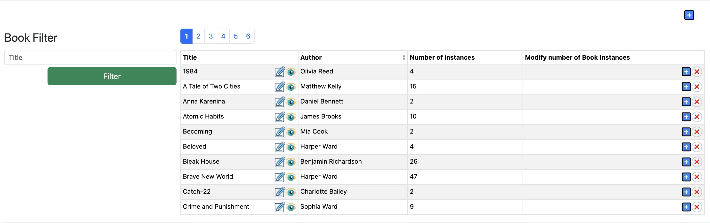

= Parte Uno
:doctype: book
:taack-category: 1|advanced
:toc:
:source-highlighter: rouge

== Introduzione

Inizieremo creando una semplice biblioteca privata, in cui l'utente può creare autori, libri e copie di libri (ispirata al progetto precedente descritto in Utilizzo).

.Tabella dei libri

Abbiamo già implementato parte del codice per voi in `myLibrary`. Per questo tutorial avete due opzioni: potete seguire l'implementazione passo dopo passo fornita qui, oppure provare a implementare ogni passaggio da soli prima di verificare la vostra implementazione. La spiegazione di ciascun metodo è suddivisa tra questa documentazione e `myLibrary`.

*Modalità Pro:* Una modalità più impegnativa pensata per gli utenti esperti. Siete incoraggiati a tentare le implementazioni in modo autonomo, facendo riferimento agli esempi forniti solo se necessario.

== Configurazione

La soluzione e gli scheletri per questa attività sono disponibili per la clonazione in questo repository:

[,shell]
----
git clone git@github.com:Taack/myLibrary.git
----

.Per accedere allo scheletro di questa parte, aprite il terminale, entrate con `cd` nel progetto (`myLibrary`) e copiate la riga seguente.
[,bash]
----
git checkout part-1-skeleton
----

Oppure in IntelliJ potete selezionare direttamente il branch desiderato. Selezionate nell'angolo in alto a sinistra `main/myLibrary/remote` e vedrete tutti i branch. Selezionate un branch ed eseguite «Checkout».

Nota: per ogni implementazione di TODO è stato creato un nuovo branch per vostra comodità. Se dovesse succedere qualcosa, potete sempre passare a quel branch invece di ricominciare da capo. Nota: ad esempio, in `part-1-todo-4` il TODO 4 sarà già implementato per voi.

.Ad esempio, se volete continuare il progetto da `part-1-todo-4`, procedete come segue.
[,bash]
----
git checkout part-1-todo-4
----

== Definire le classi di dominio
Modifica: `app/library/src/main/groovy/myLibrary/domain/`

.Diagramma delle classi per vostra comodità
[plantuml, format="svg", opts="inline"]
----
@startuml

class MyLibraryAuthor {
    String firstName
    String lastName
    Date dateOfBirth
    Boolean isActive = true
    String toString()
}

class MyLibraryBook {
    String title
    String description
    int numberOfPages
    int count = 0
    int getNumberOfInstances()
}

class MyLibraryBookInstance {
    Boolean isActive = true
    Integer serialNumber
}

MyLibraryAuthor "1" --> "*" MyLibraryBook : listOfBooks
MyLibraryBook "1" --> "*" MyLibraryBookInstance : listOfBookInstance
MyLibraryBookInstance "*" --> "1" MyLibraryBook : belongsTo

@enduml
----

Modalità Pro: implementate ogni classe da soli. Tutte le informazioni necessarie si trovano nel file. Dopo aver implementato `MyLibraryAuthor`, `MyLibraryBook` e `MyLibraryBookInstance`, verificate qui. [TODO 1.1, 1.2 & 1.3]

.Implementate una classe `MyLibraryAuthor` (TODO 1.1):
[,groovy]
----
import grails.compiler.GrailsCompileStatic
import taack.ast.annotation.TaackFieldEnum

@GrailsCompileStatic
@TaackFieldEnum
class MyLibraryAuthor {
    String firstName
    String lastName
    Date dateOfBirth
    List<MyLibraryBook> listOfBooks //<1>
    Boolean isActive = true //<2>

    static constraints = {}

    static hasMany = [listOfBooks: MyLibraryBook] //<3>

    String toString() {
        return firstName + ' ' + lastName
    }
}
----
<1> I `Books` scritti da questo `Author` verranno memorizzati in `listOfBooks`.
<2> `isActive` consentirà la cancellazione logica (soft delete).
<3> `hasMany` è una parola chiave di associazione GORM che ci consente di definire una relazione uno-a-molti tra classi di dominio. Viene utilizzata per gestire automaticamente le collezioni correlate (come un elenco di libri appartenenti a un autore). Per ulteriori informazioni, consultate la documentazione GORM.

.Implementate una classe `MyLibraryBook` (TODO 1.2):
[,groovy]
----
import grails.compiler.GrailsCompileStatic
import taack.ast.annotation.TaackFieldEnum

@GrailsCompileStatic
@TaackFieldEnum
class MyLibraryBook {
    String title
    MyLibraryAuthor author
    String description
    int numberOfPages
    List<MyLibraryBookInstance> listOfBookInstance //<1>
    int count = 0

    static constraints = {}

    static hasMany = [listOfBookInstance: MyLibraryBookInstance]

    int getNumberOfInstances() {
        if (!listOfBookInstance) { return 0}
        count = listOfBookInstance.count {it.isActive} as int
        return count
    }
}
----
<1> Le `BookInstances` di questo `Book` verranno memorizzate in `listOfBookInstance`.

.Implementate una classe `MyLibraryBookInstance` (TODO 1.3):
[,groovy]
----
import grails.compiler.GrailsCompileStatic
import taack.ast.annotation.TaackFieldEnum

@GrailsCompileStatic
@TaackFieldEnum
class MyLibraryBookInstance {
    MyLibraryBook book
    Boolean isActive = true
    Integer serialNumber = new Random().nextInt(100000) //<1>

    static constraints = {}

    static belongsTo = [book: MyLibraryBook] //<2>
}
----
<1> `Random().nextInt(100000)` creerà un numero casuale compreso tra 0 e 100 000.
<2> `belongsTo` è una parola chiave di associazione GORM che definisce il lato proprietario di una relazione molti-a-uno tra classi di dominio. Gestisce automaticamente il collegamento tramite chiave esterna e il comportamento a cascata (ad es., ogni libro appartiene a un singolo autore). Per ulteriori informazioni, consultate la documentazione GORM.

Ora avete creato tutte le classi necessarie per questa sezione!

Andate in `src/main/groovy/mylibrary`.

.Date un'occhiata alla classe `NumberForInstances`:
[,groovy]
----
import grails.compiler.GrailsCompileStatic
import grails.validation.Validateable
import taack.ast.annotation.TaackFieldEnum

@TaackFieldEnum
@GrailsCompileStatic
class NumberForInstances implements Validateable {
    Integer numberOfInstances
}
----
Non c'è nulla da implementare qui. Questa classe verrà utilizzata più avanti per acquisire l'input dell'utente.

== Definire il menu degli autori

In questa sezione rivedremo principalmente quanto fatto in link:usage-it.adoc[Utilizzo]. Dopo questa sezione padroneggerete l'uso di `UiTableSpecifier`, `UiFormSpecifier`, `UiShowSpecifier` e `UiFilterSpecifier`.

Andremo a creare:

- una tabella che mostra tutti gli autori,
- un pulsante per creare nuovi autori tramite un modulo,
- un pulsante per eliminare gli autori,
- un pulsante per riattivare gli autori,
- un filtro per gli autori.

=== Tabella degli autori

Vogliamo visualizzare gli autori in una tabella. Per farlo dobbiamo creare un `UiTableSpecifier`. Andate in `app/library/services/myLibrary/MyLibraryUiService` nella sezione `Author Menu`.

Modalità Pro: implementate la tabella da soli [TODOS 2.1.1—2.1.6].

.Implementate `buildAuthorTable`:
[,groovy]
----
MyLibraryAuthor author = new MyLibraryAuthor()
UiTableSpecifier authorTableSpecifier = new UiTableSpecifier()

authorTableSpecifier.ui {
    header {
        column {label author.firstName_}
        label author.lastName_
        if(!isSelect) {
            label author.isActive_
            label "Delete Author"
        }
    }

    TaackFilter.FilterBuilder filter = taackFilterService.getBuilder(MyLibraryAuthor)
            .setMaxNumberOfLine(10)
            .setSortOrder(TaackFilter.Order.ASC, author.lastName_)

    if(isSelect) {
        filter.addFilter(buildIsActiveAuthorFilter(author))
    }
    iterate(
            filter.build()) { MyLibraryAuthor authorIterator ->
        rowColumn {
             // TODO 2.10: Add rowAction to showAuthor with author's first name as label
            if (isSelect) {
                // TODO 3.5.6: Add SELECT action icon to select author with their id and string representation
            }
        }
        rowField authorIterator.lastName_
        if(!isSelect) {
            rowField authorIterator.isActive_
            rowColumn {
                // TODO 2.7.1: Add DELETE action icon linked to deleteAuthor controller action
                // TODO 2.7.2: Add ACTIVATE action icon linked to activateAuthor controller action
            }
        }
    }
}

----
Se avete difficoltà a comprendere questo codice, fate riferimento a link:usage-it.adoc[Utilizzo].
Notate che abbiamo aggiunto `buildIsActiveAuthorFilter`, che non è ancora stato implementato. Implementiamolo ora.

Nota: Il nome dell'autore non verrà visualizzato finché non sarà completato il TODO 2.10.

Modalità Pro: implementate il filtro da soli [TODO 2.2.1].

.Implementate `buildIsActiveAuthorFilter`:
[,groovy]
----
UiFilterSpecifier buildIsActiveAuthorFilter(MyLibraryAuthor author) {
    UiFilterSpecifier isActiveAuthorFilter = new UiFilterSpecifier()
    isActiveAuthorFilter.ui MyLibraryAuthor, {
        section "Filter", {
            filterFieldExpressionBool "Is Active", new FilterExpression(true, Operator.EQ, author.isActive_) //<1>
        }
    }
}
----
<1> Creiamo una `FilterExpression` che accetta un valore, un operatore e un `FieldInfo`.

Sono disponibili diversi operatori:

- IN: in un elenco di valori,
- NI: non in un elenco di valori,
- EQ: uguale a un altro valore,
- NE: diverso da un altro valore,
- LT: minore di un altro valore,
- IL: simile a un altro valore (is like),
- GT: maggiore di un altro valore,
- IS_EMPTY: è vuoto

Vogliamo anche aggiungere un filtro che filtri gli autori per `lastName`; implementiamo questo filtro.

Modalità Pro: implementate il filtro da soli [TODO 2.2.2].

.Implementate `buildAuthorFilter`:
[,groovy]
----
UiFilterSpecifier buildAuthorFilter() {
    MyLibraryAuthor author = new MyLibraryAuthor()
    UiFilterSpecifier authorFilterSpecifier = new UiFilterSpecifier()

    authorFilterSpecifier.ui MyLibraryAuthor, {
        section "Author Filter", {
            filterField author.lastName_
        }
    }
}
----
Se avete difficoltà a comprendere questo codice, fate riferimento a link:usage-it.adoc[Utilizzo].

La vostra tabella è ora completa; dobbiamo solo renderizzarla sulla pagina. Per renderizzare gli `UiSpecifier` costruiti in precedenza, dobbiamo usare `taackUiService`. Lo faremo in un metodo chiamato `listAuthor`. Andate in `app/library/controller/myLibrary/MyLibraryController` nella sezione `Author Menu`.

Modalità Pro: implementate `listAuthor` da soli [TODO 2.3].

.Implementate il metodo `listAuthor`:
[,groovy]
----
def listAuthor() {
    UiTableSpecifier tableAuthorSpecifier = myLibraryUiService.buildAuthorTable()
    UiFilterSpecifier filterAuthorSpecifier = myLibraryUiService.buildAuthorFilter()

    taackUiService.show(new UiBlockSpecifier().ui {
        tableFilter filterAuthorSpecifier, tableAuthorSpecifier, {
            menuIcon ActionIcon.CREATE, this.&createAuthor as MethodClosure
        }
    }, myLibraryUiService.buildMenu())
}
----

Nota: `ActionIcon` dispone di diverse icone; le principali che utilizzeremo sono: CREATE, EDIT, SAVE, DELETE, SHOW, IMPORT, EXPORT.

Ora potete avviare il server e navigare verso la vostra nuova applicazione (`myLibrary.app`). La tabella dovrebbe essere funzionante, ma al momento vedrete solo le intestazioni della tabella poiché non ci sono autori nel database. Procediamo quindi con la creazione di un modulo e il salvataggio degli oggetti nel database. Ora dobbiamo implementare `createAuthor`, che richiede la creazione di un `UiFormSpecifier`.
Torniamo in `MyLibraryUiService`.

==== Modulo dell'autore
Modalità Pro: implementate `buildAuthorForm` da soli [TODO 2.4].

.Implementate `buildAuthorForm`:
[,groovy]
----
UiFormSpecifier buildAuthorForm(MyLibraryAuthor author) {
    author ?= new MyLibraryAuthor(params)
    UiFormSpecifier createAuthorSpecifier = new UiFormSpecifier()
    createAuthorSpecifier.ui author, {
        section "Author details", {
            field author.firstName_
            field author.lastName_
            field author.dateOfBirth_
            field author.isActive_
        }
        formAction MyLibraryController.&saveAuthor as MC
    }
}
----

Torniamo in `MyLibraryController`. Renderizzeremo questo modulo in una finestra modale.

Modalità Pro: implementate `createAuthor` [TODO 2.5]

.Implementate `createAuthor`:
[,groovy]
----
def createAuthor(MyLibraryAuthor author) {
    UiFormSpecifier formAuthorSpecifier = myLibraryUiService.buildAuthorForm(author)

    taackUiService.show(new UiBlockSpecifier().ui {
        modal {
            form formAuthorSpecifier
        }
    })
}
----

Ora dobbiamo salvare l'autore. Implementiamo `saveAuthor`.

Modalità Pro: implementate `saveAuthor` [TODO 2.6].
[,groovy]
----
@Transactional
def saveAuthor() {
    taackSaveService.saveThenReloadOrRenderErrors(MyLibraryAuthor)
}
----

Abbiamo una tabella completamente funzionante in cui possiamo visualizzare e aggiungere autori. Riavviate il server. Ora dovreste essere in grado di fare clic sul pulsante e compilare il modulo. A questo punto vogliamo poter eliminare e riattivare gli autori. Implementiamo i metodi `deleteAuthor` e `reactivateAuthor`. Andiamo in `MyLibraryUiService` all'interno di `buildAuthorTable`.

==== Eliminare e riattivare un autore

Andate in `myLibraryUiService` all'interno di `buildAuthorTable`.

Modalità Pro: aggiungete i pulsanti [TODO 2.7].

.Aggiungete i pulsanti di eliminazione e attivazione. Sostituite i TODOS 2.7.1 & 2.7.2:
[,groovy]
----
rowAction ActionIcon.DELETE * IconStyle.SCALE_DOWN, MyLibraryController.&deleteAuthor as MC, authorIterator.id
rowAction ActionIcon.CREATE * IconStyle.SCALE_DOWN, MyLibraryController.&activateAuthor as MC, authorIterator.id
----

Tornate in `MyLibraryController` per implementare i metodi `deleteAuthor` & `activateAuthor`.

Modalità Pro: implementate i metodi [TODO 2.8 & 2.9]

.Implementate `deleteAuthor`:
[,groovy]
----
@Transactional
def deleteAuthor(MyLibraryAuthor author) {
    author.isActive = false
    redirect action: 'listAuthor'
}
----

.Implementate `activateAuthor`:
[,groovy]
----
@Transactional
def activateAuthor(MyLibraryAuthor author) {
    author.isActive = true
    redirect action: 'listAuthor'
}
----

Vogliamo poter visualizzare maggiori informazioni sull'autore in una finestra modale.
Implementiamo ora il metodo `showAuthor`. Per prima cosa dobbiamo creare un collegamento a questo metodo e un `UiShowSpecifier` in `myLibraryUiService`.

Andiamo in `MyLibraryUiService` all'interno di `buildAuthorTable`.

Modalità Pro: aggiungete i pulsanti [TODO 2.10].

Aggiungete l'azione di visualizzazione. Sostituite il TODO 2.10:
[,groovy]
----
rowAction authorIterator.firstName, MyLibraryController.&showAuthor as MC, authorIterator.id
----
Nota: questa volta non c'è alcuna `ActionIcon`. Verrà invece aggiunto un collegamento al nome dell'autore (`authorName`) che reindirizzerà a `showAuthor`.

Modalità Pro: implementate `buildAuthorShow` [TODO 2.11]

.Implementate `buildAuthorShow`:
[,groovy]
----
UiShowSpecifier buildAuthorShow(MyLibraryAuthor author) {
    UiShowSpecifier authorShowSpecifier = new UiShowSpecifier()

    authorShowSpecifier.ui(author, {
        fieldLabeled author.firstName_
        fieldLabeled author.lastName_
        fieldLabeled author.dateOfBirth_
        fieldLabeled author.isActive_
    })
}
----

Renderizzeremo `buildAuthorShow` in una finestra modale utilizzando `showAuthor`.

Modalità Pro: implementate `showAuthor` [TODO 2.12]

.Implementate `showAuthor`:
[,groovy]
----
def showAuthor(MyLibraryAuthor author) {
    UiTableSpecifier tableBookSpecifier = myLibraryUiService.buildBookTable(author)
    UiFilterSpecifier filterBookSpecifier = myLibraryUiService.buildBookFilter()
    UiShowSpecifier showAuthorSpecifier = myLibraryUiService.buildAuthorShow(author)

    taackUiService.show(new UiBlockSpecifier().ui {
        modal {
            show showAuthorSpecifier
            tableFilter filterBookSpecifier, tableBookSpecifier
        }
    })
}
----

Congratulazioni! Ora avete implementato tutto il necessario per visualizzare, aggiungere, eliminare, riattivare e mostrare i dettagli degli autori. Riavviate il server e testate tutte le nuove implementazioni.

== Definire il menu dei libri

Ora vogliamo visualizzare i libri in una tabella. Per farlo dobbiamo creare un altro `UiTableSpecifier`. Andate in `app/library/services/myLibrary/MyLibraryUiService` nella sezione `Book Menu`.

Modalità Pro: implementate la tabella da soli [TODOS 3.1.1 - 3.1.6].

.Implementate `buildBookTable`:
[,groovy]
----
UiTableSpecifier buildBookTable(MyLibraryAuthor author = null) {
    MyLibraryBook book = new MyLibraryBook()
    UiTableSpecifier bookTableSpecifier = new UiTableSpecifier()
    bookTableSpecifier.ui {
        header {
            column {label book.title_}
            if (!author) {sortableFieldHeader book.author_}
            column {
                label "Number of instances "//book.numberOfInstances
            }
            if (!author) {
                column {
                    label "Modify number of Book Instances"
                }
            }
        }
        TaackFilter.FilterBuilder filter =  taackFilterService.getBuilder(MyLibraryBook)
                .setMaxNumberOfLine(10)
                .setSortOrder(TaackFilter.Order.ASC, book.title_)
        if(author) {
            filter.addRestrictedIds(author.listOfBooks*.id as Long[])
        }
        iterate(
                filter.build()) { MyLibraryBook bookIterator ->
            rowColumn {
                // TODO 3.13: Add SHOW (showBook) action above title field in the rowColumn, this will be used to modify a book.
                rowAction ActionIcon.EDIT * IconStyle.SCALE_DOWN, MyLibraryController.&createBook as MC, bookIterator.id
                rowField bookIterator.title_
            }
            if (!author) {rowField bookIterator.author_}
            rowColumn {
                // TODO 3.8.1: Display number of instances (call getNumberOfInstances) and show as rowField.
            }
            if (!author) {
                rowColumn {
                    // TODO 3.9: If author is null, add purchase and select actions for managing book instances.
                }
            }
        }
    }
}
----

Vogliamo aggiungere un filtro per filtrare i libri per titolo. Implementiamolo ora.

Modalità Pro: implementate il filtro da soli [TODO 3.2].

.Implementate `buildBookFilter`:
[,groovy]
----
UiFilterSpecifier buildBookFilter() {
    MyLibraryBook book = new MyLibraryBook()
    UiFilterSpecifier bookFilterSpecifier = new UiFilterSpecifier()

    bookFilterSpecifier.ui MyLibraryBook, {
        section "Book Filter", {
            filterField book.title_
        }
    }
}
----

Ora abbiamo una tabella e un filtro; possiamo renderizzare una pagina che li contenga. Andate in `app/library/controller/myLibrary/MyLibraryController` nella sezione `Book Menu`.

Modalità Pro: implementate `listBook` da soli [TODO 3.3].

.Implementate il metodo `listBook`:
[,groovy]
----
def listBook() {
    UiTableSpecifier tableBookSpecifier = myLibraryUiService.buildBookTable()
    UiFilterSpecifier filterBookSpecifier = myLibraryUiService.buildBookFilter()

    taackUiService.show(new UiBlockSpecifier().ui {
        tableFilter filterBookSpecifier, tableBookSpecifier, {
            menuIcon ActionIcon.CREATE, this.&createBook as MethodClosure
        }
    }, myLibraryUiService.buildMenu())
}
----

Ora potete avviare il server. La tabella dei libri dovrebbe essere funzionante, ma al momento vedrete solo le intestazioni della tabella poiché non ci sono libri nel database. Procediamo quindi con la creazione di un modulo e il salvataggio degli oggetti nel database. Ora dobbiamo implementare `createBook`, che richiede la creazione di un `UiFormSpecifier`.
Torniamo in `MyLibraryUiService`.

Modalità Pro: implementate `buildBookForm` da soli [TODO 3.4].

.Implementate `buildBookForm`:
[,groovy]
----
UiFormSpecifier buildBookForm(MyLibraryBook book) {
    book ?= new MyLibraryBook(params)
    UiFormSpecifier bookFormSpecifier = new UiFormSpecifier()
    bookFormSpecifier.ui book, {
        section "Book details", {
            field book.title_
            ajaxField book.author_, MyLibraryController.&selectAuthor as MC //<1>
            field book.numberOfPages_
            field book.description_
        }
        formAction MyLibraryController.&saveBook as MC
    }
}
----
<1> Qui utilizziamo un `AjaxField` per recuperare le informazioni da `selectAuthor`.

Torniamo in `MyLibraryController` e implementiamo `selectAuthor` per chiarire.

Modalità Pro: implementate `selectAuthor` da soli, situato in `Author Menu` [TODO 3.5]. Nota: 3.5.6 si trova in `buildAuthorTable`.

.Implementate `selectAuthor`:
[,groovy]
----
def selectAuthor() {
    UiTableSpecifier tableAuthorSpecifier = myLibraryUiService.buildAuthorTable(true) //<1>
    UiFilterSpecifier filterAuthorSpecifier = myLibraryUiService.buildAuthorFilter()
    taackUiService.show(new UiBlockSpecifier().ui {
        modal {
            tableFilter filterAuthorSpecifier, tableAuthorSpecifier
        }
    })
}
----
<1> Notate che `buildAuthorTable` accetta un `Boolean` per visualizzare la versione `isSelect` dello `UiTableSpecifier`.

.Aggiungete questa riga al posto del TODO 3.5.6 per salvare la selezione dell'utente:
[,groovy]
----
rowAction tr('default.role.label'), ActionIcon.SELECT * IconStyle.SCALE_DOWN, authorIterator.id, authorIterator.toString()
----

Modalità Pro: implementate `createBook` [TODO 3.6]

[,groovy]
----
def createBook(MyLibraryBook book) {
    UiFormSpecifier tableFormSpecifier = myLibraryUiService.buildBookForm(book)

    taackUiService.show new UiBlockSpecifier().ui {
        modal {
            form tableFormSpecifier
        }
    }
}
----

Ora dobbiamo salvare il libro; implementiamo `saveBook`.

Modalità Pro: implementate `saveBook` [TODO 3.7].
[,groovy]
----
@Transactional
def saveBook() {
    taackSaveService.saveThenReloadOrRenderErrors(MyLibraryBook)
}
----

Avete una tabella completamente funzionante in cui possiamo visualizzare e aggiungere libri. Implementiamo `purchaseBook` e `selectBookInstance`: vogliamo poter acquistare copie (`bookInstances`) di un libro specifico ed eliminarle. Andiamo in `MyLibraryUiService` all'interno di `buildBookTable`.

Modalità Pro: implementate i pulsanti e visualizzate `numberOfInstances` [TODOS 3.8].

.Implementate `numberOfInstances`. Sostituite il TODO 3.8.1
[,groovy]
----
rowField bookIterator.numberOfInstances_
----

.Aggiungete le azioni di acquisto e selezione. Sostituite il TODO 3.8.2
[,groovy]
----
rowAction ActionIcon.DELETE * IconStyle.SCALE_DOWN, MyLibraryController.&selectBookInstance as MC, bookIterator.id
rowAction ActionIcon.ADD * IconStyle.SCALE_DOWN, MyLibraryController.&purchaseBook as MC, bookIterator.id
----

Vogliamo che l'utente selezioni quante `BookInstances` desidera acquistare. Pertanto, dobbiamo implementare uno `UiFormSpecifier` chiamato `buildBookPurchase`.

Modalità Pro: implementate lo `UiFormSpecifier` [TODO 3.9]

.Implementate `buildBookPurchase`:
[,groovy]
----
UiFormSpecifier buildBookPurchase(MyLibraryBook book) {
    NumberForInstances numberForInstances = new NumberForInstances()
    book ?= new MyLibraryBook(params)
    UiFormSpecifier bookPurchaseSpecifier = new UiFormSpecifier()
    bookPurchaseSpecifier.ui book, {
        section "Purchase Number", {
            field numberForInstances.numberOfInstances_ //<1>
        }
        formAction MyLibraryController.&purchaseAndSaveBook as MC
    }
}
----
<1> Notate che stiamo usando una classe per recuperare il `numberOfInstances` che l'utente desidera acquistare. Questo numero viene utilizzato solo per l'input e non verrà salvato nel database, a differenza delle altre istanze di classe.

Tornate in `MyLibraryController` per implementare i metodi `purchaseBook` & `selectBookInstance`.

Modalità Pro: implementate i metodi [TODO 3.10–3.12]

.Implementate `purchaseBook`:
[,groovy]
----
def purchaseBook(MyLibraryBook book) {
    UiFormSpecifier tableAddBookInstanceSpecifier = myLibraryUiService.buildBookPurchase(book)

    taackUiService.show new UiBlockSpecifier().ui {
        modal {
            form tableAddBookInstanceSpecifier
        }
    }
}
----

.Implementate `purchaseAndSaveBook`:
[,groovy]
----
@Transactional
def purchaseAndSaveBook(NumberForInstances numberForInstances, MyLibraryBook book) {
    for (int i = 0; i < (numberForInstances.numberOfInstances) as Integer; i++) {
        MyLibraryBookInstance newBookInstance = new MyLibraryBookInstance()
        newBookInstance.book = book
        book.addToListOfBookInstance(newBookInstance)
    }
    taackUiService.ajaxReload()
}
----

.Implementate `selectBookInstance`:
[,groovy]
----
def selectBookInstance(MyLibraryBook book) {
    UiTableSpecifier bookInstanceTableSpecifier = myLibraryUiService.buildInstanceBookTable(book)

    taackUiService.show new UiBlockSpecifier().ui {
        modal true, {
            table bookInstanceTableSpecifier
        }
    }
}
----

Implementiamo ora il metodo `showBook`. Per prima cosa dobbiamo creare un `UiShowSpecifier` in `myLibraryUiService`.

Andiamo in `MyLibraryUiService` all'interno di `buildBookTable`.

Modalità Pro: aggiungete i pulsanti [TODO 3.13].

Aggiungete l'azione di visualizzazione. Sostituite il TODO 3.13:
[,groovy]
----
rowAction ActionIcon.SHOW * IconStyle.SCALE_DOWN, MyLibraryController.&showBook as MC, bookIterator.id
----

Modalità Pro: implementate `buildBookShow` [TODO 3.14]

.Implementate `buildBookShow`:
[,groovy]
----
    UiShowSpecifier buildBookShow(MyLibraryBook book) {
        UiShowSpecifier bookShowSpecifier = new UiShowSpecifier()

        bookShowSpecifier.ui(book, {
            fieldLabeled book.title_
            fieldLabeled book.author_
            fieldLabeled book.numberOfPages_
            fieldLabeled book.description_
            fieldLabeled book.numberOfInstances_
        })
    }
----

Modalità Pro: implementate `showBook` [TODO 3.15]

.Implementate `showBook`:
[,groovy]
----
def showBook(MyLibraryBook book) {
    UiShowSpecifier showBookSpecifier = myLibraryUiService.buildBookShow(book)

    taackUiService.show(new UiBlockSpecifier().ui {
        modal {
            show showBookSpecifier
        }
    })
}
----

Ora implementeremo `deleteBookInstance`. Vogliamo selezionare la copia specifica del libro che desideriamo cancellare. Pertanto, dobbiamo creare una `buildBookInstanceTable` con un'opzione `isSelect`. Abbiamo anche bisogno di un filtro `buildIsActiveBookInstances` poiché si tratta di una cancellazione logica (filtreremo le `BookInstances` inattive).

Iniziamo implementando il filtro `buildIsActiveBookInstances`.

Modalità Pro: implementate `buildIsActiveBookInstances` [TODO 3.16].

.Implementate `buildIsActiveBookInstances`.
[,groovy]
----
UiFilterSpecifier buildIsActiveBookInstances(MyLibraryBook book) {
    MyLibraryBookInstance bookInstance = new MyLibraryBookInstance()
    UiFilterSpecifier bookInstanceFilterSpecifier = new UiFilterSpecifier()
    bookInstanceFilterSpecifier.sec MyLibraryBookInstance, {
        filterFieldExpressionBool new FilterExpression(true, Operator.EQ, bookInstance.isActive_)
    }
}
----

Ora possiamo implementare `buildBookInstanceTable`.

Modalità Pro: implementate `buildBookInstanceTable` [TODO 3.17].

.Implementate `buildBookInstanceTable`.
[,groovy]
----
UiTableSpecifier buildInstanceBookTable(
    MyLibraryBook book,
    MyLibraryBookInstance bookInstance = null) {
    UiTableSpecifier table = new UiTableSpecifier()
    table.ui {
        header {
            label "Serial Number"
            column {label "Delete"}
        }

        TaackFilter.FilterBuilder filter = taackFilterService
            .getBuilder(MyLibraryBookInstance)
            .addRestrictedIds(book.listOfBookInstance*.id as Long[])

        filter.addFilter(buildIsActiveBookInstances(book))

        iterate(filter.build()) { MyLibraryBookInstance bookInstanceIterator ->
            rowField bookInstanceIterator.serialNumber_
            rowColumn {
                rowAction ActionIcon.DELETE * IconStyle.SCALE_DOWN,
                    MyLibraryController.&deleteBookInstances as MC,
                    bookInstanceIterator.id, [bookId:book.id]
            }
        }
    }
}
----

Implementiamo ora `deleteBookInstances`.

Modalità Pro: implementate `deleteBookInstances` [TODO 3.18].

.Implementate `deleteBookInstances`:
[,groovy]
----
@Transactional
def deleteBookInstances(MyLibraryBookInstance bookInstance) {
    MyLibraryBook book = MyLibraryBook.get(params.long('bookId'))
    UiTableSpecifier bookInstanceTable = myLibraryUiService.buildInstanceBookTable(book)

    bookInstance.isActive = false
    bookInstance.save(flush: true, validate: false)

    taackUiService.show new UiBlockSpecifier().ui {
        closeModalAndUpdateBlock { //<1>
            tableFilter(
                    myLibraryUiService.buildBookFilter(), //<2>
                    myLibraryUiService.buildBookTable(), //<2>
            ) {
                menuIcon ActionIcon.CREATE, this.&createBook as MethodClosure //<2>
            }
            modal {
                table bookInstanceTable //<3>
            }
        }
    }
}
----
<1> L'utilizzo di `closeModalAndUpdateBlock` consente all'utente di vedere istantaneamente lo stato aggiornato della `BookInstance` eliminata. Chiude la finestra modale immediatamente dopo che l'utente ha selezionato una `BookInstance`.
<2> Chiamiamo i builder utilizzati per visualizzare i libri in modo che `numberOfInstances` venga aggiornato quando chiudiamo la finestra modale nella tabella che mostra i libri.
<3> Riapriamo una finestra modale. Quando l'utente seleziona una `BookInstance`, la finestra modale si chiude e poi si riapre, cosicché la `BookInstance` selezionata non appare più.

Congratulazioni! Avete completato la prima parte di questo progetto.
