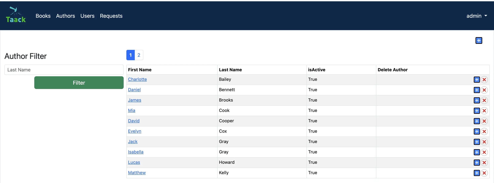
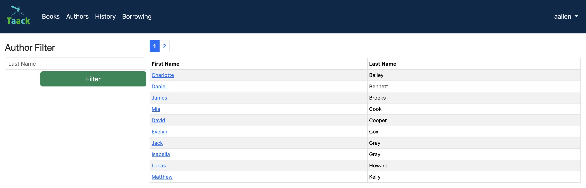

= Sicurezza e vincoli
:doctype: book
:taack-category: 3|advanced
:toc:
:source-highlighter: rouge

== Configurazione
La soluzione e gli scheletri per questo esercizio sono disponibili per essere clonati da questo repository:

[,shell]
----
git clone git@github.com:Taack/myLibrary.git
----

.Per accedere allo scheletro di questa parte, apri il terminale, entra nella cartella del progetto (`myLibrary`) con `cd` e copia la riga seguente.
[,bash]
----
git checkout part-3-skeleton
----

Oppure in IntelliJ puoi selezionare direttamente il branch desiderato. Seleziona in alto a sinistra `main/myLibrary/remote` per visualizzare tutti i branch. Seleziona un branch e fai clic su checkout.
== Introduzione

In questa sezione impareremo a conoscere la sicurezza e i vincoli (constraints). Prima vedremo come implementare questi vincoli, che ci permetteranno di limitare gli input degli utenti. Poi approfondiremo la sicurezza creando due tipi di utenti: amministratori e mutuatari (borrowers), ciascuno con accesso a funzionalità diverse.

Gli amministratori potranno:

- aggiungere, eliminare e riattivare gli autori nel menu Author.
- aggiungere libri nel menu Book.
- acquistare ed eliminare copie di libri (`bookInstances`) nel menu Book.
- accedere all'elenco degli utenti e alle informazioni su ciascuno di essi nel menu User.
- approvare i libri nel menu Borrowed.

I mutuatari potranno:

- vedere gli autori nel menu Author.
- vedere i libri nel menu Book.
- richiedere una copia di un libro (`bookInstance`) nel menu Book.
- restituire una copia di un libro (`bookInstance`) nel menu Borrowed.
- vedere le proprie richieste passate nel menu History.

.Amministratori

.Mutuatari

== Vincoli (Constraints)

Se un amministratore sta approvando una richiesta, non avrebbe senso consentirgli di approvare il libro in una data precedente a quella della richiesta; non dovrebbe essere autorizzato a farlo. Lo stesso vale per la data in cui l'utente restituisce il libro: non dovrebbe poterlo restituire prima della data di approvazione. Implementiamo tutto questo in `MyLibraryBorrowed`.

.Diagramma delle classi per comodità
[plantuml, format="svg", opts="inline"]
----
@startuml

enum ApprovalStatus {
    PENDING
    APPROVED
    REJECTED
}

class MyLibraryAuthor {
    String firstName
    String lastName
    Date dateOfBirth
    Boolean isActive = true
    String toString()
}

class MyLibraryBook {
    String title
    String description
    int numberOfPages
    int count = 0
    int getNumberOfInstances()
    int getNumberOfBooksBorrowable()
}

class MyLibraryBookInstance {
    Boolean isActive = true
    Integer serialNumber
    Boolean isAvailableB = true
}

class MyLibraryBorrowed {
    Date requestDate
    Date approvalDate
    Date returnDate
    ApprovalStatus statusOfApproval = ApprovalStatus.PENDING
}

MyLibraryAuthor "1" --> "*" MyLibraryBook : listOfBooks
MyLibraryBook "1" --> "*" MyLibraryBookInstance : listOfBookInstance
MyLibraryBookInstance "*" --> "1" MyLibraryBook : belongsTo
MyLibraryBookInstance "1" --> "*" MyLibraryBorrowed : borrowHistoryOfBook
MyLibraryBorrowed "*" --> "1" MyLibraryBookInstance : bookInstance
MyLibraryBorrowed "*" --> "1" User : user
MyLibraryBorrowed --> ApprovalStatus

@enduml
----

Dobbiamo implementare dei vincoli sulle nostre entità di dominio per assicurarci di fornire dati conformi e logici alla nostra biblioteca.

Prova ad aggiungere il vincolo `nullable` sulle date del prestito con un validatore (la data di approvazione deve essere successiva o uguale a `requestDate`, e `returnDate` deve essere successiva o uguale alla data di approvazione del prestito).

.Soluzione
[%collapsible]
====
.Aggiungi i seguenti vincoli:
[,groovy]
----
static constraints = {
    approvalDate nullable: true, validator: { Date val, MyLibraryBorrowed obj ->
        if (val == null) return true
        return val >= obj.requestDate
    }

    returnDate nullable: true, validator: { Date val, MyLibraryBorrowed obj ->
        if (val == null) return true
        return val >= obj.approvalDate
    }

    bookInstance nullable:false
    user nullable:false
}
----
====
Per maggiori informazioni, consulta la link:https://docs.grails.org/latest/ref/Constraints/Usage.html[documentazione di Grails] sui vincoli.

== Definire i menu

Come spiegato in precedenza, ci saranno due nuovi menu disponibili solo per gli amministratori. Aggiungiamoli in `MyLibraryUiService` all'interno di `buildMenu`.

Modalità Pro: Aggiungi i menu [TODO 2]

.Aggiungi i seguenti menu:
[%collapsible]
====
[,groovy]
----
menu MyLibraryController.&listOfUsers as MC
menu MyLibraryController.&listOfRequests as MC
----
====

== Configurare gli utenti

Per prima cosa, creeremo un metodo per determinare quale tipo di utente è connesso in `MyLibraryUiService`.

Modalità Pro: implementa `isAdmin` [TODO 3.1].

.Implementa `isAdmin`:
.Soluzione
[%collapsible]
====
[,groovy]
----
boolean isAdmin() {
    User currentUser = springSecurityService.currentUser as User
    return currentUser?.authorities?.any { it.authority == 'ROLE_ADMIN' }
}
----
====

In secondo luogo, modificheremo l'azione `index` del controller per poter determinare quale tipo di utente è connesso in `MyLibraryController`.

.Soluzione
[%collapsible]
====
.Modifica `index()`:
[,groovy]
----
def index() {
    currentUser = springSecurityService.currentUser as User
    isAdmin = currentUser?.authorities?.any { it.authority == 'ROLE_ADMIN' }
    redirect action: 'listAuthor'
}
----
====

== Modificare i Builder

Per recepire le modifiche, dovremo modificare le tabelle degli autori, dei libri e dei prestiti utente (`userBorrowed`).

.Soluzione
[%collapsible]
====
.Modifica `buildAuthorTable` TODO 4.1.1–4.1.4:
[,groovy]
----
boolean isAdmin = isAdmin() //TODO 4.1.1
if(!isSelect && isAdmin) { // TODO 4.1.2 & TODO 4.1.4
if(!isAdmin) {filter.addFilter(buildIsActiveAuthorFilter(author))} //TODO 4.1.3
----

.Modifica `buildBookTable` TODO 4.2.1–4.2.8:
[,groovy]
----
boolean isAdmin = isAdmin() //TODO 4.2.1
if(isAdmin) column {label "Number of instances "} // TODO 4.2.2
if(isAdmin) column {label "Modify number of Book Instances"} // TODO 4.2.3
if (!isAdmin) label "Request Form" // TODO 4.2.4

// TODO 4.2.5
if(!isAdmin) {
    MyLibraryBookInstance bookInstance = new MyLibraryBookInstance()
    filter.addFilter(new FilterExpression(true, Operator.EQ, book.listOfBookInstance_,bookInstance.isAvailableB_))
}

if (isAdmin) {rowColumn {rowField bookIterator.numberOfInstances_}} // TODO 4.2.6

// TODO 4.2.7 & 4.2.8
if(isAdmin) {
    rowColumn {
        rowAction ActionIcon.DELETE * IconStyle.SCALE_DOWN, MyLibraryController.&selectBookInstance as MC, bookIterator.id
        rowAction ActionIcon.ADD * IconStyle.SCALE_DOWN, MyLibraryController.&purchaseBook as MC, bookIterator.id
    }
} else {
    rowColumn {
        rowAction ActionIcon.CREATE * IconStyle.SCALE_DOWN, MyLibraryController.&requestBookInstance as MC, bookIterator.id
    }
}
----
====

Dobbiamo aggiungere una variabile `showUser`, che permette di mostrare i record di prestito per quello specifico utente.

.Soluzione
[%collapsible]
====
.Modifica `buildUserBorrowsTable` TODO 4.3.1–4.3.7:
[,groovy]
----
Boolean isAdmin = isAdmin() // TODO 4.3.1
if (isCurrently  && !isAdmin) column {label "Return Book"} // TODO 4.3.2

if(isAdmin) {
    column { label borrowed.user_ }
    if (!showUser) {
        label "Approve Book"
    }
}

User currentUser = springSecurityService.currentUser as User
if (showUser) {
    currentUser = showUser
}

if(!isUser || showUser) {
    filter.addFilter(new FilterExpression(currentUser, Operator.EQ, borrowed.user_))
}

if (isCurrently && !isAdmin) {  // TODO 4.3.6

if(isAdmin) {
    rowColumn { rowField borrowedIterator.user.username_ }
    if (!showUser) {
        rowColumn {
            rowAction ActionIcon.DELETE * IconStyle.SCALE_DOWN, MyLibraryController.&approveBook as MC, borrowedIterator.id
        }
    }
}
----
====
Ora che abbiamo aggiunto gli elementi necessari per visualizzare tutte le richieste di tutti gli utenti, facciamo il rendering di questa tabella.

.Soluzione
[%collapsible]
====
[,groovy]
----
def listOfRequests() {
    UiTableSpecifier tableUserBorrowsSpecifier = myLibraryUiService.buildUserBorrowsTable(true, null, true)
    UiFilterSpecifier filterUserBorrowsSpecifier = myLibraryUiService.buildUserBorrowsFilter()

    taackUiService.show(new UiBlockSpecifier().ui {
        tableFilter filterUserBorrowsSpecifier, tableUserBorrowsSpecifier
    }, myLibraryUiService.buildMenu())
}
----
====
== Menu Utenti (User Menu)
Come spiegato in precedenza, vogliamo anche avere una tabella che mostri tutti gli utenti per gli amministratori.
Iniziamo implementando `buildUsersTable` (puoi usare la tabella degli autori come esempio di base per implementarla).

.Soluzione
[%collapsible]
====
[,groovy]
----
UiTableSpecifier buildUsersTable() {
    UiTableSpecifier buildUsersSpecifier = new UiTableSpecifier()
    User user = new User()

    buildUsersSpecifier.ui {
        header {
            label user.username_
            label "Authorities"
        }

        TaackFilter taackFilter = taackFilterService.getBuilder(User)
                .setSortOrder(TaackFilter.Order.ASC, user.username_)
                .setMaxNumberOfLine(10).build()

        iterate taackFilter, {User userIterator ->
            rowColumn {
                rowAction ActionIcon.SHOW * IconStyle.SCALE_DOWN, MyLibraryController.&showUser as MC, userIterator.id
                rowField userIterator.username_
            }
            rowField userIterator.authorities_
        }
    }
}
----
====

Possiamo quindi farne il rendering e servirla in una pagina dal controller.

.Soluzione
[%collapsible]
====
[,groovy]
----
def listOfUsers() {
    UiTableSpecifier tableUsersSpecifier = myLibraryUiService.buildUsersTable()

    taackUiService.show(new UiBlockSpecifier().ui {
        table tableUsersSpecifier
    }, myLibraryUiService.buildMenu())
}
----
====

Implementiamo ora i metodi `showUser` e `buildUserShow` nel controller e nel servizio UI.
Vai a `MyLibraryUiService`.

.UIService
[%collapsible]
====
[,groovy]
----
UiShowSpecifier buildUserShow(User user) {
    UiShowSpecifier userShowSpecifier = new UiShowSpecifier()

    userShowSpecifier.ui(user, {
        fieldLabeled user.username_
        fieldLabeled user.firstName_
        fieldLabeled user.lastName_
        fieldLabeled user.authorities_
    })
}
----
====

.Controller
[%collapsible]
====
[,groovy]
----
def showUser(User user) {
    UiShowSpecifier showSpec = myLibraryUiService.buildUserShow(user)
    UiTableSpecifier userBorrowsSpecifier = myLibraryUiService.buildUserBorrowsTable(false, user)
    UiFilterSpecifier userBorrowsFilterSpecifier = myLibraryUiService.buildUserBorrowsFilter(user)
    UiTableSpecifier userBorrowsCurrentlySpecifier = myLibraryUiService.buildUserBorrowsTable(true, user)

    taackUiService.show(new UiBlockSpecifier().ui {
        modal {
            show showSpec
            tableFilter userBorrowsFilterSpecifier, userBorrowsSpecifier
            tableFilter userBorrowsFilterSpecifier, userBorrowsCurrentlySpecifier
        }
    })

}
----
====

== Sicurezza Parte 1
Ottimo, ora abbiamo tutto ciò che ci serve. Dobbiamo solo aggiungere il livello di sicurezza.
Uno dei grandi punti di forza di Taack è quanto sia semplice questa operazione. Semplicemente aggiungendo `@Secured(['ROLE_ADMIN'])` sopra un metodo, proteggi il metodo da qualsiasi utente che non possieda il ruolo `ROLE_ADMIN`. `@Secured(['ROLE_ADMIN'])` non solo nasconderà l'icona, ma renderà anche il metodo inaccessibile tramite link diretto.

Procediamo aggiungendo `@Secured(['ROLE_ADMIN'])` e `@Secured(['ROLE_BORROWER'])` ai metodi necessari. [TODO 6.1] Suggerimento: ci sono in totale 11 annotazioni `@Secured` da aggiungere in `MyLibraryController`.

Nei progetti più grandi, aggiungere istruzioni condizionali per nascondere pulsanti o colonne può diventare molto complesso. Per questo motivo consigliamo di cercare di mantenere lo stesso numero di righe/colonne visualizzate per tutte le pagine e finestre modali che utilizzano lo stesso builder. Per nascondere i pulsanti in questo caso, puoi usare un'altra tecnica.

== Sicurezza Parte 2
Puoi creare un file in cui specificare i metodi che devono essere protetti e le condizioni in base alle quali alcuni metodi devono essere protetti.

Naviga fino a `intranet/app/myLibrary/grails-app/services/my/library/MyLibrarySecurityService.groovy`, che è già stato creato per te.

La maggior parte dei metodi è già stata implementata per te. Leggi la documentazione nel file per maggiori informazioni.

Utilizzando la stessa idea di `returnSecurityClosure` (che controlla se `ApprovalStatus` è `APPROVED` per consentire all'utente di vedere il pulsante per restituire un libro), implementerai `approvedSecurityClosure`.

Modalità Pro: implementa `approvedSecurityClosure` [TODO 6.2]

.SecurityService
[%collapsible]
====
[,groovy]
----
private static boolean approvedSecurityClosure(Long id, Map p) {
    MyLibraryBorrowed borrowed = MyLibraryBorrowed.get(id)
    return (borrowed.statusOfApproval != ApprovalStatus.APPROVED)
}
----
====

.Aggiungi le seguenti righe di codice in `init`:
[,groovy]
----
TaackUiEnablerService.securityClosure(
    this.&approvedSecurityClosure,
    MyLibraryController.&approveBook as MethodClosure)
----

Congratulazioni! Hai terminato l'implementazione del progetto.

Nella prossima parte imparerai a creare dei grafici.
