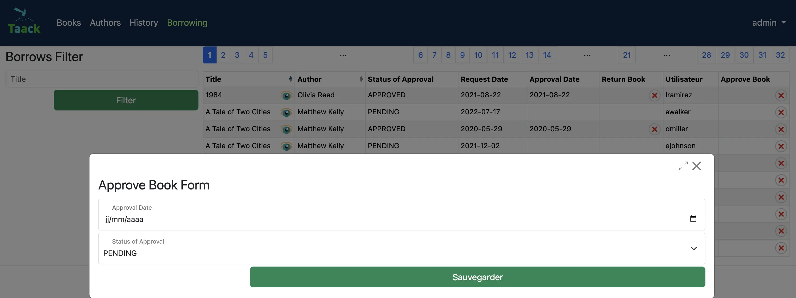

= Teil Zwei
:doctype: book
:taack-category: 2|advanced
:toc:
:source-highlighter: rouge

== Einrichtung
Die Lösung und die Grundgerüste für diese Aufgabe können aus diesem Repository geklont werden:

[,shell]
----
git clone git@github.com:Taack/myLibrary.git
----

.Um auf das Grundgerüst für diesen Teil zuzugreifen, öffnen Sie Ihr Terminal, wechseln Sie mit `cd` in das Projekt (`myLibrary`) und kopieren Sie die folgende Zeile.
[,bash]
----
git checkout part-2-skeleton
----

Oder Sie wählen in IntelliJ direkt den gewünschten Branch aus. Wählen Sie oben links `main/myLibrary/remote`, um alle Branches anzuzeigen. Wählen Sie einen Branch aus und führen Sie „Checkout“ aus.

== Einführung

Sie haben nun eine persönliche Bibliothek erstellt; fügen wir einige Funktionen hinzu. Wir möchten ein Ausleihsystem ergänzen. Nach diesem Teil können Sie Bücher aus Ihrer eigenen Bibliothek ausleihen, die Anfrage genehmigen und die Bücher zurückgeben, und Sie haben außerdem Zugriff auf den Verlauf Ihrer Ausleihanfragen.

Wir haben den Code in `myLibrary` aktualisiert. Führen Sie ein `pull` dieser Version aus, um Zugriff auf den neuen Grundgerüst-Code zu erhalten.

.Formular

== Domänenklassen definieren und aktualisieren
Bearbeiten: `app/library/src/main/groovy/myLibrary/domain/`

.Aktualisiertes Klassendiagramm zur Übersicht
[plantuml, format="svg", opts="inline"]
----
@startuml

enum ApprovalStatus {
    PENDING
    APPROVED
    REJECTED
}

class MyLibraryAuthor {
    String firstName
    String lastName
    Date dateOfBirth
    Boolean isActive = true
    String toString()
}

class MyLibraryBook {
    String title
    String description
    int numberOfPages
    int count = 0
    int getNumberOfInstances()
    int getNumberOfBooksBorrowable()
}

class MyLibraryBookInstance {
    Boolean isActive = true
    Integer serialNumber
    Boolean isAvailableB = true
}

class MyLibraryBorrowed {
    Date requestDate
    Date approvalDate
    Date returnDate
    ApprovalStatus statusOfApproval = PENDING
}

class User

MyLibraryAuthor "1" --> "*" MyLibraryBook : listOfBooks
MyLibraryBook "1" --> "*" MyLibraryBookInstance : listOfBookInstance
MyLibraryBookInstance "*" --> "1" MyLibraryBook : belongsTo
MyLibraryBookInstance "1" --> "*" MyLibraryBorrowed : borrowHistoryOfBook
MyLibraryBorrowed "*" --> "1" MyLibraryBookInstance : bookInstance
MyLibraryBorrowed "*" --> "1" User : user

@enduml
----

Pro-Modus: [TODO 1.1, 1.2 & 1.3]

.Passen Sie die Klasse `MyLibraryBook` an und fügen Sie die folgende Methode hinzu (TODO 1.1):
[,groovy]
----
int getNumberOfBooksBorrowable() {
        return MyLibraryBookInstance.countByIsAvailableBAndIsActiveAndBook(true, true, this) //<1>
    }
----
<1> `countByIsAvailableBAndIsActiveAndBook` ist eine dynamische Finder-Methode in Grails/GORM, die automatisch die Anzahl der Datensätze in einer Domänenklasse zählt, die den angegebenen Bedingungen für die Felder `isAvailableB`, `isActive` und `book` entsprechen. Weitere Informationen finden Sie unter link:https://docs.grails.org/latest/ref/Domain%20Classes/countBy.html[Grails-Dokumentation (countBy)].

.Passen Sie die Klasse `MyLibraryBookInstance` an und fügen Sie die folgenden Variablen und die `hasMany`-Beziehung hinzu (TODO 1.2):
[,groovy]
----
List<MyLibraryBorrowed> borrowHistoryOfBook
Boolean isAvailableB = true

static hasMany = [borrowHistoryOfBook: MyLibraryBorrowed]
----

.Implementieren Sie eine Klasse `MyLibraryBorrowed` (TODO 1.3):
[,groovy]
----
enum ApprovalStatus {
    PENDING, APPROVED, REJECTED
}

@GrailsCompileStatic
@TaackFieldEnum
class MyLibraryBorrowed {
    MyLibraryBookInstance bookInstance
    User user
    Date requestDate
    Date approvalDate
    Date returnDate
    ApprovalStatus statusOfApproval= ApprovalStatus.PENDING

    static constraints = {
        approvalDate nullable: true
        returnDate nullable: true
    }
}
----

Sie haben nun alle erforderlichen Klassen für diesen Abschnitt implementiert!

== Menüs definieren

Für diesen Abschnitt müssen wir zwei neue Menüs erstellen. Der Benutzer stellt die Anfrage zum Ausleihen einer `bookInstance` im Büchermenü. Die `bookInstances`, die angefragt und noch nicht zurückgegeben wurden (entweder ausstehende oder genehmigte Anfragen), befinden sich im Menü „Ausgeliehen“. Die `bookInstances`, die zurückgegeben wurden, befinden sich im Menü „Verlauf“.

Beginnen wir damit, diese Menüs zu `buildMenu` hinzuzufügen.

Pro-Modus: Fügen Sie die Menüs in `buildMenu` hinzu. [TODO 2]

.Fügen Sie die folgenden Zeilen zu `buildMenu` hinzu:
[,groovy]
----
menu MyLibraryController.&listBooksBorrowed as MC
menu MyLibraryController.&listBooksCurrentlyBorrowed as MC
----

== Ausgeliehen-Menü definieren

=== Ausgeliehen-Tabelle

Wir möchten die ausgeliehenen (noch nicht zurückgegebenen) Bücher in einer Tabelle anzeigen. Dafür müssen wir einen `UiTableSpecifier` erstellen. Wechseln Sie zu `app/library/services/myLibrary/MyLibraryUiService` im Bereich `Author Menu`.

Hinweis: Die einzigen Unterschiede zwischen dem Ausgeliehen-Menü und dem Verlaufsmenü sind `returnDate` und `StatusOfApproval`.
Daher verwenden wir denselben `TableSpecifier` für beide Menüs; dies ist einer der großen Vorteile der Verwendung einer separaten Datei (`MyLibraryUiService`) zur Implementierung der Specifier: Sie können mit kleinen Anpassungen in verschiedenen Kontexten wiederverwendet werden.

[NOTE]
===============================
Sie benötigen ein boolesches Flag, um zu prüfen, ob ein Buch aktuell ausgeliehen ist; wir nennen es `isCurrentlyBorrowed`.
===============================
Pro-Modus: Implementieren Sie die Tabelle selbst [TODOS 3.1].

.Lösung
[%collapsible]
====
.Implementieren Sie `buildBorrowedTable`:
[,groovy]
----
MyLibraryBook book = new MyLibraryBook()
MyLibraryBorrowed borrowed = new MyLibraryBorrowed()
UiTableSpecifier buildUserBorrowsSpecifier = new UiTableSpecifier()
MyLibraryBookInstance bookInstance = new MyLibraryBookInstance()

buildUserBorrowsSpecifier.ui {
    header {
        sortableFieldHeader borrowed.bookInstance_,bookInstance.book_,book.title_
        sortableFieldHeader borrowed.bookInstance_,bookInstance.book_,book.author_
        if (isCurrently) {label borrowed.statusOfApproval_}
        label borrowed.requestDate_
        label borrowed.approvalDate_
        column {label borrowed.user_}
    }

    TaackFilter.FilterBuilder filter = taackFilterService.getBuilder(MyLibraryBorrowed)
            .setMaxNumberOfLine(10)
            .setSortOrder(
                TaackFilter.Order.ASC,
                borrowed.bookInstance_,
                bookInstance.book_,book.title_)

    if(isCurrently) {filter.addFilter(new FilterExpression(null, Operator.EQ, borrowed.returnDate_))} //<1>
    else {filter.addFilter(new FilterExpression(null, Operator.NE, borrowed.returnDate_))} //<1>

    iterate(
            filter.build()) { MyLibraryBorrowed borrowedIterator ->
        rowColumn {
            rowField borrowedIterator.bookInstance.book.title
        }
        rowField borrowedIterator.bookInstance.book.author.toString()
        if(isCurrently) {rowField borrowedIterator.statusOfApproval_}
        rowField borrowedIterator.requestDate_
        rowField borrowedIterator.approvalDate_
        rowColumn {rowField borrowedIterator.user.username_}
    }
}
----
====

<1> Dies ist eine weitere Möglichkeit, einen Filter zu erstellen, wenn Sie nicht vorhaben, ihn an anderer Stelle wiederzuverwenden.

Wir möchten außerdem einen Filter hinzufügen, der die Einträge filtert. Implementieren wir diesen Filter.

Pro-Modus: Implementieren Sie den Filter selbst [TODO 3.2].

.Implementieren Sie `buildUserBorrowsFilter`:
[,groovy]
----
UiFilterSpecifier buildUserBorrowsFilter(User user = null) {
    MyLibraryBook book = new MyLibraryBook()
    UiFilterSpecifier UserBorrowsFilterSpecifier = new UiFilterSpecifier()
    MyLibraryBorrowed borrowed = new MyLibraryBorrowed()
    MyLibraryBookInstance bookInstance = new MyLibraryBookInstance()

    UserBorrowsFilterSpecifier.ui MyLibraryBorrowed, {
        if (user) hiddenId(user.id)
        section "Borrows Filter", {
            filterField borrowed.bookInstance_,bookInstance.book_,book.title_
        }
    }
}
----
Ihre Tabelle ist nun vollständig; wir müssen sie nur noch auf der Seite rendern. Wir tun dies in einer Methode namens `listBooksCurrentlyBorrowed`. Wechseln Sie zu `app/library/controller/myLibrary/MyLibraryController` im Bereich `Borrowed Menu`.

Pro-Modus: Implementieren Sie `listBooksCurrentlyBorrowed` selbst [TODO 3.3].

.Implementieren Sie die Methode `listBooksCurrentlyBorrowed`:
[,groovy]
----
def listBooksCurrentlyBorrowed() {
    UiTableSpecifier tableUserBorrowsSpecifier = myLibraryUiService.buildUserBorrowsTable(true)
    UiFilterSpecifier filterUserBorrowsSpecifier = myLibraryUiService.buildUserBorrowsFilter()

    taackUiService.show(new UiBlockSpecifier().ui {
        tableFilter filterUserBorrowsSpecifier, tableUserBorrowsSpecifier
    }, myLibraryUiService.buildMenu())
}
----

Sie können nun den Server starten. Die Ausgeliehen-Tabelle sollte funktionsfähig sein, aber derzeit sehen Sie nur die Tabellenköpfe, da sich noch keine Ausleihen in Ihrer Datenbank befinden. Fahren wir also damit fort, ein Formular zu erstellen und Objekte in der Datenbank zu speichern. Wir müssen nun `requestBookInstance` implementieren, wofür ein `UiFormSpecifier` erstellt werden muss.
Kehren wir zurück zu `MyLibraryUiService`.

==== Ausleihformular
Pro-Modus: Implementieren Sie `buildRequestBookForm` [TODO 3.4].

.Implementieren Sie `buildRequestBookForm`:
[,groovy]
----
UiFormSpecifier buildRequestBookForm(MyLibraryBook book) {
    User user = springSecurityService.currentUser as User
    MyLibraryBorrowed borrowed = new MyLibraryBorrowed()
    borrowed.user = user
    book ?= new MyLibraryBook(params)
    UiFormSpecifier requestBookFormSpecifier = new UiFormSpecifier()

    requestBookFormSpecifier.ui borrowed, {
        section "Request Book Form", {
            hiddenField borrowed.user_ //<1>
            field borrowed.requestDate_
            ajaxField borrowed.bookInstance_, MyLibraryController.&selectBookInstanceOne as MC, book.id
        }
        formAction MyLibraryController.&saveBookForm as MC
    }
}
----
<1> Übergibt Parameter im Formular, ohne dass der Benutzer sie sieht.

Kehren wir zurück zu `MyLibraryController`. Wir werden dieses Formular in einem Modal-Dialog rendern.

Pro-Modus: Implementieren Sie `requestBookInstance` [TODO 3.5]

.Implementieren Sie `requestBookInstance`:
[,groovy]
----
def requestBookInstance(MyLibraryBook book){
    UiFormSpecifier requestBookInstanceForm = myLibraryUiService.buildRequestBookForm(book)

    taackUiService.show new UiBlockSpecifier().ui {
        modal {
            form requestBookInstanceForm
        }
    }
}
----

Jetzt müssen wir den Ausleihdatensatz speichern; implementieren wir also `saveBookForm`.

Pro-Modus: Implementieren Sie `saveBookForm` [TODO 3.6].
[,groovy]
----
@Transactional
def saveBookForm() {
    MyLibraryBorrowed borrowed = taackSaveService.save(MyLibraryBorrowed)
    borrowed.bookInstance?.isAvailableB = false
    taackSaveService.redirectOrRenderErrors(borrowed)
}
----

Nun müssen wir `selectBookInstanceOne` implementieren, das `buildInstanceBookTable` verwendet; dafür müssen wir diesen Specifier zuerst anpassen.

Pro-Modus: Passen Sie `buildInstanceBookTable` an [TODO 3.7].

.Ersetzen Sie TODO 3.7.1:
[,groovy]
----
column {
    if (isOne) {
        label "Select Book Instance"
    } else {
        label "Delete"
    }
}
----
.Ersetzen Sie TODO 3.7.2:
[,groovy]
----
filter.addFilter(buildIsAvailableBookInstances(book))
----
.Ersetzen Sie TODO 3.7.3:
[,groovy]
----
rowColumn {
    if(isOne) {
        rowAction tr('default.serialNumber.label'), ActionIcon.SELECT * IconStyle.SCALE_DOWN, bookInstanceIterator.id, bookInstanceIterator.serialNumber.toString()
    } else {
        rowAction ActionIcon.DELETE * IconStyle.SCALE_DOWN, MyLibraryController.&deleteBookInstances as MC, bookInstanceIterator.id, [bookId:book.id]
    }
}
----

Wir haben den Filter `buildIsAvailableBookInstances` verwendet; implementieren wir ihn nun.

Pro-Modus: Implementieren Sie `buildIsAvailableBookInstances` [TODO 3.8].

.Implementieren Sie `buildIsAvailableBookInstances`:
[,groovy]
----
UiFilterSpecifier buildIsAvailableBookInstances(MyLibraryBook book) {
    MyLibraryBookInstance bookInstance = new MyLibraryBookInstance()
    UiFilterSpecifier bookInstanceFilterSpecifier = new UiFilterSpecifier()
    bookInstanceFilterSpecifier.sec MyLibraryBookInstance, {
        filterFieldExpressionBool new FilterExpression(true, Operator.EQ, bookInstance.isAvailableB_)
    }
}
----

Pro-Modus: Implementieren Sie `selectBookInstanceOne` [TODO 3.9].

.Implementieren Sie `selectBookInstanceOne`:
[,groovy]
----
def selectBookInstanceOne(MyLibraryBook book) {
    UiTableSpecifier bookInstanceTable = myLibraryUiService.buildInstanceBookTable(book, true)

    taackUiService.show new UiBlockSpecifier().ui {
        modal {
            table bookInstanceTable
        }
    }
}
----

Fügen wir nun die Schaltfläche für den Zugriff auf das Anfrageformular hinzu. Außerdem möchten wir wissen, wie viele Bücher verfügbar sind (ausgeliehen werden können); dies implementieren wir in `buildBookTable`.

Pro-Modus: Passen Sie `buildBookTable` an [TODO 3.10]

.Ersetzen Sie TODO 3.10.1:
[,groovy]
----
label "Number of Available Book Instances"
----

.Ersetzen Sie TODO 3.10.2:
[,groovy]
----
label "Request Form"
----

.Ersetzen Sie TODO 3.10.3:
[,groovy]
----
rowField bookIterator.numberOfBooksBorrowable_
----

.Ersetzen Sie TODO 3.10.4:
[,groovy]
----
rowColumn {
    rowAction ActionIcon.CREATE * IconStyle.SCALE_DOWN, MyLibraryController.&requestBookInstance as MC, bookIterator.id
}
----

Sie haben nun eine voll funktionsfähige Tabelle, in der wir Ausleihanfragen anzeigen und erstellen können. Starten Sie den Server erneut; Sie sollten nun auf die Schaltfläche klicken und das Formular ausfüllen können.

Als Nächstes möchten wir Anfragen genehmigen und ausgeliehene `bookInstances` zurückgeben können. Implementieren wir die Methoden `approveBook` und `returnBook`. Navigieren wir zu `MyLibraryUiService` in die Methode `buildUserBorrowsTable`.

==== Anfragen genehmigen und BookInstances zurückgeben

Wechseln Sie zu `myLibraryUiService` in `buildUserBorrowsTable`.

Pro-Modus: Fügen Sie die Schaltflächen hinzu [TODO 3.11].

.Fügen Sie die Rückgabe-Schaltflächen hinzu. Ersetzen Sie die TODOS 3.11.1 & 3.11.3:
[,groovy]
----
if (isCurrently) column {label "Return Book"}

if (isCurrently) {
    rowColumn {
        if (borrowedIterator.statusOfApproval == ApprovalStatus.APPROVED) {
            rowAction ActionIcon.DELETE * IconStyle.SCALE_DOWN, MyLibraryController.&returnBook as MC, borrowedIterator.id
        }
    }
}
----

.Fügen Sie die Genehmigungs-Schaltflächen hinzu. Ersetzen Sie die TODOS 3.11.2 & 3.11.4:
[,groovy]
----
if (isCurrently) {label "Approve Book"}

if (isCurrently) {
    rowColumn {
        rowAction ActionIcon.DELETE * IconStyle.SCALE_DOWN, MyLibraryController.&approveBook as MC, borrowedIterator.id
    }
}
----

Implementieren wir nun die Formulare für `approveBook` und `returnBook`.

Pro-Modus: Implementieren Sie `buildApproveBookTable` [TODO 3.12]

.Implementieren Sie `buildApproveBookTable`:
[,groovy]
----
UiFormSpecifier buildApproveBookTable(MyLibraryBorrowed borrowed) {
    UiFormSpecifier approveBookSpecifier = new UiFormSpecifier()

    approveBookSpecifier.ui borrowed, {
        section "Approve Book Form", {
            field borrowed.approvalDate_
            field borrowed.statusOfApproval_
        }
        formAction MyLibraryController.&saveApprovalBookForm as MC
    }
}
----

Pro-Modus: Implementieren Sie `buildRequestReturnBookForm` [TODO 3.13]

.Implementieren Sie `buildRequestReturnBookForm`:
[,groovy]
----
UiFormSpecifier buildRequestReturnBookForm(MyLibraryBorrowed borrowed) {
    UiFormSpecifier requestBookFormSpecifier = new UiFormSpecifier()

    requestBookFormSpecifier.ui borrowed, {
        section "Request Return Book Form", {
            field borrowed.returnDate_
        }
        formAction MyLibraryController.&saveReturnBookForm as MC
    }
}
----

Navigieren Sie zurück zu `MyLibraryController`, um die Methoden `approveBook` & `returnBook` zu implementieren.

Pro-Modus: Implementieren Sie die Methoden [TODO 3.14 & 3.15]

.Implementieren Sie `approveBook`:
[,groovy]
----
def approveBook(MyLibraryBorrowed borrowed) {
    UiFormSpecifier approveBookSpecifier = myLibraryUiService.buildApproveBookTable(borrowed)

    taackUiService.show(new UiBlockSpecifier().ui {
        modal {
            form approveBookSpecifier
        }
    })
}
----

.Implementieren Sie `returnBook`:
[,groovy]
----
def returnBook(MyLibraryBorrowed borrowed) {
    UiFormSpecifier requestReturnBookInstanceForm = myLibraryUiService.buildRequestReturnBookForm(borrowed)

    taackUiService.show new UiBlockSpecifier().ui {
        modal {
            form requestReturnBookInstanceForm
        }
    }
}
----

Implementieren wir nun das Speichern: `saveApprovalBookForm` & `saveReturnBookForm`.

Pro-Modus: Implementieren Sie die Methoden [TODO 3.16 & 3.17]

.Implementieren Sie `saveApprovalBookForm`:
[,groovy]
----
 @Transactional
def saveApprovalBookForm() {
    Calendar cal = Calendar.getInstance()
    cal.set(999999, Calendar.DECEMBER, 31)
    Date date = cal.time
    MyLibraryBorrowed borrowed = taackSaveService.save(MyLibraryBorrowed)
    if(borrowed.statusOfApproval == ApprovalStatus.REJECTED) {
        borrowed.returnDate = date
    }
    taackSaveService.redirectOrRenderErrors(borrowed)
}
----
Hinweis: Der Kalender wird auf ein weit in der Zukunft liegendes Datum (Jahr 999999) gesetzt, um eine Ablehnung als dauerhaft zu kennzeichnen.

.Implementieren Sie `saveReturnBookForm`:
[,groovy]
----
@Transactional
def saveReturnBookForm() {
    MyLibraryBorrowed borrowed = taackSaveService.save(MyLibraryBorrowed)
    borrowed.bookInstance?.isAvailableB = true
    taackSaveService.redirectOrRenderErrors(borrowed)
}
----

Sie sollten nun Bücher genehmigen und zurückgeben können. Starten Sie den Server und probieren Sie es aus!

Wir möchten weitere Informationen über die Anfrage in einem Modal-Dialog anzeigen können.
Implementieren wir nun die Methode `showBorrowed`. Zuerst müssen wir einen Link zu dieser Methode und einen `UiShowSpecifier` in `myLibraryUiService` erstellen.

Navigieren wir zu `MyLibraryUiService` in `buildUserBorrowsTable`.

Pro-Modus: Fügen Sie die Schaltflächen hinzu [TODO 3.18].

Fügen Sie die Show-Aktion hinzu. Ersetzen Sie TODO 3.18:
[,groovy]
----
rowAction ActionIcon.SHOW * IconStyle.SCALE_DOWN, MyLibraryController.&showBorrowed as MC, borrowedIterator.id
----

Pro-Modus: Implementieren Sie `buildBorrowedShow` [TODO 3.19]

.Implementieren Sie `buildBorrowedShow`:
[,groovy]
----
UiShowSpecifier buildBorrowedShow(MyLibraryBorrowed borrowed) {
    UiShowSpecifier borrowedShowSpecifier = new UiShowSpecifier()

    borrowedShowSpecifier.ui(borrowed, {
        fieldLabeled borrowed.bookInstance.book.title_
        fieldLabeled borrowed.bookInstance.book.author_
        fieldLabeled borrowed.user.username_
        fieldLabeled borrowed.statusOfApproval_
        fieldLabeled borrowed.requestDate_
        fieldLabeled borrowed.approvalDate_
        fieldLabeled borrowed.returnDate_
    })
}
----

Wir rendern `buildBorrowedShow` in einem Modal-Dialog mithilfe von `showBorrowed`.

Pro-Modus: Implementieren Sie `showBorrowed` [TODO 3.20]

.Implementieren Sie `showBorrowed`:
[,groovy]
----
def showBorrowed(MyLibraryBorrowed borrowed) {
    UiShowSpecifier showSpec = myLibraryUiService.buildBorrowedShow(borrowed)

    taackUiService.show(new UiBlockSpecifier().ui {
        modal {
            show showSpec
        }
    })
}
----

Herzlichen Glückwunsch! Sie haben nun alles implementiert, was Sie zum Anfragen, Genehmigen und Zurückgeben von Büchern sowie zum Anzeigen aller laufenden Anfragen benötigen. Starten Sie den Server erneut und testen Sie alle neuen Implementierungen.

== Verlaufsmenü definieren

Wir möchten nun die bisherigen Ergebnisse in einer Tabelle anzeigen. Wie bereits erläutert, ist dies einfach und schnell erledigt, da wir unseren Builder bereits haben und `isCurrently` implementiert haben. Wechseln wir zu `MyLibraryController` und rendern die vergangenen Anfragen.

Pro-Modus: Implementieren Sie `listBooksBorrowed` [TODOS 4.1].

.Implementieren Sie `listBooksBorrowed`:
[,groovy]
----
def listBooksBorrowed() {
    UiTableSpecifier tableUserBorrowsSpecifier = myLibraryUiService.buildUserBorrowsTable()
    UiFilterSpecifier filterUserBorrowsSpecifier = myLibraryUiService.buildUserBorrowsFilter()

    taackUiService.show(new UiBlockSpecifier().ui {
        tableFilter filterUserBorrowsSpecifier, tableUserBorrowsSpecifier
    }, myLibraryUiService.buildMenu())
}
----

.Ausleiher testen
[NOTE]
===============================
Sie können die Ausleiher testen, indem Sie entweder:

-> eine `ROLE_BORROWER` in der Tabelle `ROLE` der H2-Datenbank erstellen

-> sich mit einem erstellten Benutzer anmelden. Weitere Informationen finden Sie unter xref:part-four.adoc[Abschnitt B].
===============================
Herzlichen Glückwunsch! Sie haben den zweiten Teil dieses Projekts abgeschlossen.

Im nächsten Teil befassen wir uns mit Sicherheit (Security) und Einschränkungen (Constraints).
