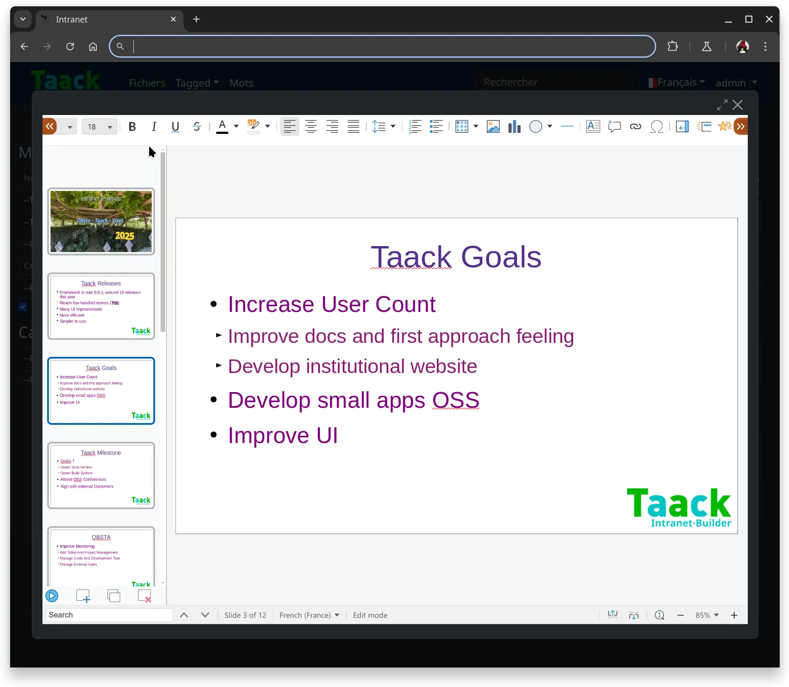

= Collabora Editor
:doctype: book
:taack-category: 4|App
:toc:
:source-highlighter: rouge
:experimental: true

== Propósito

Extiende el controlador de archivos adjuntos (`Attachment`) en la aplicación Crew.

Permite editar documentos ofimáticos utilizando https://www.collaboraonline.com/[Collabora Online]. Todos los archivos adjuntos pasan a ser editables en línea.

== Roles

* `ROLE_TEMPLATE_ADMIN`: Permite a los usuarios crear nuevas plantillas para crear nuevos archivos adjuntos.

== Instalar y ejecutar la imagen Docker de Collabora CODE

.Iniciar Docker
[source,bash]
----
sudo systemctl restart docker
----

.Instalar Collabora CODE
[source,bash]
----
sudo docker pull collabora/code:latest
----

.Ejecutar Collabora CODE
[source,bash]
----
sudo docker run --privileged --network host -e "username=test" -e "password=test"  -e "extra_params=--o:ssl.enable=false" -p 9980:9980 collabora/code:latest   <1>
----

<1> Solo con fines de prueba, desactivamos SSL y elegimos un usuario / contraseña sencillos. No necesita `--network host` si Collabora se ejecuta en un servidor diferente.

.Comprobar que se ha iniciado
[source,bash]
----
$ LANG=C wget http://localhost:9980/
--2025-02-18 22:35:56--  http://localhost:9980/
Resolving localhost (localhost)... ::1, 127.0.0.1
Connecting to localhost (localhost)|::1|:9980... connected.
HTTP request sent, awaiting response... 200 OK

    The file is already fully retrieved; nothing to do.
----

== Clonar y enlazar el repositorio `editor-collabora`

[source,bash]
----
$ git clone https://github.com/Taack/collabora-editor.git
----

== Configuración de la Intranet

[source,yaml]
----
collabora.url: http://127.0.0.1:9980/     <1>
----

<1> Reemplace la dirección IP por el nombre DNS del servidor.

== Captura de pantalla

.Editando un archivo ODP

Algunos comandos básicos:

* Pantalla completa => menu:Zoom[Fullscreen]
* Vista compacta => menu:Display[Compact View], o haga clic en 
* Cerrar el panel lateral => menu:Display[Close Panel]
* Guardar el archivo para crear una nueva versión en la Intranet (haga clic en  o pulse btn:[CTRL + S])

== Vídeo

video::tB6mL07pzQQ[youtube,480]
