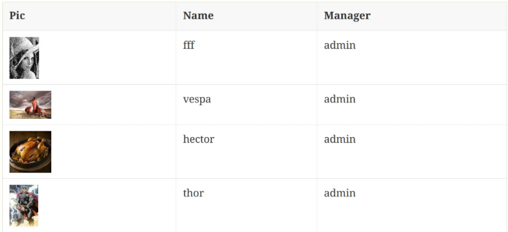
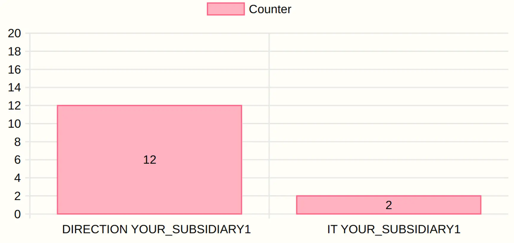

= Intercom
:doctype: book
:taack-category: 4|App
:toc:
:source-highlighter: rouge

== Propósito

Servidor SSH, servidor Git y servicio de renderizado Asciidoctor, subido a través de Git.

== Roles

* `ROLE_INTERCOM_DIRECTOR`
* `ROLE_INTERCOM_MANAGER`

Consulte link:Crew-es.adoc#_purpose[configurar roles en Crew] para añadir el rol en su Intranet.

== Extensiones AsciidoctorJ

Vídeo que demuestra la integración con IntelliJ:

video::2r0fSRmL2Io[youtube,width=1024,height=680]

=== TQL y TDL incrustados en AsciiDoc

Intercom permite incrustar presentaciones reveal.js y consultas TQL con TDL en los documentos. Consulte https://github.com/Taack/infra/releases/tag/v0.5.2[la página de descarga de taack-jdbc-client-1.0-SNAPSHOT-all]

.Ejemplo de tabla
====
[[tql_tdl]]
.TQL y TDL (Taack Display Language)
[source,sql]
----
select                              <1>
    u.rawImg,
    u.username,
    u.manager.username as manager
from User u
where u.dateCreated > '2024-01-01' and
    u.manager.username = 'admin';
--                                  <2>
table rawImg as "Pic",
      username as "Name",
      manager as "Manager"

----

<1> TQL (Taack Query Language), una especie de subconjunto de HQL
<2> TDL (Taack Display Language), indica cómo mostrar los datos consultados.

.Resultados

====

.Ejemplo de diagrama
====
[[tql_tdl]]
.TQL y TDL (Taack Display Language)
[source,sql]
----
select
    u.businessUnit,
    u.subsidiary,
    count(u.id) as counter
from User u
group by u.businessUnit;
--
barchart counter as "Counter"

----

.Resultados

====

=== Presentación incrustada

`slide::[fn=<prefijo del nombre de archivo de la presentación>]`

Consulte la página de inicio de este sitio web.
