= FreeCAD PLM
:doctype: book
:taack-category: 2|App
:toc:
:icons: font

== Propósito

Gestionar el uso compartido de modelos de FreeCAD y el versionado lineal. Esta aplicación muestra las capacidades del framework. Muy pocas líneas de código describen la interfaz de usuario y gestionan los datos persistentes. Podemos ver esta aplicación como un pequeño PLM (Product Lifecycle Management) para FreeCAD.

== Roles

* `ROLE_ADMIN`
* `ROLE_PLM_USER`

Consulte link:Crew-es.adoc#_purpose[configurar roles en Crew] para añadir el rol en su Intranet.

== Instalación del servidor

=== Configurar el servidor PLM

Si solo desea obtener una vista general, puede descargar el servidor de demostración con la configuración predeterminada; vaya directamente a <<_launch_server_binaries>>.

Aquí están los comandos paso a paso:

.Clonar el repositorio de Intranet
[source,bash]
----
git clone https://github.com/Taack/intranet.git
OR
git clone git@github.com:Taack/intranet.git
----

.Ir a la carpeta `app`
[source,bash]
----
cd intranet/app
----

.Clonar el repositorio PLM
[source,bash]
----
git clone https://github.com/Taack/plm.git
OR
git clone git@github.com:Taack/plm.git
----

A partir de aquí, puede compilar el servidor o ejecutarlo. Cambie el directorio actual a la carpeta `intranet` y elija una de las siguientes opciones:

.Compilar los binarios del servidor (para entorno de producción)
[source,bash]
----
./gradlew bootJar
----

.Iniciar el servidor (para entorno de desarrollo)
[source,bash]
----
./gradlew bootRun
----

[[_launch_server_binaries]]
=== Iniciar los binarios del servidor

La versión de demostración está disponible aquí: https://github.com/Taack/plm/releases[versiones de Taack PLM], descargue `server-0.6.jar`.

Si opta por compilar los binarios del servidor, ejecute:

[source,bash]
.Iniciar el servidor
----
java -jar server/build/libs/server-0.6.jar
----

==== Argumentos del servidor

Consulte `server/grails-app/conf/application.yml` para ver una lista de las opciones disponibles.

Las opciones se pueden pasar al servidor de esta manera:

[source,bash]
.Combinar opciones
----
java -DOption1=Value1 -DOption2=Value2 ... -jar server-0.3.jar
----

===== Opciones

* Ruta donde la Intranet almacena sus archivos: `-Dintranet.root=/home/test/someDir`
* Puerto del servidor: `-Dserver.port=9444`
* URL de la base de datos: `-DdataSource.url='jdbc:h2./prodDb2;LOCK_TIMEOUT=10000;DB_CLOSE_ON_EXIT=FALSE'`
* Ruta del ejecutable `dot`: `-Dexe.dot.path=/somePath...`

[[python-protobuf-install]]
== Instalación del banco de trabajo de FreeCAD

Vaya a #Tools# > #Addon Manager#, actualice la caché local y busque *Taack*.

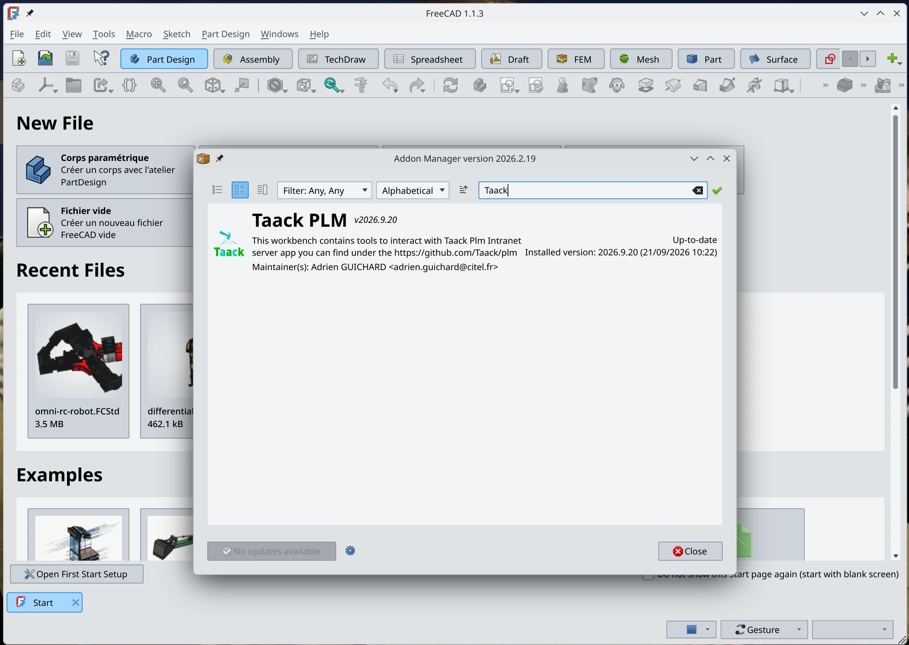

Haga clic en el botón de instalación.

== Uso

=== Conectarse al PLM

.Conectarse al PLM
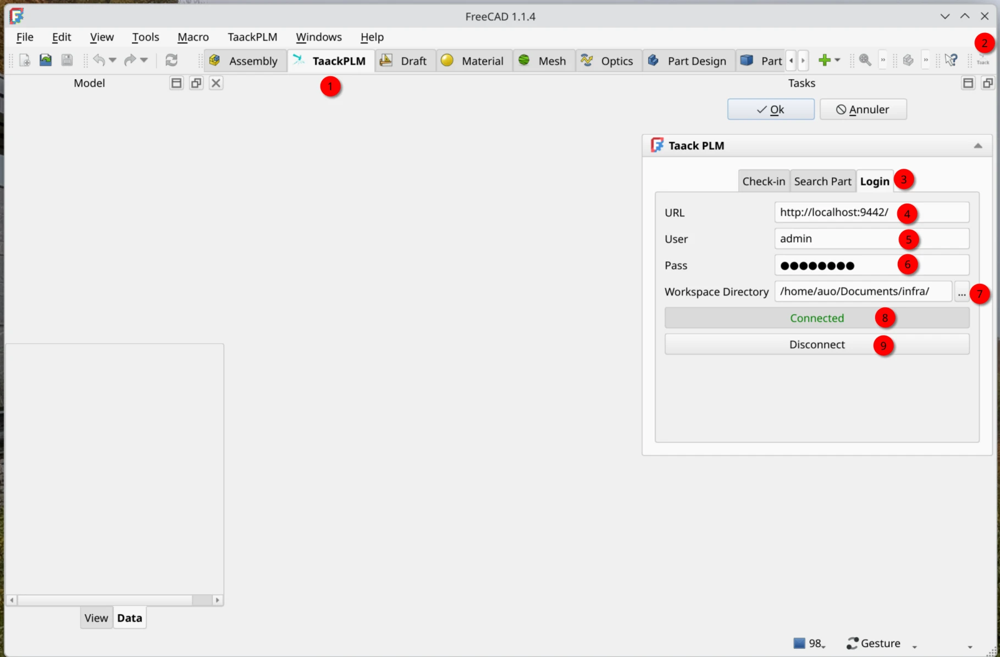

<1> URL del servidor (con una `/` al final)
<2> Nombre de usuario
<3> Contraseña
<4> Directorio donde se guardarán las piezas descargadas (asegúrese de que esté reservado exclusivamente para piezas del PLM)
<5> Haga clic en `Connect` y espere a que aparezca `Connected`

=== Subir piezas

Al hacer clic en el botón `Upload` (u `Ok`) en la pestaña `Check-in`, el archivo se subirá a su Intranet. La Intranet creará una vista previa; este proceso puede tardar algún tiempo.

.Subiendo al PLM
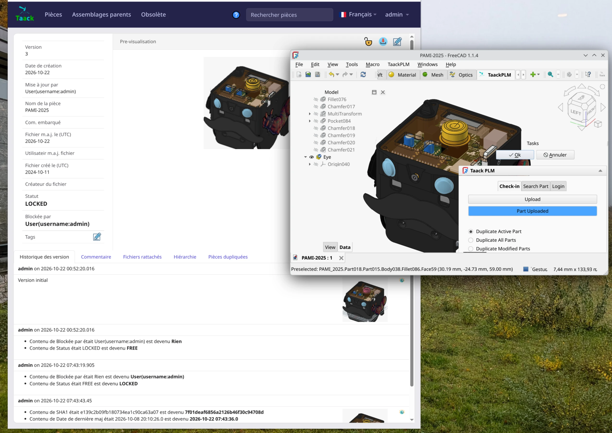

=== Buscar piezas

A continuación, puede buscar piezas:

.Buscar piezas
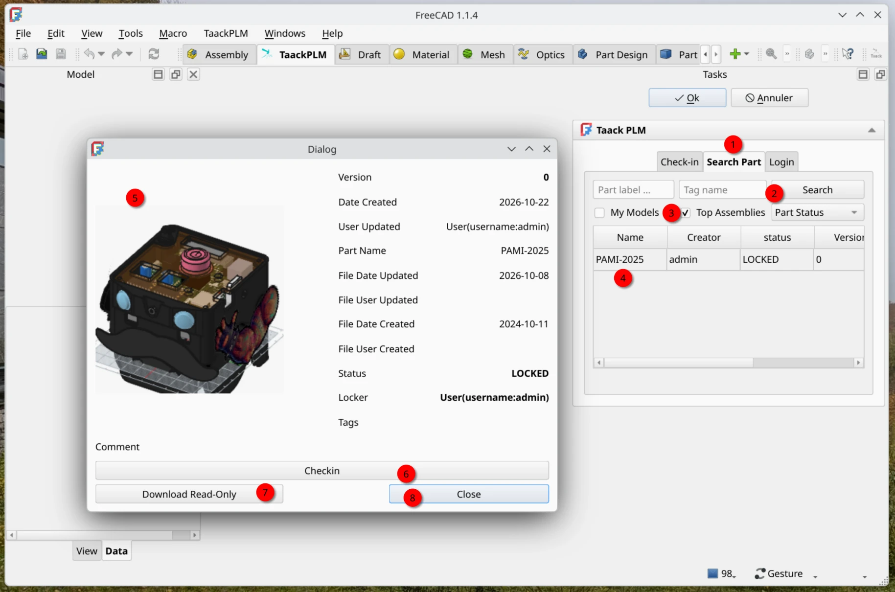

<1> Haga clic en la pestaña `Search Part`
<2> Buscar pieza
<3> Solo ensamblajes superiores (piezas que no pertenecen a otra pieza)
<4> Haga clic para abrir un cuadro de diálogo con los detalles
<5> Vista previa de la pieza
<6> `Checkin`: descarga el modelo localmente y bloquea el archivo en el servidor para que nadie pueda subir una nueva versión hasta que usted suba una nueva versión
<7> Descarga el modelo localmente, en modo de solo lectura
<8> Cierra la ventana

=== Gestionar piezas subidas

.Gestionar piezas subidas
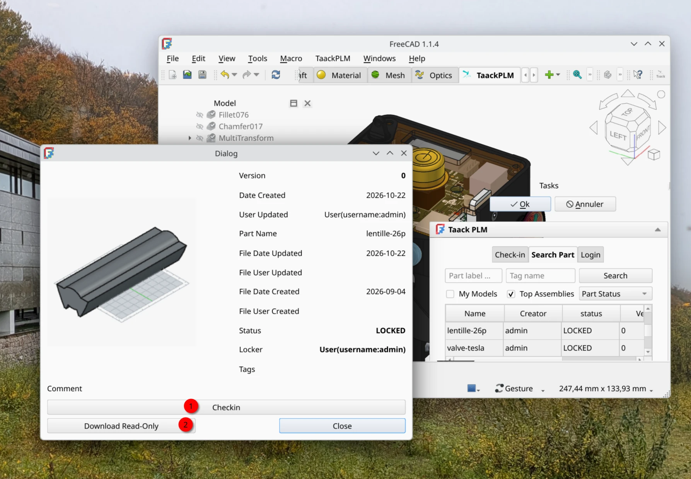

<1> Al hacer clic en `Checkin` se bloqueará la pieza para que pueda editarla y se cargará en FreeCAD. Luego, cuando suba la pieza, sus nuevos cambios se añadirán al historial de la pieza y esta se desbloqueará.
<2> Al hacer clic en `Download Read-Only` se descargará la pieza en su ordenador y se abrirá en FreeCAD. No podrá subir cambios a esta pieza, a menos que la duplique.

=== Descarga de solo lectura (Download Read-Only)

Observe el texto `READ_ONLY` en el campo principal del ID de la pieza. Si intenta subirla mediante la pestaña `Check-in`, un mensaje de error le recordará que la pieza es de solo lectura. Tendrá que duplicar la pieza para subir una nueva versión.

.Descarga de solo lectura
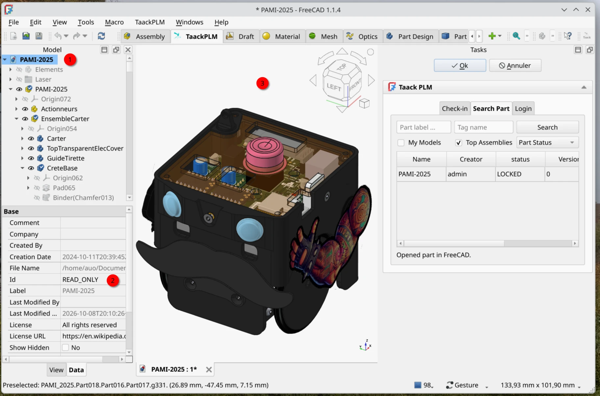

<1> Jerarquía del modelo
<2> Observe la palabra clave `READ_ONLY`
<3> El modelo 3D

=== Duplicar piezas

Para subir una pieza de solo lectura, debe duplicarla. También puede duplicar una pieza que haya reservado (`Checkin`) si desea bifurcar (fork) el modelo.

.Duplicar piezas
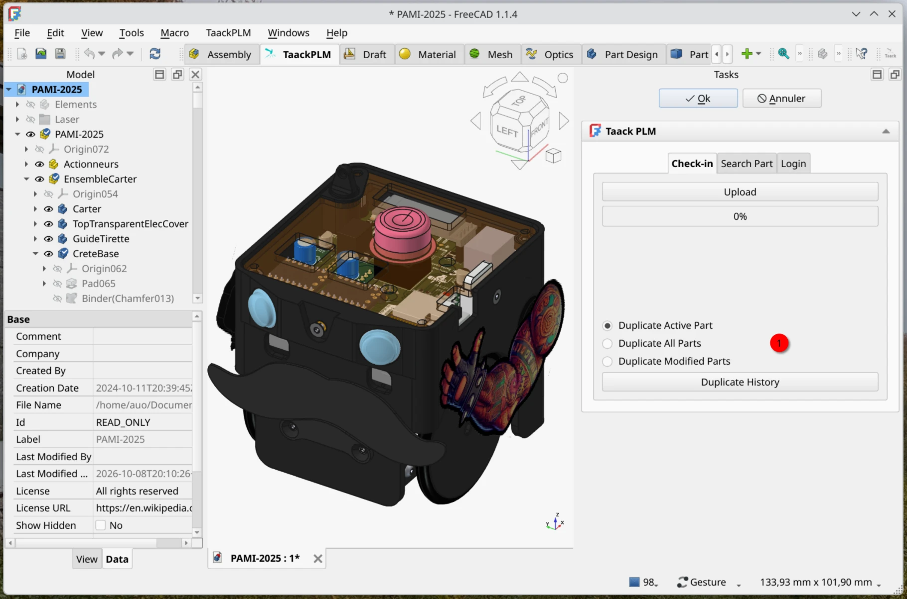

<1> Elija cómo desea duplicar el modelo y haga clic en `Duplicate History` para duplicarlo

Esto creará una nueva pieza en el servidor y se mantendrá un enlace entre ambas piezas:

.Piezas duplicadas en el servidor
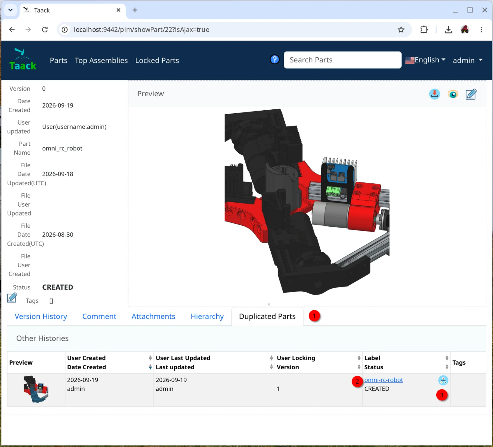

<1> Pestaña de piezas duplicadas (`Duplicated Parts`)
<2> La pieza clonada
<3> Ver el grafo de jerarquía de esta pieza

=== Vistas del servidor

==== Lista de piezas

.Lista de piezas
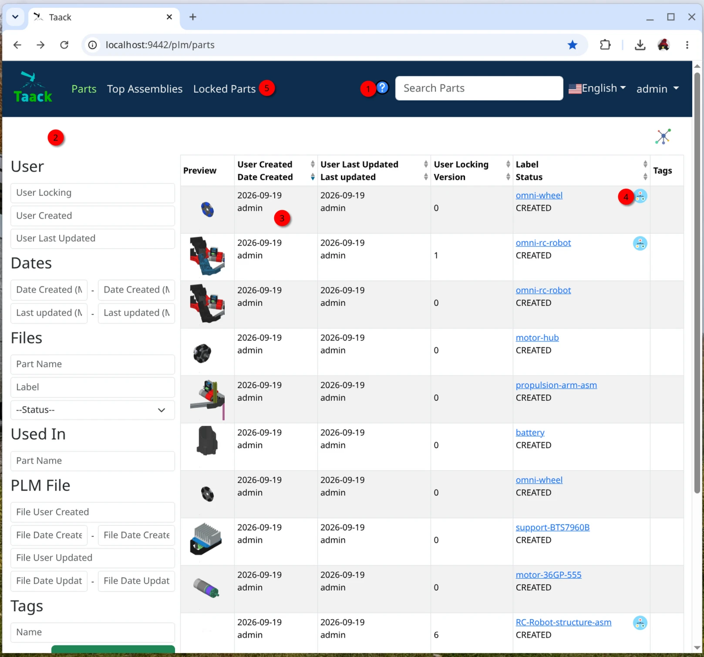

<1> Ayuda contextual
<2> Filtro para buscar una pieza
<3> Lista de resultados
<4> Haga clic para mostrar el grafo de dependencias del ensamblaje
<5> Piezas bloqueadas (piezas en estado `Check-in`)

==== Detalles de la pieza

.Vista detallada de las piezas
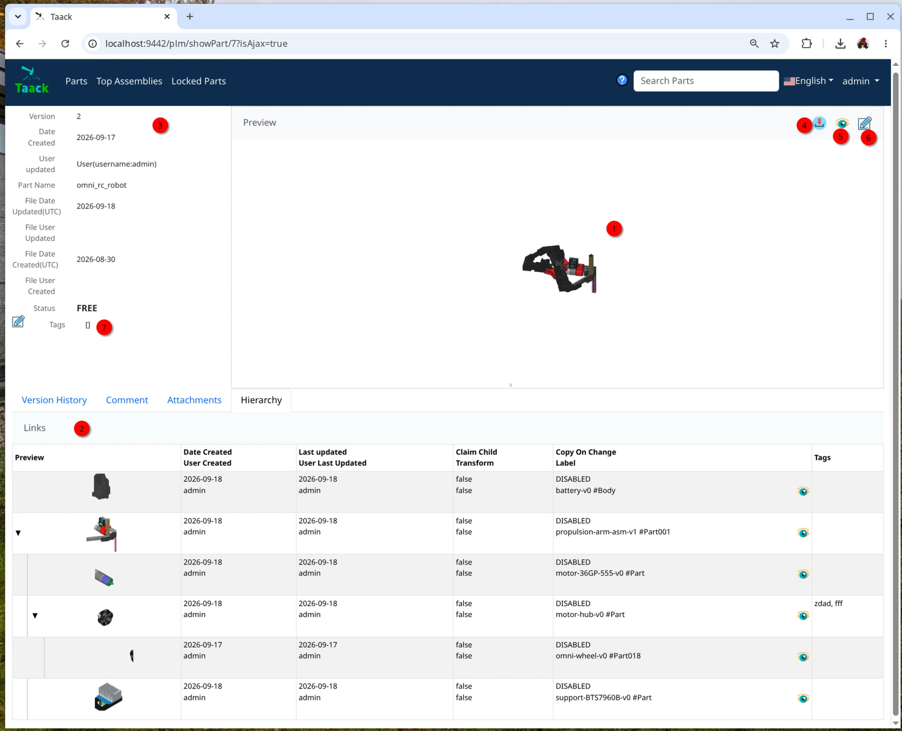

<1> Vista previa de la versión actual
<2> Subpiezas, con vista previa y enlaces a la versión específica de la subpieza
<3> Información de la versión
<4> Descargar el modelo y sus subpiezas en un archivo ZIP
<5> Vista previa del modelo en un visor 3D de estructura alámbrica (wireframe)
<6> Cambiar el estado de la pieza o desbloquearla si usted la bloqueó o tiene los permisos necesarios
<7> Añadir etiquetas (tags) a la pieza para facilitar su búsqueda

==== Historial de la pieza

.Historial de la pieza
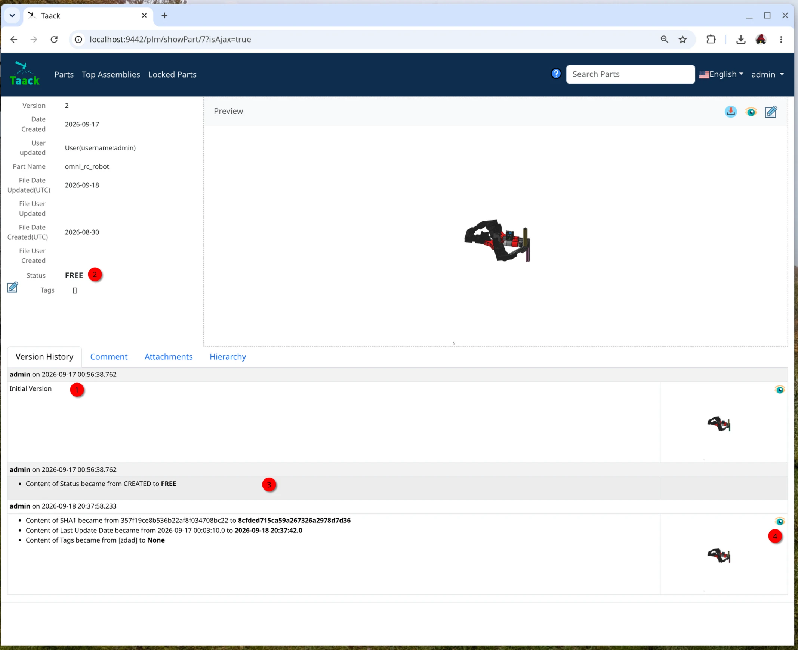

<1> Versión inicial
<2> La pieza está desbloqueada, alguien puede reservarla (`Check-in`)
<3> El estado cambió de `CREATED` a `FREE`
<4> Nueva subida de la pieza; puede ver la estructura alámbrica 3D del modelo anterior para realizar un seguimiento visual de los cambios

WARNING: Si tiene muchos enlaces, impórtelos desde el mismo ordenador. Desde otros ordenadores, descargue el archivo ZIP desde su intranet.

Eso es todo; grabaré algunos vídeos demostrando las capacidades de esta aplicación.

video::YNbKiaUQY94[youtube, width=820, height=480]

// # [auo@auo-systemproductname FreeCAD]$ yay -S boost cmake coin curl desktop-file-utils eigen gcc-fortran git glew hicolor-icon-theme jsoncpp libspnav med nlohmann-json opencascade pyside6-tools pyside6 python-matplotlib python-netcdf4 python-packaging python-pivy qt6-svg qt6-tools qt6-webengine shared-mime-info shiboken6 swig utf8cpp xerces-c yaml-cpp
// git submodule update --init
// ccmake -DFREECAD_QT_VERSION=6 ..
// cmake .
// make -j$(nproc --ignore=2)
