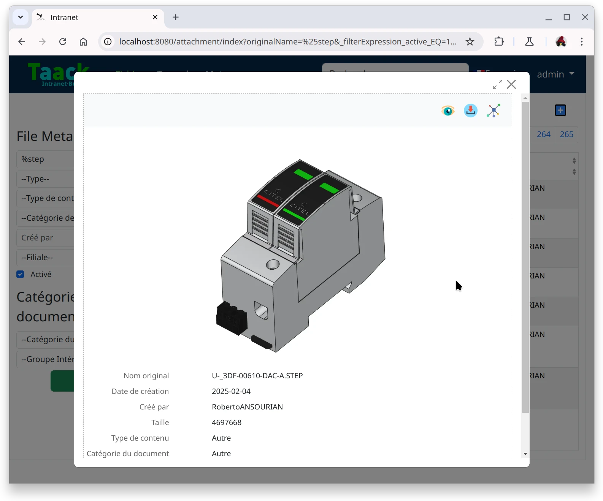
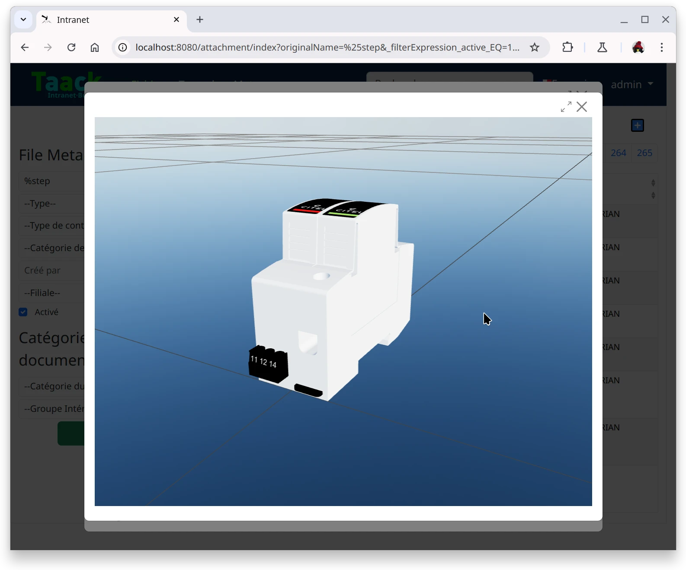

= Viewers
:doctype: book
:taack-category: 4|App
:toc:
:source-highlighter: rouge

== 用途

转换并预览文件。

.STEP 图像预览

.STEP 自定义预览

== 源码

[source,bash]
----
$ git clone https://github.com/Taack/viewers.git
----
