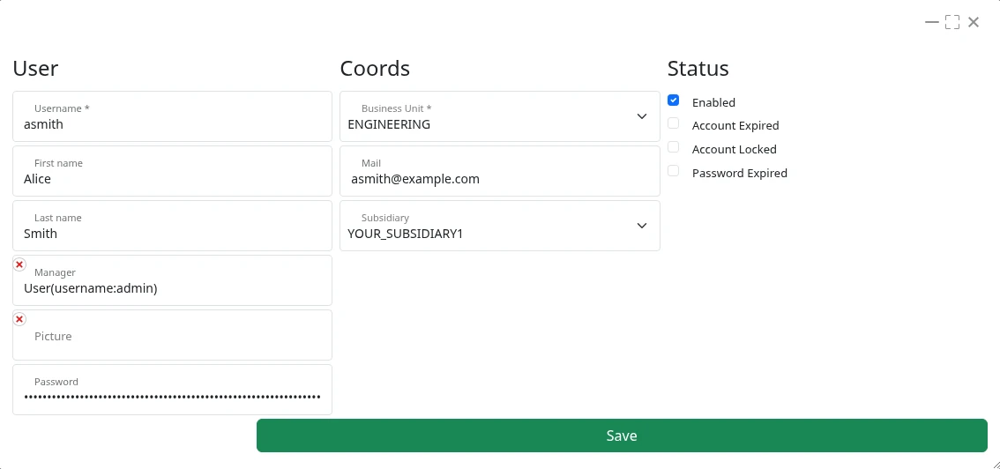

= Taack UI DSLs
:doctype: book
:taack-category: 2|doc/Concepts
:toc:
:source-highlighter: rouge
:icons: font

== Prefacio sobre Block DSL

El Block DSL permite especificar el diseño de la página definiendo bloques que contienen elementos gráficos. Un bloque puede actualizarse mediante acciones. Los `bloques AJAX` pueden seleccionarse utilizando su ID. Los bloques también pueden anidarse.

Para obtener más información, consulte la página dedicada a link:../DSLs/block-dsl.adoc[Block DSL]. Los PDF tienen su propia gestión de bloques a través de link:../DSLs/block-printable-dsl-es.adoc[Bloques imprimibles], donde también son aplicables los DSL de visualización (show), tabla (table) y diagrama (diagram).

[source,groovy]
----
UiBlockSpecifier b = new UiBlockSpecifier() <1>
b.ui {
    modal {                                 <2>
        form f                              <3>
    }
}
----

<1> Crea el bloque, construido mediante el método `ui`
<2> Este bloque contendrá una ventana modal, que también es un bloque
<3> La ventana modal contiene un formulario

[[form-html-output]]
.Formulario dentro de una ventana modal.

== DSL de elementos de bloque

* link:../DSLs/form-dsl-es.adoc[*Form DSL*]: Permite definir un formulario para incluirlo en un bloque

* link:../DSLs/show-dsl-es.adoc[*Show DSL*]: Permite mostrar un resumen de un objeto. Admite la edición limitada de campos

* link:../DSLs/filter-table-dsl-es.adoc[*DSL de tabla y filtro de tabla*]: Una tabla está asociada a uno o cero filtros. Los filtros no pueden mostrarse sin una tabla.
** El Table DSL permite agrupar y ordenar columnas
** Incluye paginación
** La tabla también puede representar un árbol
** Las filas se pueden editar en línea (`rowQuickEdit`)
** El filtro puede mostrarse junto a la tabla o como una barra de herramientas encima de ella (`FilterLayout`)
* link:../DSLs/diagram-dsl-es.adoc[*Diagram DSL*]: Permite dibujar diagramas (barras, líneas, áreas, dispersión, circular, cajas y bigotes, línea de tiempo) en un bloque, un PDF o un correo electrónico
* link:../DSLs/kanban-dsl-es.adoc[*Kanban DSL*]: Permite dibujar un tablero Kanban con arrastrar y soltar entre columnas
* `custom`: Permite insertar código HTML personalizado en un bloque.

== DSL a nivel de página

* link:../DSLs/menu-dsl-es.adoc[*Menu DSL*]: Describe el menú de la página (entradas, submenús, iconos, cuadro de búsqueda, opciones)
* link:../DSLs/block-printable-dsl-es.adoc[*Printable Block DSL*]: Describe el diseño de un documento PDF
