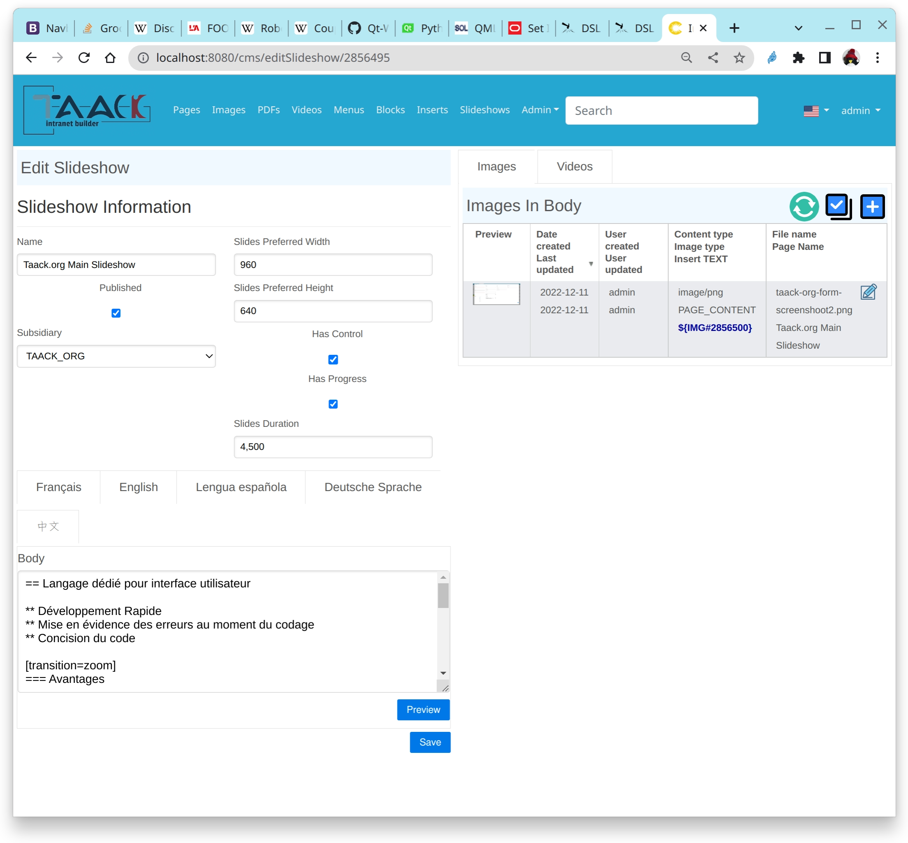
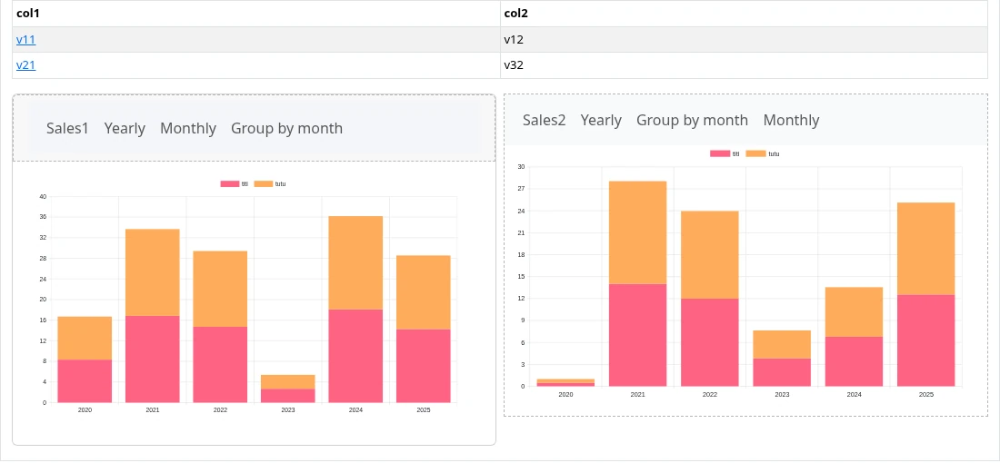

= Block DSL
:doctype: book
:taack-category: 10|doc/DSLs
:toc:
:source-highlighter: rouge
:icons: font

[%interactive]
* [*] Renderizado en HTML
* [*] Renderizado en PDF
* [ ] Renderizado en CSV

DSL de nivel superior responsable de organizar los elementos gráficos de la página y de actualizar conjuntamente los bloques `ajaxBlock`. En caso de renderizar una página completa, también debemos especificar la descripción del menú de la página mediante el link:menu-dsl.adoc[Menu DSL].

Este DSL también es responsable de gestionar la pila de ventanas modales. Abra una ventana modal usando `modal` o ciérrela usando `closeModalAndUpdateBlock` (y otras variantes).

== Ejemplo de código de construcción de bloques

[[block-preview]]
.Ejemplo de bloque con pestañas (véase <<block-sample1>>).

[source,groovy]
[[block-sample1]]
.Ejemplo de bloque con pestañas
----
def editSlideshow(CmsPage slideshow) {

    Boolean createNew = slideshow == null
    if (!slideshow)
        slideshow = new CmsPage(pageType: CmsPageType.SLIDESHOW)

    UiBlockSpecifier b = new UiBlockSpecifier().ui {
        if (createNew)
            modal {
                form buildCmsSlideshowForm(slideshow)
            }
        else {
            row {                                               <1>
                col {
                    form buildCmsSlideshowForm(slideshow)
                }
                col {
                    tabs {
                        tab "Images", buildImagesTab(slideshow) <2>
                        tab "Videos", buildVideosTab(slideshow)
                    }
                }
            }

        }
    }
    taackUiService.show(b, buildMenu())                     <3>
}
----

<1> 1 fila, 2 columnas
<2> Declarar 2 pestañas dentro; la primera se muestra cuando aparece la página
<3> Enviar el bloque junto con la descripción del menú al navegador.

pass:[<a class="taackMenu" ajaxAction="/dslSample/block" href="/dslSample/block">&#9654; Try it live</a>]

== Ejemplo de código de pila modal

Después de procesar un formulario, puede actualizar el contenido de la página o de otra ventana modal situada debajo de la actual. También puede recargar la página o mostrar otra página. Recargar la página permite que el código sea reutilizable, ya que no depende de la URL actual (recuerde los *parámetros* `redirectAction` que se ven en link:../../first-app.adoc#_adding_buttons_to_a_table_block[Primera aplicación (Añadir botones a un bloque de tabla)]).

Por lo general, una ventana modal se cierra después de procesar un formulario. O bien no es válido y los errores se muestran en el navegador directamente en el formulario, o bien guardamos el objeto y actualizamos el contenido.

=== Cerrar modal y recargar la página

[source,groovy]
----
@Transactional
@Secured(["ROLE_CMS_MANAGER", "ROLE_CMS_DIRECTOR"])
def saveCmsInsert() {
    taackSaveService.saveThenReloadOrRenderErrors(CmsInsert)
}
----

Si no se detecta ningún error al guardar `CmsInsert`, la página simplemente se recarga.

=== Cerrar modal y cargar una página

[source,groovy]
----
@Transactional
@Secured(["ROLE_ADMIN", "ROLE_CMS_MANAGER", "ROLE_CMS_DIRECTOR"])
def saveCmsPage() {
    taackSaveService.saveThenRedirectOrRenderErrors(  <1>
        CmsPage, this.&pages as MethodClosure
    )
}
----
<1> Se cargará el closure de método de este controlador (respetando los URL Mappings)

=== Cerrar modal y actualizar el modal inferior

[source,groovy]
----
@Transactional
@Secured(['ROLE_ADMIN'])
def saveLlmRag() {
    taackSaveService.saveOrCloseModalAndRefresh(LlmRag)  <1>
}
----
<1> Si no se detecta ningún error, se cierra el último modal y se actualiza el contenido inferior (página o modal anterior)

=== Cerrar modal y actualizar los bloques Ajax de la página

.Caso de uso complejo: cerrar la ventana modal y actualizar el `ajaxBlock` presente en la página
[source,groovy]
----
@Transactional
def saveProjects() {
    EngineeringChangeRequest ecr = taackSaveService.save(EngineeringChangeRequest) <1>
    taackSaveService.displayBlockOrRenderErrors(ecr,
        new UiBlockSpecifier().ui {                                             <2>
            closeModalAndUpdateBlock {                                          <3>
                show buildShowProjects(ecr), {
                    menuIcon ActionIcon.ADD, Ecr2Controller.&projectsForm as MC, ecr.id
                }
            }
        }
    )
}
----

<1> Vincular los parámetros y guardar el objeto
<2> `displayBlockOrRenderErrors` recibe un `UiBlockSpecifier` como parámetro, que se renderiza solo si el objeto no tiene errores
<3> `closeModalAndUpdateBlock` cerrará primero el último modal abierto y luego aplicará la modificación

=== Reemplazar el contenido de un modal

[source,groovy]
----
taackUiService.show(new UiBlockSpecifier().ui {
    replaceModal {                                      <1>
        custom "<h1>Done.</h1>"
    }
})
----
<1> Se reemplaza el contenido del modal actual, sin abrir uno nuevo

== Elementos de diseño (Layout Elements)

[source,groovy]
.Filas, columnas, acordeón, tarjeta y ScrollPanel
----
new UiBlockSpecifier().ui {
    row {
        col BlockSpec.Width.TWO_THIRD, {                <1>
            card 'Customers', {                         <2>
                menu 'Export', this.&export as MC
            }, {
                scrollPanel '512px', {                  <3>
                    table buildCustomerTable()
                }
            }
        }
        col BlockSpec.Width.THIRD, {
            accordion {                                 <4>
                accordionItem 'Filter', true, {
                    form buildFilterForm()
                }
            }
        }
    }
}
----
<1> Ancho de `col`, de `BlockSpec.Width`: `MAX`, `THREE_QUARTER`, `TWO_THIRD`, `HALF` (predeterminado), `THIRD`, `QUARTER` o `FLEX`
<2> `card` con un título opcional, un closure de menú opcional y su contenido
<3> `scrollPanel` limita la altura de su contenido, añadiendo una barra de desplazamiento si es necesario
<4> `accordion` contiene `accordionItem`; el segundo parámetro indica si el elemento está abierto de forma predeterminada

[source,groovy]
.Actualizar solo algunos bloques con `poke`
----
def topCustomerSalesCard(StatsParams statsParams) {
    boolean p0 = statsParams.v == 0
    boolean p1 = statsParams.v == 1
    boolean p2 = statsParams.v == 2

    taackUiService.show(new UiBlockSpecifier().ui {
        poke p0, {
            table statsService.buildTable()                         <1>
        }
        row {
            poke p1, {                                              <2>
                col BlockSpec.Width.HALF, {
                    card({                                          <3>
                        label 'Sales1'
                        menu 'Yearly', StatsController.&topCustomerSalesCard as MC,
                            new StatsParams(showMonthlyGraph1: false, v: 1)
                        menu 'Monthly', StatsController.&topCustomerSalesCard as MC,
                            new StatsParams(groupPerMonth1: false, v: 1)
                    }, {
                        diagram statsService.&buildChart1 as MC     <4>
                    })
                }
            }
            poke p2, {
                col BlockSpec.Width.HALF, {
                    diagram(statsService.&buildChart2 as MC) {      <5>
                        label 'Sales2'
                        menu 'Yearly', StatsController.&topCustomerSalesCard as MC,
                            new StatsParams(showMonthlyGraph2: false, v: 2)
                    }
                }
            }
        }
    }, RootController.buildMenu(), statsParams)                     <6>
}
----
<1> Las filas de la tabla enlazan con esta acción con `v: 1` o `v: 2`, actualizando solo uno de los diagramas
<2> `p1` y `p2` son booleanos. Si son `true`, los bloques dentro del bloque `poke` se actualizan
<3> `card` con un closure de menú y un closure de contenido
<4> `diagram` puede recibir un `MethodClosure` que devuelva un `UiDiagramSpecifier`
<5> Cualquier hoja puede recibir un closure de menú, que se muestra en su encabezado
<6> `StatsParams` es un `Validateable`; sus valores se conservan al hacer clic en los enlaces

.Tarjetas, diagramas y `poke`

== Elementos del Block DSL

=== Contenedores
* `modal`: abre una ventana modal; `modal(true) {}` recarga la página cuando se cierra el modal
* `replaceModal`: reemplaza el contenido del modal actual
* `closeModalAndUpdateBlock`: cierra el último modal y actualiza los bloques de la página (o del modal anterior)
* `closeModal`: cierra el modal y transmite un id y un valor al formulario que lo abrió (usado por las selecciones `ajaxField`)
* `ajaxBlock`: rodea otros elementos y permite actualizar solo una parte de la página
* `row`, `col`: organiza elementos horizontalmente, véase `BlockSpec.Width`
* `tabs`, `tab`: pestañas; la primera se muestra de forma predeterminada
* `accordion`, `accordionItem`: elementos plegables
* `card`: tarjeta con un título y un menú
* `scrollPanel`: elemento con una altura máxima
* `poke`: actualiza el contenido solo si la condición es verdadera

=== Hojas (Leaves)
Todas las hojas pueden recibir un closure opcional que describe un menú (véase link:menu-dsl.adoc[Menu DSL]) mostrado en el encabezado del bloque.

* `form`: véase link:form-dsl.adoc[Form DSL]
* `show`: véase link:show-dsl.adoc[Show DSL]
* `table`, `tableFilter`: véase link:filter-table-dsl.adoc[FilterTable DSL]
* `diagram`, `diagramFilter`: véase link:diagram-dsl.adoc[Diagram DSL]
* `kanban`, `kanbanFilter`: véase link:kanban-dsl.adoc[Kanban DSL]
* `custom`: código HTML personalizado
* `iframe`: muestra una URL dentro de un iframe

== Jerarquía de símbolos de Block DSL

[graphviz,format="svg",align=center]
.Diagrama de jerarquía de símbolos para Block DSL (sin ajaxBlock)
----
digraph mygraph {
  node [shape=box];
  ui -> modal, replaceModal, closeModalAndUpdateBlock [label = "0,1"]
  ui, modal, replaceModal, closeModalAndUpdateBlock -> row, tabs, accordion, card, scrollPanel, poke [label = "0,N"]
  row -> col [label = "1,N"]
  tabs -> tab [label = "1,N"]
  accordion -> accordionItem [label = "1,N"]
  ui, modal, tab, col, accordionItem, card, scrollPanel, poke -> form, show, table, tableFilter, diagram, diagramFilter, kanban, kanbanFilter, custom, iframe [label = "0,N"]
}
----

`ajaxBlock` puede rodear otros elementos y permite actualizar solo una parte de la página.
