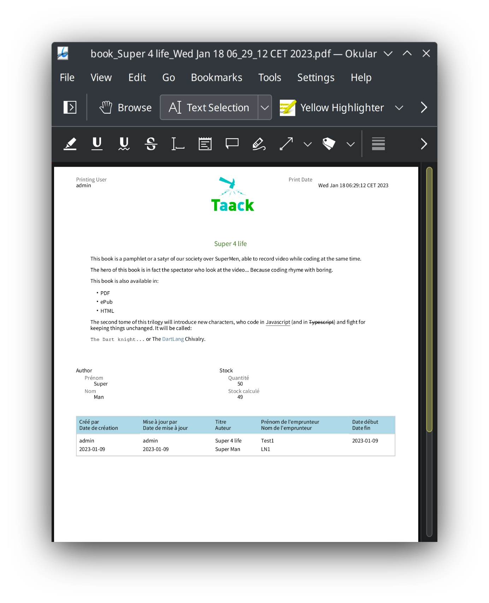

= 可打印块 DSL (Printable Block DSL)
:doctype: book
:taack-category: 11|doc/DSLs
:toc:
:source-highlighter: rouge
:icons: font

* [*] 支持渲染为 HTML
* [*] 支持渲染为 PDF
* [ ] 支持渲染为 CSV

用于可打印文档的 DSL，负责将页面图形元素排列到静态文档中（通常是 PDF，未来可添加更多格式）。

== 构建可打印块的代码示例

[source,groovy]
[[printable-block-sample1]]
.基础 PDF
----
def p = new UiPrintableSpecifier().ui {
    printableHeader "3.5cm", {                  <1>
        show new UiShowSpecifier().ui {
            fieldLabeled u.username_            <2>
        }, BlockSpec.Width.THIRD
        show new UiShowSpecifier().ui {
            field """
            

                
            

            """
        }, BlockSpec.Width.THIRD
        show new UiShowSpecifier().ui {
            field Style.ALIGN_RIGHT, 'Print Date',
                  new Date().toString()
        }, BlockSpec.Width.THIRD
    }
    printableBody {                             <3>
        def a = book.author
        show new UiShowSpecifier().ui {
            field Style.ALIGN_CENTER,
                  """<h1>${book.name}</h1>"""
            fieldUnlabeled Style.MARKDOWN_BODY,
                  book.abstractTextHtml_
        }, BlockSpec.Width.MAX
        show new UiShowSpecifier().ui {
                fieldLabeled book.isbn_
            section 'Author', {
                fieldLabeled book.author_, a.firstName_
                fieldLabeled book.author_, a.lastName_
            }
        }, BlockSpec.Width.HALF
        show new UiShowSpecifier().ui {
            section 'Stock', {
                fieldLabeled book.number_
                fieldLabeled book.stock_
            }
        }, BlockSpec.Width.HALF
        table bookstoreUiService.buildBorrowedBookTable(),
              BlockSpec.Width.MAX               <4>
    }
    printableFooter {                           <5>
    }
}
----

<1> `printableHeader` 允许定义在所有页面上重复显示的页眉，如果需要不同于 2cm 的高度，则高度参数是必填的。
<2> 您可以使用常规的 #show# 闭包。
<3> `printableBody` 定义跨多页的 PDF 主体内容。
<4> 您可以使用常规的 #table# 闭包，同时也支持 `diagram`。
<5> `printableFooter` 允许定义在所有页面上重复显示的页脚，其高度不得超过 2cm。

pass:[<a class="taackMenu" ajaxAction="/dslSample/pdf" href="/dslSample/pdf">&#9654; Try it live</a>]

== 可打印块 DSL 符号层级结构

[graphviz,format="svg",align=center]
.可打印块 DSL 的符号层级图
----
digraph mygraph {
  node [shape=box];
  ui -> printableHeader, printableHeaderLeft, printableHeaderRight
  ui -> printableFooter, printableBody
  printableHeader, printableHeaderLeft, printableHeaderRight, printableFooter, printableBody -> anonymousBlock, show, table, diagram, custom
  anonymousBlock -> anonymousBlock, show, table, diagram, custom
}
----
