= Diagram DSL
:doctype: book
:taack-category: 3|doc/DSLs
:toc:
:source-highlighter: rouge
:icons: font

* [*] Renderizzato in HTML
* [*] Renderizzato in PDF
* [*] Renderizzato in Mail
* [ ] Renderizzato in CSV

Il Diagram DSL consente di disegnare rapidamente diagrammi a barre (bar), ad area (area), a torta (pie), a dispersione (scatter), a linee (line), box-and-whiskers (whiskers) e cronologici (timeline), eventualmente combinati (mixed), sia rasterizzati in formato PNG sia in formato SVG.

In un blocco, un diagramma viene aggiunto tramite `diagram`, che accetta un `UiDiagramSpecifier` oppure una `MethodClosure` che ne restituisce uno, o tramite `diagramFilter` per associarlo a un filtro.

== Esempi di grafici

=== Barre (Bar)

.Grafico a barre
====
.Esempio di codice per grafico a barre
[source,groovy]
----
private static UiDiagramSpecifier barDiagram(boolean isStacked) {
    new UiDiagramSpecifier().ui {
        bar(isStacked, {
            labels "T1", "T2", "T3", "T4"
            dataset 'Truc1', 1.0, 2.0, 1.0, 4.0
            dataset 'Truc2', 2.0, 0.1, 1.0, 0.0
            dataset 'Truc3', 2.0, 0.1, 1.0, 1.0
        })
    }
}
----

.Risultato
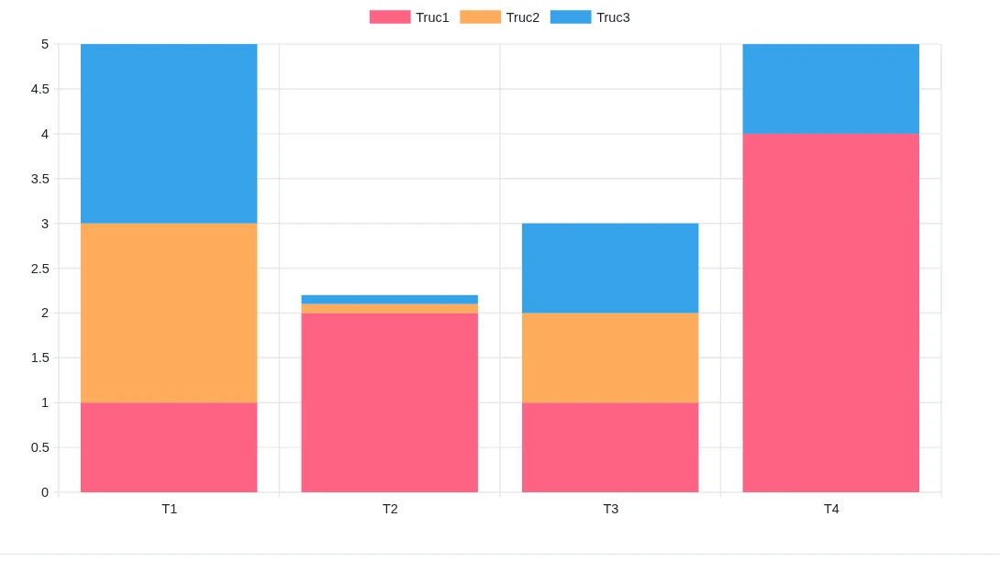

pass:[<a class="taackMenu" ajaxAction="/dslSample/bar" href="/dslSample/bar">&#9654; Try it live</a>]
====

=== Linee (Line)

.Grafico a linee
====
.Esempio di codice per grafico a linee
[source,groovy]
----
diagram new UiDiagramSpecifier().ui({
    line {
        labels 1.5, 3, 4.4, 5, 7.8, 8
        dataset "client", 10.0, 20.1, 30.0
        dataset "admin", 5.0, 7.0
        dataset "other", 1.0, 2.0, 3.0, 4.0, 5.0, 6.0
    }
})
----

.Risultato
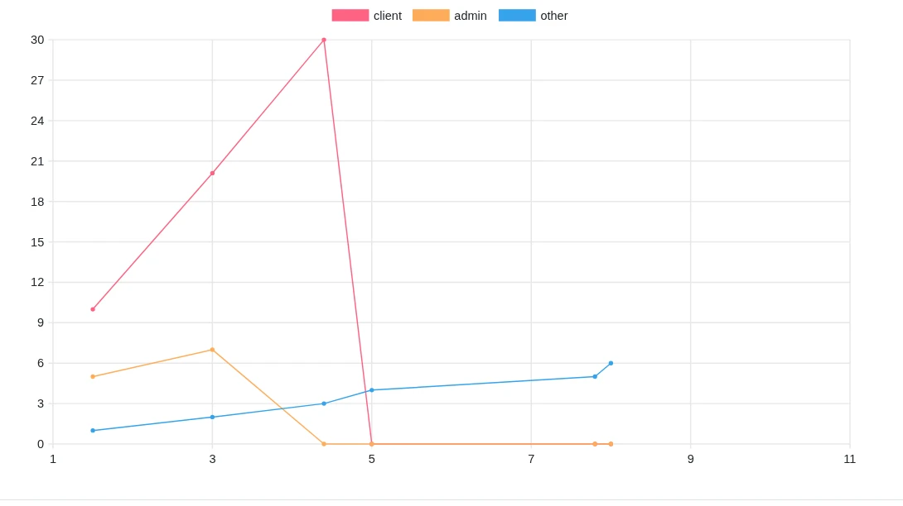

pass:[<a class="taackMenu" ajaxAction="/dslSample/line" href="/dslSample/line">&#9654; Try it live</a>]
====

=== Torta (Pie)

.Grafico a torta
====
.Esempio di codice per grafico a torta
[source,groovy]
----
private static UiDiagramSpecifier pieDiagram(boolean hasSlice) {
    new UiDiagramSpecifier().ui({
        pie(hasSlice, {
            labels "Pie"
            dataset("cli", 1.47)
            dataset("client", 0.28)
            dataset("client1", 0.1)
            dataset("client2", 1.45)
            dataset("client3", 0.05)
            dataset("client31", 0.05)
            dataset("client32", 0.05)
            dataset("c33", 0.05)
            dataset("client311", 0.05)
            dataset("client312", 0.05)
            dataset("client313", 0.05)
            dataset("client4", 0.8)
            dataset("client5", 2.1)
            dataset("client55", 0.1)
            dataset("client555", 0.2)
            dataset("client5555", 0.3)
            dataset("client55555", 0.3)
            dataset("admin", 1.6)
            dataset("test1", 0.05)
        })
    })
}
----

.Risultato
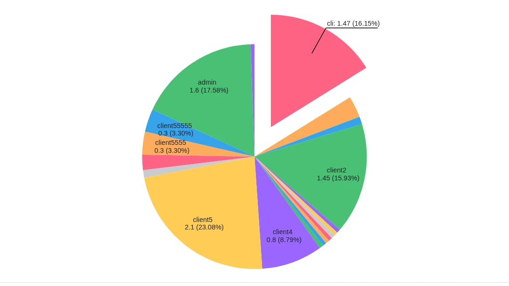

pass:[<a class="taackMenu" ajaxAction="/dslSample/pie" href="/dslSample/pie">&#9654; Try it live</a>]
====

=== Box-and-Whiskers (Whiskers)

.Grafico box-and-whiskers
====
.Esempio di codice per box-and-whiskers
[source,groovy]
----
diagram new UiDiagramSpecifier().ui({
    whiskers {
        labels "T1", "T2", "T3", "T4"

        dataset 'Truc1', {
            boxData 1.0, 2.0, 3.0, 3.5, 4.0, 4.5, 5.0
            boxData 1.5, 2.5, 3.5, 6.0, 7.0, 8.0, 9.0
            boxData 2.0, 2.0, 2.1, 2.5, 5.5, 5.6, 6.7
            boxData 1.7, 1.8, 1.9, 2.0, 2.1, 2.2, 2.3
        }
        dataset 'Truc2', {
            boxData 0.5, 1.0, 1.1, 1.2, 1.3, 2.0, 5.5
            boxData 0.5, 1.0, 1.1, 1.2, 1.3, 2.0, 5.5
            boxData 0.5, 1.0, 1.1, 1.2, 1.3, 2.0, 5.5
            boxData 0.5, 1.0, 1.1, 1.2, 1.3, 2.0, 5.5
        }
    }
})
----

.Risultato
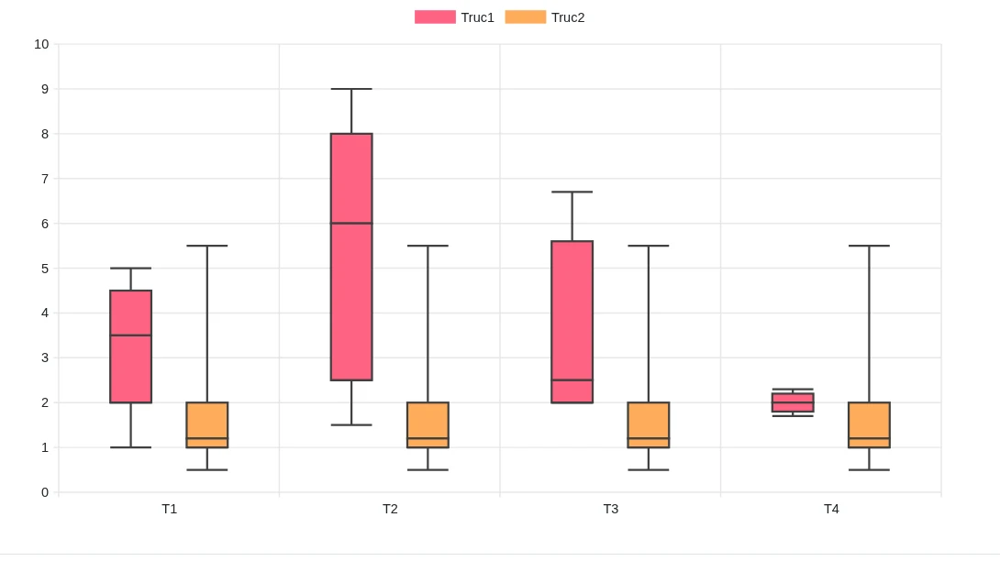

pass:[<a class="taackMenu" ajaxAction="/dslSample/whiskers" href="/dslSample/whiskers">&#9654; Try it live</a>]
====

=== Cronologia (Timeline)

.Grafico cronologico
====
.Esempio di codice per timeline
[source,groovy]
----
diagram new UiDiagramSpecifier().ui({
    timeline {
        SimpleDateFormat format = new SimpleDateFormat('yyyy-MM-dd')
        dataset 'Truc1', {
            periodData format.parse('2025-06-12'), format.parse('2025-07-08'), "Period1"
            periodData format.parse('2025-07-08'), format.parse('2025-07-21'), "Period2"
            periodData format.parse('2025-07-21'), format.parse('2025-08-30'), "Period3"
        }
        dataset 'Truc2', {
            periodData format.parse('2025-06-20'), format.parse('2025-06-25'), "Period1"
            periodData format.parse('2025-07-01'), format.parse('2025-07-21'), "Period2"
        }
    }
})
----

.Risultato
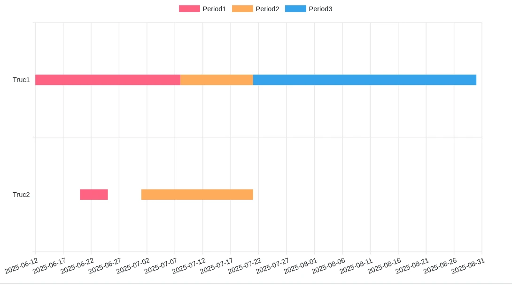
====

=== Misto (Mixed)

Altri tipi di diagramma possono essere annidati all'interno della closure di un diagramma. Condividono le etichette dell'asse X e la legenda, mentre ciascun tipo annidato ha il proprio asse Y, colorato come i relativi serie di dati (`dataset`).

.Grafico misto
====
.Esempio di codice per grafico misto
[source,groovy]
----
diagram new UiDiagramSpecifier().ui {
    bar {                                                           <1>
        labels 'W1', 'W2', 'W3', 'W4', 'W5', 'W6', 'W7', 'W8'
        dataset 'Line A', 55.0, 62.0, 58.0, 70.0, 74.0, 61.0, 80.0, 77.0
        dataset 'Line B', 40.0, 48.0, 44.0, 58.0, 61.0, 57.0, 70.0, 65.0
        line {                                                      <2>
            dataset 'Scrap rate (%)', 2.1, 1.8, 2.5, 1.6, 1.4, 2.9, 1.2, 1.5
        }
        scatter {                                                   <3>
            dataset 'Downtime (h)', 4.0, 6.0, 3.0, 8.0, 5.0, 2.0, 7.0, 4.0
        }
        option DiagramOption.builder
                .setTitle('Weekly production')
                .build()
    }
}
----
<1> Diagramma principale, che definisce le etichette sull'asse X (qui un grafico a barre impilate)
<2> Linea annidata, disegnata sopra le barre con il proprio asse Y a destra
<3> Grafico a dispersione annidato, con il proprio asse Y a sinistra

.Risultato
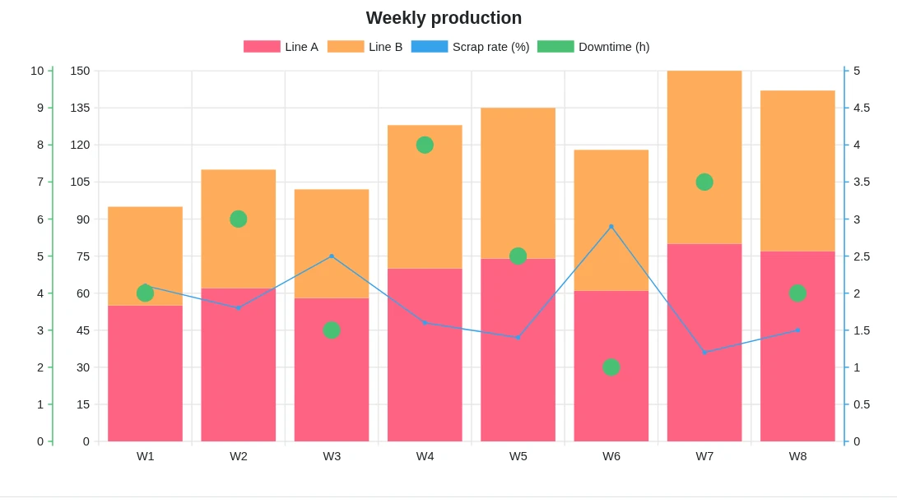
====

== Opzioni personalizzate

Forniamo diverse opzioni per consentire all'utente di personalizzare il grafico utilizzando `DiagramOption`.

.Grafico a barre con DiagramOption
[source,groovy]
----
private static UiDiagramSpecifier barDiagram(boolean isStacked) {
    new UiDiagramSpecifier().ui {
        bar(isStacked, {
            labels "T1", "T2", "T3", "T4"
            dataset 'Truc1', 1.0, 2.0, 1.0, 4.0
            dataset 'Truc2', 2.0, 0.1, 1.0, 0.0
            dataset 'Truc3', 2.0, 0.1, 1.0, 1.0

            option DiagramOption.builder
                    .setTitle("This is a Bar chart !")
                    .hideLegend()
                    .showDataCount()
                    .setKeyColors(Color.RED, Color.ORANGE, Color.YELLOW, Color.GREEN)
                    .setClickAction(Pr2Controller.&onclickBar as MethodClosure)
                    .setResolution(DiagramResolution.DEFAULT_2K)
                    .build()
        })
    }
}
----

.Risultato
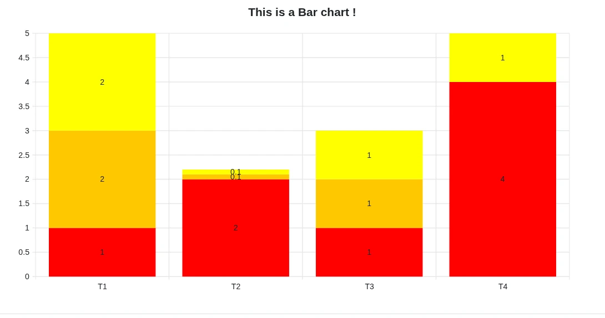

Opzioni disponibili:

* `setTitle`: titolo del diagramma
* `hideLegend`: le legende sono mostrate per impostazione predefinita
* `showDataCount`: mostra i valori sul diagramma (nascosti per impostazione predefinita)
* `setKeyColors`: colori di ciascun dataset (7 colori per impostazione predefinita)
* `setClickAction`: azione chiamata quando si fa clic su una forma; riceve i parametri `key` (nome del dataset), `x` e `y`, più l'id e i parametri specificati (vedi <<clickable-diagram>>)
* `setResolution`: la risoluzione predefinita è SVG: 960x540, da `DEFAULT_540P` a `DEFAULT_4K`
* `setXLabelDateFormat`: vedi <<_different_types_of_xlabels>>
* `setMaxDataNumberToShowByDefault`: limita il numero di dati visualizzati prima dello zoom
* `showTodayLine`: solo per timeline, traccia una linea alla data odierna

[[clickable-diagram]]
== Diagramma cliccabile

Quando è impostata un'azione di clic, facendo clic su una forma (barra, punto, fetta, box, periodo...) viene chiamata l'azione tramite Ajax. L'azione può restituire un blocco, tipicamente una finestra modale, oppure una pagina intera che verrà aperta in una nuova scheda.

.Apertura di una finestra modale al clic su una barra
[source,groovy]
----
def salesPerMonth() {
    taackUiService.show(new UiBlockSpecifier().ui {
        diagram new UiDiagramSpecifier().ui {
            bar false, {
                labels 'Jan', 'Feb', 'Mar', 'Apr', 'May', 'Jun'
                dataset 'Bikes', 12.0, 18.0, 9.0, 21.0, 25.0, 30.0
                dataset 'Scooters', 7.0, 5.0, 11.0, 8.0, 14.0, 12.0
                option DiagramOption.builder
                        .setTitle('Units sold per month')
                        .setClickAction(SalesController.&salesDetail as MC,  <1>
                                [year: 2026])
                        .build()
            }
        }
    }, buildMenu())
}

def salesDetail(String key, String x, String y, Integer year) {         <2>
    int units = new BigDecimal(y).intValue()
    Map<String, Integer> orders = [                                     <3>
            'Acme Corp': units.intdiv(2) as Integer,
            'Globex'   : units.intdiv(3) as Integer,
            'Initech'  : units - units.intdiv(2) - units.intdiv(3)
    ]
    taackUiService.show(new UiBlockSpecifier().ui {
        modal {                                                         <4>
            show new UiShowSpecifier().ui {
                field 'Product', key
                field 'Month', "$x $year".toString()
                field 'Units sold', y
            }
            table new UiTableSpecifier().ui {
                header {
                    label 'Order'
                    label 'Customer'
                    label 'Units'
                }
                orders.eachWithIndex { Map.Entry<String, Integer> o, int i ->
                    row {
                        rowField "SO-$year-$x-${i + 1}".toString()
                        rowField o.key
                        rowField o.value
                    }
                }
            }
        }
    })
}
----

<1> Azione chiamata al clic, con parametri opzionali (o un id)
<2> `key` è il nome del dataset, `x` l'etichetta sull'asse X e `y` il valore; `year` proviene dai parametri passati a `setClickAction`
<3> Dati fittizi, solitamente una query sugli oggetti di dominio
<4> L'azione risponde con una finestra modale, visualizzata sopra il diagramma

.Clic sulla barra "Bikes" di maggio
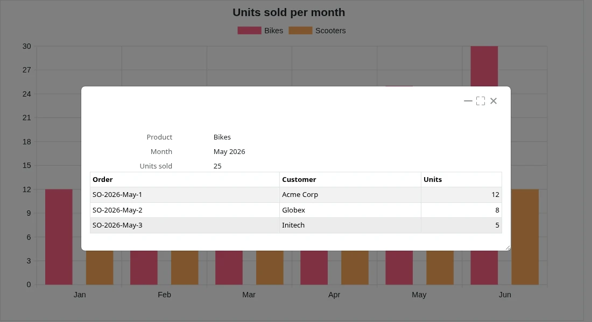

== Metodi aggiuntivi di codifica

[[_different_types_of_xlabels]]
=== Diversi tipi di etichette sull'asse X (xLabels)

Le etichette sull'asse X possono essere di 3 tipi:

- Stringa (`String`, discreto)
- Numero (`Number`, continuo)
- Data (`Date`, continuo)

[source,groovy]
----
diagram new UiDiagramSpecifier().ui({
    line { // X axis: String
        labels "T1", "T2", "T3"
        dataset "test", 10.0, 20.1, 30.0
    }
    line { // X axis: Number
        labels 1.5, 1.7, 3.5
        dataset "test", 10.0, 20.1, 30.0
    }
    line { // X axis: Date
        Date date1 = new Date() // now (2025-02-28 10:55)
        Date date2 = new Date(date1.getTime() + 1000*60*60*2) // 2 hours later
        Date date3 = new Date(date1.getTime() + 1000*60*60*10) // 10 hours later
        labels date1, date2, date3
        dataset "test", 10.0, 20.1, 30.0
        option DiagramOption.builder
                .setXLabelDateFormat(DiagramXLabelDateFormat.HOUR) <1>
                .build()
    }
})
----

<1> `DiagramXLabelDateFormat`: definisce il formato della data da visualizzare e anche l'unità minima di intervallo (poiché l'asse X è continuo)

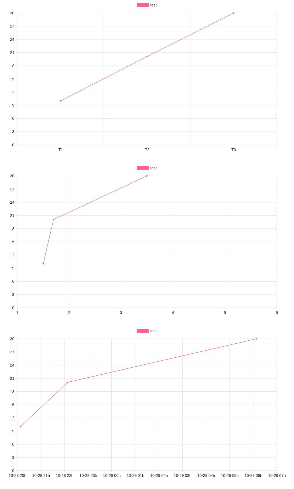

=== Secondo modo per fornire le coordinate dei dati

Spesso utilizzato per un asse X continuo su cui diversi dataset hanno coordinate X differenti.

[source,groovy]
----
diagram new UiDiagramSpecifier().ui({
    // Normal way: different datasets have same X coordinates
    line {
        labels 1.5, 1.7, 3.5

        // 3 data: (1.5, 10.0), (1.7, 20.1), (3.5, 30.0)
        dataset "test1", 10.0, 20.1, 30.0

        // 3 data: (1.5, 1.0), (1.7, 2.0), (3.5, 3.0)
        dataset "test2", 1.0, 2.0, 3.0
    }

    // Second way: different datasets have different X coordinates
    line {
        // 3 data: (1.5, 10.0), (1.7, 20.1), (3.5, 30.0)
        dataset "test1", [1.5: 10.0, 1.7: 20.1, 3.5: 30.0]

        // 2 data: (1.5, 1.0), (6.1, 2.0)
        dataset "test2", [1.5: 1.0, 6.1: 2.0]
    }
})
----

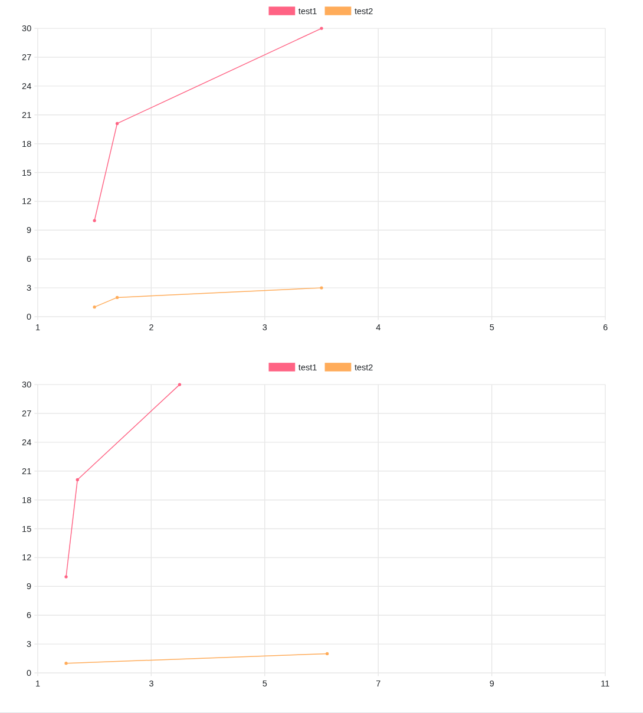

=== DSL per mostrare il conteggio dei dati a intervalli regolari

Abbiamo un gran numero di oggetti e vorremmo avere un diagramma che mostri il numero di oggetti anno per anno (o mese per mese / giorno per giorno / ora per ora) in base al campo `dateCreated` dell'oggetto.

.DSL da utilizzare
[source,groovy]
----
    /**
     * Group the given dates according to DiagramXLabelDateFormat, then count every group and put the result as data to draw.
     *
     * For example:
     *      Knowing DiagramXLabelDateFormat.MONTH (Defined by {@link #labels(DiagramXLabelDateFormat dateFormat)}),
     *      and being given dates: 2025-01-01, 2025-01-10, 2025-01-20, 2025-02-01, 2025-02-10, 2025-03-01.
     *
     *      So they are divided to 3 groups with their own count: [2025-01: 3, 2025-02: 2, 2025-03: 1].
     *      The groups will be used as data to draw:
     *          - xLabels = ["2025-01", "2025-02", "2025-03"]
     *          - yDataList = [3.0, 2.0, 1.0]
     *
     * @param key
     * @param dates
     */
    void dataset(final String key, final Date... dates)
----

.Codice di utilizzo del DSL
[source,groovy]
----
diagram new UiDiagramSpecifier().ui({
    List<Claim> claims = Claim.findAll()
    bar {
        dataset "Claim", claims.collect { it.dateCreated } as Date[]
        option DiagramOption.builder
                .setXLabelDateFormat(DiagramXLabelDateFormat.MONTH) // show claim count month-by-month
                .build()
    }
})
----

.Diagramma
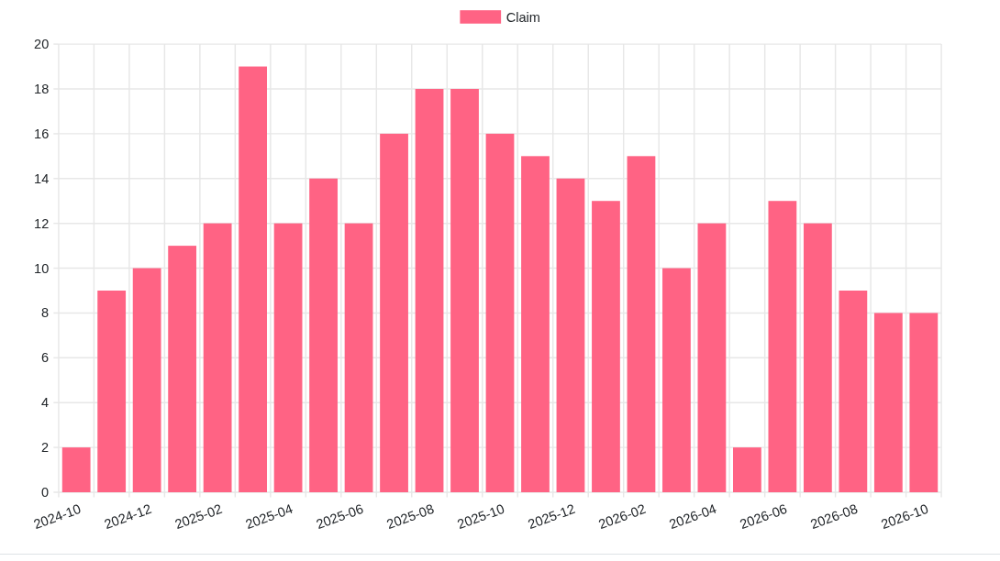

== Parti dinamiche (solo in HTML)

=== Zoom (orizzontale)

Posizionare il mouse sul diagramma, quindi ruotare la rotellina del mouse tenendo premuto CTRL.

- CTRL + rotellina in su per ingrandire.
- CTRL + rotellina in giù per rimpicciolire.

=== Scorrimento (orizzontale)

Posizionare il mouse sul diagramma, tenere premuto il pulsante sinistro del mouse e muovere il mouse orizzontalmente.

WARNING: I valori minimo e massimo di scorrimento sono limitati

=== Tooltip

Il valore di un grafico a barre/linee/... non viene mostrato staticamente per impostazione predefinita. Posizionando invece il mouse su qualsiasi forma, apparirà dinamicamente un tooltip che mostra tutte le informazioni sulla forma selezionata.

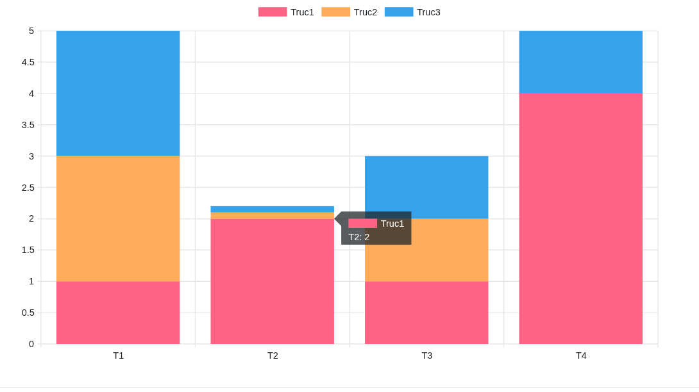

=== Legenda cliccabile

Fare clic sulla legenda di un dataset consente di nascondere o mostrare il dataset corrispondente.

== Gerarchia dei simboli DSL

[graphviz,format="svg",align=center]
.Diagramma della gerarchia dei simboli per Diagram DSL
----
digraph mygraph {
  node [shape=box];
  ui
  ui -> bar, scatter, line, area, pie, whiskers, timeline, custom
  bar, scatter, line, area -> "bar, scatter, line, area (mixed)" [label = "0:N"]
  bar, scatter, line, area, pie, whiskers -> labels [label = "0:1"]
  bar, scatter, line, area, pie, whiskers, timeline -> option [label = "0:1"]
  bar, scatter, line, area, pie -> dataset [label = "1:N"]
  whiskers -> wdataset [label = "1:N"]
  wdataset -> boxData [label = "1:N"]
  timeline -> tdataset [label = "1:N"]
  tdataset -> periodData [label = "1:N"]
}
----
