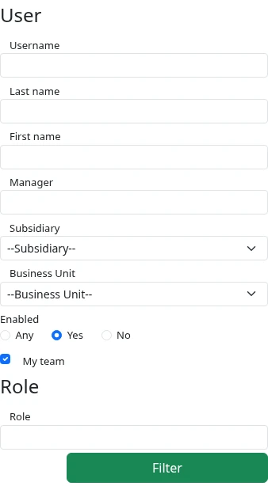
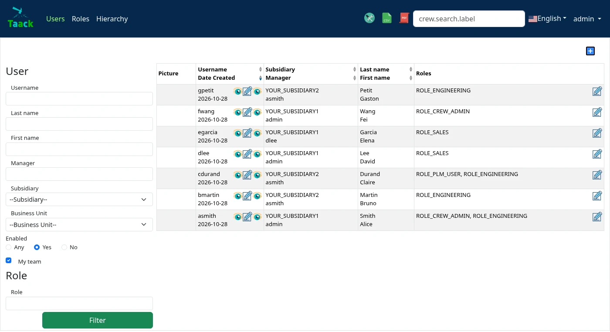
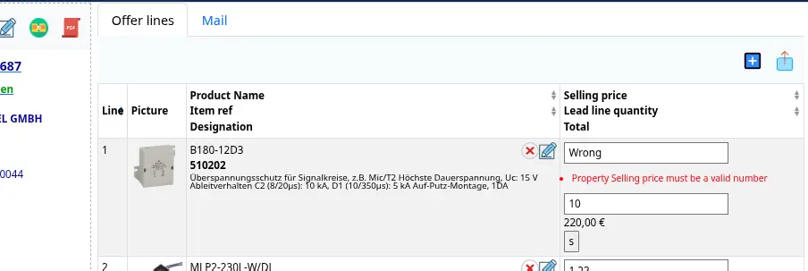

= 筛选与表格 DSL (FilterTable DSL)
:doctype: book
:taack-category: 5|doc/DSLs
:toc:
:source-highlighter: rouge
:icons: font

== 筛选器 (Filter)

* [*] 支持渲染为 HTML
* [ ] 支持渲染为 PDF
* [ ] 支持渲染为邮件 (Mail)
* [ ] 支持渲染为 CSV

.应用于表格的筛选器，来自 <<filter-sample1>>

筛选器 DSL (Filter DSL) 始终与表格 (Table)、图表 (Diagram) 或看板 (Kanban) 关联使用。一个块不能仅包含筛选器。

[[filter-code-sample]]
=== 代码示例

[source,groovy]
[[filter-sample1]]
.筛选器代码示例 1
----
UiFilterSpecifier f = new UiFilterSpecifier()           <1>

f.ui User, {                                            <2>
    section "User", {                                   <3>
    	filterField u.username_                         <4>
    	filterField u.lastName_
    	filterField u.firstName_
    	filterField u.manager_, u.manager.username_     <5>
    	filterField u.subsidiary_
    	filterField u.businessUnit_
    	filterField u.enabled_
    	filterFieldExpressionBool "My Team", true,      <6>
            new FilterExpression(cu.allManagedUsers*.id,
                    Operator.IN,
                    u.selfObject_)
    }
    section "Role", {
    	UserRole ur = new UserRole(role: new Role())
    	filterFieldInverse "Role", UserRole,            <7>
            ur.user_, ur.role_, ur.role.authority_
    }
}
----

<1> 创建筛选器
<2> 通过 `ui` 方法传入对象类以及包含筛选器规格说明的闭包
<3> 创建一个标签为 "User" 的分区
<4> 向筛选器添加字段，请注意字段名称末尾的**下划线**
<5> 如果字段是关联对象，请传入定位到目标筛选字段所需的所有路径步骤
<6> `filterFieldExpressionBool` 支持更复杂的筛选条件，显示为复选框；`true` 为默认值
<7> `filterFieldInverse` 根据指向该用户的 `UserRole` 及其匹配的角色权限来筛选用户

[source,groovy]
[[sample2]]
.筛选器示例 2
----
UiFilterSpecifier f = new UiFilterSpecifier()

CmsImage i = new CmsImage(cmsPage: new CmsPage())

f.ui CmsImage, cmsPage ? [id: cmsPage.id] : null, { <1>
    section "Image", {
        filterField i.hide_
        filterField i.filePath_
        filterField i.imageType_
    }
    section "Origin", {
        filterField i.cmsPage_, i.cmsPage.name_
        filterField i.cmsPage_, i.cmsPage.subsidiary_
        filterField i.cmsPage_, i.cmsPage.pageLayout_
        filterField i.cmsPage_, i.cmsPage.pageType_
    }
}
f
----

<1> 可以向筛选操作传递可选参数

[source,groovy]
[[filter-sample-join]]
.复用筛选器
----
UiFilterSpecifier createReminderFilter(FieldInfo... leftField) {
    Reminder r = new Reminder()
    User u = new User()
    new UiFilterSpecifier(leftField).ui Reminder, {     <1>
        section Reminder, {                             <2>
            filterField r.assignee_, u.username_
            filterField r.status_
            filterField r.title_
        }
    }
}

UiFilterSpecifier createReminderLinkFilter(FieldInfo... leftField) {
    ReminderLink rl = new ReminderLink()
    new UiFilterSpecifier(leftField).ui(ReminderLink, {
        section 'Link', {
            filterField rl.kind_
        }
    }).join(createReminderFilter(rl.reminder_))         <3>
}
----

<1> `leftField` 列出了从外层对象指向 `Reminder` 的字段路径
<2> 分区标签根据类自动计算（i18n）
<3> `reminder` 字段的类型为 `Reminder`，此处直接复用 `Reminder` 类的筛选器

.联合筛选器 (Joined Filters)
image::screenshot-dsl-filter-join.webp[]

[source,groovy]
[[filter-sample-reverse]]
.根据指向被筛选对象的其他对象进行筛选
----
UiFilterSpecifier f = new UiFilterSpecifier().sec PlmFreeCadPart, {  <1>
    PlmFreeCadLink link = new PlmFreeCadLink()
    filterFieldExpressionReverse link.part_, true,                  <2>
        new FilterExpression(null as Object, Operator.NE, link.part_)
}
----

<1> `sec` 创建一个无图形界面的筛选器，始终生效（例如用于安全控制）
<2> 仅列出未被任何 `PlmFreeCadLink` 引用的零件（`true` 代表 `NOT IN`）。它会生成 `sc.id NOT IN (select l.part.id from PlmFreeCadLink l where l.part IS NOT NULL)`

=== DSL 符号层级结构

[graphviz,format="svg",align=center]
.筛选器 DSL 的符号层级图
----
digraph mygraph {
  node [shape=box];
  "ui"
  "ui" -> hiddenId [label = "0,1"]
  "ui" -> "section" [label = "1,N"]
  "ui" -> "filterAction" [label = "0,1"]
  "section" -> "section"
  "section" -> "filterField", "filterFieldInverse" [label = "0,N"]
  "ui", "section" -> "filterFieldExpressionBool", "filterFieldExpressionReverse", "orOp", "andOp", "innerFilter" [label = "0,N"]
}
----

=== DSL 元素

=== 根节点 (Root)
* `ui`：其中一个重载版本允许向筛选操作传递附加参数（参见 <<sample2>>）
* `sec`：无图形界面的筛选器，在显示的筛选器之外额外生效
* `join`：添加关联类的筛选器（参见 <<filter-sample-join>>）

=== 输入项 (Inputs)
* `filterField`：添加要传递给筛选操作的对象字段
* `filterFieldInverse`：当另一个对象指向该对象时对其进行筛选。
* `filterFieldExpressionBool`：允许使用 `FilterExpression` 更改筛选操作中的 `where` 子句，显示为复选框，第二个参数为默认值。
* `filterFieldExpressionReverse`：对子查询执行 `IN` 或 `NOT IN`（参见 <<filter-sample-reverse>>）
* `orOp`、`andOp`：组合多个表达式
* `innerFilter`：在某个字段上复用另一个筛选器

=== 结构 (Structure)
* `section`：添加图形化的筛选分区，以字符串或类命名标签，可选配初始折叠
* `filterAction`：自定义筛选按钮

== 表格 (Table)

* [*] 支持渲染为 HTML
* [*] 支持渲染为 PDF
* [*] 支持渲染为 CSV

pass:[<a class="taackMenu" ajaxAction="/dslSample/table" href="/dslSample/table">&#9654; Try it live</a>]

=== 代码示例

预览图右侧部分对应下方的 DSL 示例。
筛选器位于图片左侧，对应代码请参见 <<filter-sample1>>。

该表格带有**分页**功能，默认按 **Date Created** 列排序，除 Picture 和 Roles 外的所有列均**可排序**。
单个列可以包含多个单元格。
由于筛选器中默认勾选了 "My Team"，因此仅列出当前用户所在团队的成员。

[source,groovy]
[[table-sample1]]
.表格示例：表头、行与默认排序
----
new UiTableSpecifier().ui {
    User u = new User(manager: new User(), enabled: true)
    header {                                                <1>
        column {
            label tr('picture.header.label')                <2>
        }
        column {
            sortableFieldHeader u.username_                 <3>
            sortableFieldHeader u.dateCreated_
        }
        column {
            sortableFieldHeader u.subsidiary_
            sortableFieldHeader u.manager_, u.manager.username_
        }
        column {
            sortableFieldHeader u.lastName_
            sortableFieldHeader u.firstName_
        }
        label tr('default.roles.label')                     <4>
    }

    TaackFilter tf = taackFilterService.getBuilder(User)
            .setSortOrder(TaackFilter.Order.DESC, u.dateCreated_)
            .setMaxNumberOfLine(20).addFilter(f).build()

    iterate(tf) { User ru ->                                <5>
        rowFieldRaw attachmentUiService.preview(ru.mainPicture?.id)
        rowColumn {
            rowAction ActionIcon.SHOW * IconStyle.SCALE_DOWN,   <6>
                CrewController.&showUser as MC, ru.id
            rowAction ActionIcon.EDIT * IconStyle.SCALE_DOWN,
                CrewController.&editUser as MC, ru.id
            rowField ru.username_
            rowField ru.dateCreated_
        }
        rowColumn {
            rowField ru.subsidiary_
            rowField ru.manager?.username
        }
        rowColumn {
            rowField ru.lastName_
            rowField ru.firstName_
        }
        rowField ru.authorities*.authority.join(', ')
    }
}
----
<1> 表格规格说明的表头部分
<2> 不可排序的字段表头
<3> 可排序的字段表头
<4> 如果只有一个字段，可以**不**用 `column` 包裹
<5> `iterate`，指定排序、分页和筛选条件
<6> 调用操作的图标，显示在字段值之前

[source,groovy]
[[table-sample-select]]
.多选功能
----
header {
    columnSelect "selectedUsers", {                         <1>
        columnSelectButton "Disable", CrewController.&disableUsers as MC
    }
    // ...
}
iterate(tf) { User ru ->
    rowSelect ru.id.toString(), true                        <2>
    // ...
}
----
<1> 多选列，包含对所选行调用操作的按钮
<2> 与表头中的 `columnSelect` 对应的列复选框

`ActionIcon` 可以通过 `IconStyle` 进行修饰（例如 `ActionIcon.EDIT * IconStyle.SCALE_DOWN`）。

表格样式由 `Style` 指定，可作为 `row`、`rowColumn` 或 `rowField` 元素的可选参数。

[[table-filter-layout]]
=== HTML 内容：rowField 与 rowFieldRaw

接收 `String` 的 `rowField` 会经过**净化 (sanitized)**：仅保留基本的格式标签和链接，其余内容（如 ``、`
`、脚本等）均会被移除。若要插入您自己构建的 HTML（例如图片预览），请使用按原样输出值的 `rowFieldRaw`。

[source,groovy]
----
iterate(tf) { User ru ->
    rowFieldRaw attachmentUiService.preview(ru.mainPicture?.id)  <1>
    rowField ru.authorities*.authority.join(', ')                <2>
}
----
<1> 由应用程序生成的 HTML，按原样渲染
<2> 纯文本，经过净化处理

WARNING: 切勿将用户输入的数据传递给 `rowFieldRaw`：它不会进行转义，因此可能导致 HTML 或脚本注入。

=== 筛选器布局 (Filter Layout)

[source,groovy]
----
new UiBlockSpecifier().ui {
    tableFilter FilterLayout.TOOLBAR, buildFilter(), buildTable(), {  <1>
        menuIcon ActionIcon.ADD, this.&editUser as MC                 <2>
    }
}
----

<1> `FilterLayout.TOOLBAR` 将筛选器显示为表格上方的工具栏，`FilterLayout.SIDE` 则将其显示在表格旁侧的列中（默认）
<2> 显示在块头部的菜单

[[table-option]]
=== 表格选项 (Table Options)

[source,groovy]
----
TableOption tableOption = TableOption.builder
        .stickyColumns(2)                           <1>
        .onDropAction(this.&dropOnTable as MC)      <2>
        .headerTheme(Style.BLUE)                    <3>
        .build()

new UiTableSpecifier().ui tableOption, {
    // ...
}
----

<1> 当表格水平滚动时保持可见的最左侧列数
<2> 当文件拖放到表格上时调用的操作（`cellDropAction` 可在单元格上实现相同功能）
<3> 表头颜色主题

[[table-inline-edit]]
=== 行内编辑 (Inline Edition)

[source,groovy]
----
iterate(tf) { LeadLine ll ->
    rowQuickEdit(CrmController.&applyLeadLine as MC, ll.id) {   <1>
        rowColumn {
            rowFieldEdit ll.salePrice_                          <2>
            rowFieldEdit ll.qty_
            rowField ll.total, nf                               <3>
        }
    }
}

@Transactional
def applyLeadLine() {
    LeadLine ll = new LeadLine()
    taackSaveService.saveThenReloadOrRenderErrors(LeadLine,
            [ll.qty_, ll.salePrice_] as FieldInfo[])            <4>
}
----

<1> `rowQuickEdit` 声明当值被编辑时要调用的操作
<2> `rowFieldEdit` 在输入框中编辑值；如果用户无权调用该操作，则仅显示该值
<3> 其他字段会在编辑后重新计算
<4> 表格中不可编辑的锁定字段（`lockedFields`）

.带有本地化错误反馈的行内编辑

=== DSL 符号层级结构

.表格 DSL 的符号层级图
[graphviz,format="svg",align=center]
----
digraph mygraph {
  node [shape=box];
  ui
  ui -> header, iterate [label = "0,1"]
  ui -> row,rowIndent [label = "0,N"]
  header -> column, columnSelect [label = "0,N"]
  columnSelect -> columnSelectButton [label = "1,N"]
  column, header -> label, sortableFieldHeader [label = "1,N"]
  row, iterate, rowTree -> rowColumn, innerRow, rowQuickEdit [label = "0,N"]
  rowQuickEdit -> rowColumn [label = "0,N"]
  rowColumn, row, rowTree, iterate -> rowAction, rowField, rowFieldEdit, rowFieldRaw, rowSelect, cellDropAction [label = "0,N"]
  rowIndent -> rowTree [label = "0,N"]
  rowIndent -> rowIndent [label = "0,N"]
}
----
