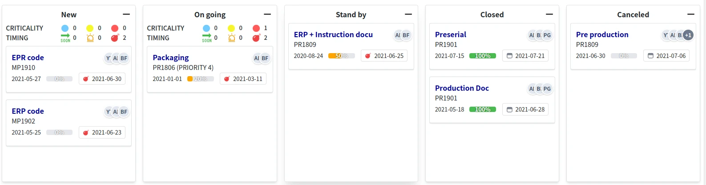

= Kanban DSL
:doctype: book
:taack-category: 6|doc/DSLs
:toc:
:source-highlighter: rouge
:icons: font
:experimental: true

* [*] Renderizzato in HTML
* [ ] Renderizzato in Mail
* [ ] Renderizzato in PDF
* [ ] Renderizzato in CSV

== Esempio di codice
[source,groovy]
.Esempio di codice Kanban 1
----
UiKanbanSpecifier buildTodoKanban() {
    new UiKanbanSpecifier().ui {                                                                   <1>
        column 'To Do', Style.ALIGN_CENTER, {                                                      <2>
            custom "Custom header html code"
        }, Gantt2Controller.&changeTodoProgression as MethodClosure, [newProgression: 0], {
            custom "Custom html code"                                                              <3>
            todos.forEach { Todo todo ->
                card todo, Gantt2Controller.&showTodo as MethodClosure, todo.id, {                 <4>
                    cardField todo.what_                                                           <5>
                    cardFieldRaw "Custom html code"                                                <6>
                    cardAction ActionIcon.SHOW * IconStyle.SCALE_DOWN, Gantt2Controller.&doSomething as MethodClosure, todo.id   <7>
                }
            }
        }
    }
}
----

[source,groovy]
.Azione di rilascio (Drop)
----
@Transactional
def changeTodoProgression(Integer newProgression) {
    Todo todo = Todo.get(params.long('cardId'))                                                    <10>
    todo.progression = newProgression
    render status: 200
}
----

[source,groovy]
.Registrazione del menu contestuale in un servizio
----
@PostConstruct
void init() {
    TaackUiService.registerContextualMenuClosure(Todo, new UiMenuSpecifier().ui { Long id ->    <8>
        menu 'Show Gantt', Gantt2Controller.&showGanttByTodo as MethodClosure, id                 <9>
    })
}
----

<1> Creare lo specificatore kanban
<2> Costruire la colonna kanban con la sua etichetta, lo stile e una closure di intestazione opzionale (solo `custom`); è possibile passare un'azione e dei parametri chiamati al kbd:[Drag+Drop] nella colonna
<3> È possibile aggiungere codice HTML personalizzato per il corpo della colonna
<4> Costruire le schede nella colonna; è possibile passare un'azione e dei parametri per il kbd:[MouseDoubleClic] sulla scheda
<5> Costruire una riga con un campo nella scheda; notare il *trattino basso* (`_`) alla fine del nome del campo
<6> Codice HTML personalizzato, renderizzato così com'è. `cardField` con una `String` viene sanificato (vengono mantenuti solo la formattazione di base e i link); usare `cardFieldRaw` per l'HTML generato dall'applicazione, mai per dati inseriti dagli utenti
<7> È possibile aggiungere un'icona con un'azione associata al clic
<8> Registrare il menu contestuale tramite kbd:[MouseRight] per la scheda
<9> Aggiungere una voce di menu associata a un'azione
<10> L'id della scheda rilasciata viene trasmesso tramite il parametro `cardId`, insieme ai parametri della colonna

Per visualizzare il Kanban in un blocco, utilizzare `kanban` o `kanbanFilter` per associare un filtro:

[source,groovy]
----
taackUiService.show(new UiBlockSpecifier().ui {
    kanbanFilter buildTodoFilter(), buildTodoKanban()
}, buildMenu())
----

== Gerarchia dei simboli DSL
[graphviz,format="svg",align=center]
.Diagramma della gerarchia dei simboli per Kanban DSL
----
digraph kanbanDslGraph {
  node [shape=box];
  ui -> column [label = "0,N"]
  column -> header [label = "0,1"]
  header -> custom [label = "0,N"]
  column -> custom, card [label = "0,N"]
  card -> cardField, cardFieldRaw, cardAction [label = "0,N"]
}
----
