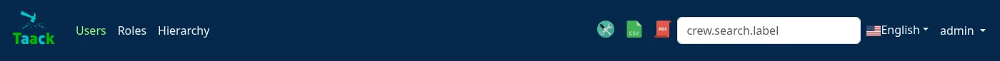

= Menu DSL
:doctype: book
:taack-category: 1|doc/DSLs
:toc:
:source-highlighter: rouge
:icons: font

* [*] Renderizado en HTML
* [ ] Renderizado en Mails
* [ ] Renderizado en PDF
* [ ] Renderizado en CSV

Menu DSL asocia entradas de menú con acciones de nivel superior.
Menu DSL admite como máximo 2 niveles (sin tener en cuenta `section`).

Las entradas se muestran solo si el usuario actual tiene acceso a la acción de destino; las etiquetas se deducen del nombre de la acción si no se especifican (use `lang=test` en la URL para ver las claves i18n).

[source,groovy]
[[menu-sample1]]
.Ejemplo de menú
----
private UiMenuSpecifier buildMenu(String q = null) {
    new UiMenuSpecifier().ui {                                  <1>
        menu CrewController.&index as MC                        <2>
        menu CrewController.&listRoles as MC
        menu CrewController.&hierarchy as MC
        menuIcon ActionIcon.CONFIG_USER, this.&editUser as MC   <3>
        menuIcon ActionIcon.EXPORT_PDF, this.&downloadBinPdf as MC
        menuSearch this.&search as MC, q                        <4>
        menuOptions SupportedLanguage.fromContext()             <5>
    }
}
----

<1> Crear un nuevo menú
<2> Entradas cuyas etiquetas se deducen de la acción
<3> Entradas de icono (mensaje emergente deducido automáticamente)
<4> Cuadro de búsqueda
<5> Entradas de opciones (aquí idiomas), se pueden añadir otros enums que implementen `IEnumOptions`

.Renderizado del menú correspondiente

== Submenús

[source,groovy]
----
new UiMenuSpecifier().ui {
    label 'Roles', {                                    <1>
        subMenu CrewController.&listRoles as MC
        subMenu CrewController.&hierarchy as MC
    }
    menuIcon 'Admin', ActionIcon.CONFIG, {              <2>
        section 'Users', {                              <3>
            subMenu CrewController.&editUser as MC
        }
    }
}
----

<1> Entrada con etiqueta que contiene submenús
<2> Entrada de icono que contiene submenús
<3> `section` agrupa submenús bajo un título

== Menús contextuales

El mismo DSL se utiliza para describir menús contextuales (clic derecho) en campos o clases:

[source,groovy]
----
TaackUiService.registerContextualMenuClosure(
    new Lead().leadStatus_,
    new UiMenuSpecifier().ui { Long id ->
        label 'Change Status'
        Lead.read(id)?.leadStatus?.transitionsTo()?.each {
            menu it.toString(), CrmController.&changeLeadStatus as MC,
                [id: id, leadStatus: it.toString()]
        }
    })
----

== Elementos del DSL

* `menu`: entrada que apunta a una acción, opcionalmente con una etiqueta, un id, un mapa de parámetros o un objeto `Validateable`
* `label`: entrada sin acción, o un grupo de submenús si se proporciona un closure
* `subMenu`, `subMenuIcon`: entradas dentro de un closure `label` o `menuIcon`
* `section`: agrupa submenús bajo un título
* `menuIcon`: entrada de icono en la parte derecha del menú, puede contener submenús
* `menuSelect`: cuadro de selección cuyo valor seleccionado se transmite a la acción actual
* `menuSearch`: cuadro de búsqueda
* `menuOptions`: entradas de opciones (idiomas, filiales, ...)
* `inlineHtml`: código HTML personalizado

[graphviz,format="svg",align=center]
.Diagrama de jerarquía de símbolos para Menu DSL
----
digraph mygraph {
    node [shape=box];
    ui -> menu, label, menuIcon, menuSelect, menuOptions, inlineHtml [label = "0,N"]
    ui -> menuSearch [label = "0,1"]
    label, menuIcon -> subMenu, subMenuIcon, section, inlineHtml [label = "1,N"]
}
----
