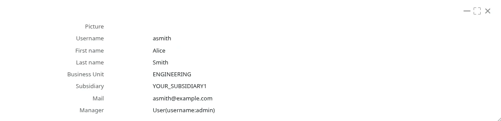
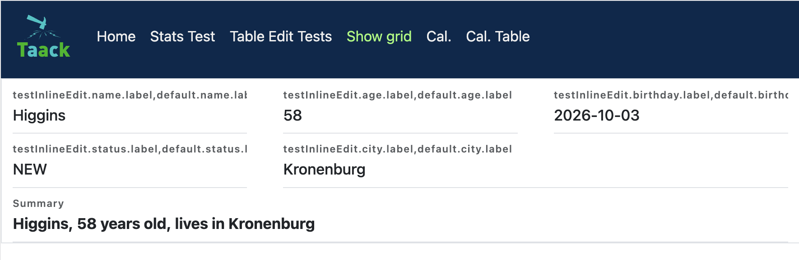

= 数据详情 DSL (Show DSL)
:doctype: book
:taack-category: 4|doc/DSLs
:toc:
:source-highlighter: rouge
:icons: font

* [*] 支持渲染为 HTML
* [*] 支持渲染为 PDF
* [ ] 支持渲染为 CSV

该 DSL 用于展示信息，并具有有限的交互操作能力。字段可以设置样式。

== 代码示例

[source,groovy]
----
UiShowSpecifier buildUserShow(User u) {
    new UiShowSpecifier().ui {
        field 'Picture',                                <1>
            attachmentUiService.previewFull(u.mainPicture?.id)
        fieldLabeled u.username_                        <2>
        fieldLabeled u.firstName_
        fieldLabeled u.lastName_
        fieldLabeled u.businessUnit_
        fieldLabeled u.subsidiary_
        fieldLabeled u.mail_
        fieldLabeled u.manager_
    }
}
----
<1> 显式指定标签和值（此处为 HTML 代码）
<2> 标签由字段推导得出，请注意字段名末尾的**下划线**

.模态窗口中的对应渲染结果

pass:[<a class="taackMenu" ajaxAction="/dslSample/show" href="/dslSample/show">&#9654; Try it live</a>]

== 分区、操作与样式

[source,groovy]
----
new UiShowSpecifier().ui {
    section "Partner", {
        showAction ActionIcon.SHOW * IconStyle.SCALE_DOWN,  <1>
            this.&showContact as MC, partner.id
        fieldLabeled Style.EMPHASIS + Style.BLUE,           <2>
            partner.name_
        fieldLabeled partner.branding_
    }
}
----
<1> 图标显示在下一个字段值的末尾，需要缩小尺寸以适配字段旁的位置
<2> 样式放在最前面，可以使用 `+` 进行组合

== 网格布局 (Grid Layout)

[source,groovy]
----
new UiShowSpecifier().ui ShowLayout.GRID, {                      <1>
    fieldLabeled item.ref_
    fieldLabeled item.name_
    fieldLabeled item.itemStatus_
    fieldLabeled item.gtin_
    fieldLabeled Style.SPAN_TWO, item.labeling_                  <2>
    fieldLabeled Style.BOLD + Style.SPAN_FULL, item.description_ <3>
}
----

<1> `ShowLayout.GRID` 将字段排列在自适应网格上，而不是在单列中垂直排列。默认值为 `ShowLayout.LIST`。
<2> 默认情况下每个字段占据一个网格单元。`Style.SPAN_TWO` / `Style.SPAN_THREE` 可让字段跨越更多列。
<3> `Style.SPAN_FULL` 使字段跨越整行。

网格会根据容器宽度自动适配尽可能多的列，每列宽度至少为 `220px`（可通过 CSS 中的 `taackShowGrid` 类覆盖该最小宽度）。

== HTML 内容

部分元素会按原样输出其 `String` 值，其他元素则会对其进行**净化 (sanitize)**（仅保留基本的格式标签和链接，``、`
` 或脚本会被移除）：

[cols="2,1",options="header"]
|===
|元素 |HTML 处理方式
|`fieldLabeled field_`、`fieldUnlabeled field_` |已净化 (Sanitized)
|`field style, html`（无标签） |已净化 (Sanitized)
|`field label, html` |按原样输出
|`field html`（单参数） |按原样输出
|`inlineHtml html, cssClass` |按原样输出在带有指定 CSS 类的 `div` 中
|===

[source,groovy]
----
new UiShowSpecifier().ui {
    field 'Picture', attachmentUiService.previewFull(u.mainPicture?.id) <1>
    field Style.BOLD, '<b>Summary</b>'                   <2>
    fieldLabeled u.username_                                            <3>
}
----
<1> 带标签字段：图片 HTML 按原样显示
<2> 无标签：经过净化，粗体文本被保留，`` 标签被移除
<3> 域字段的值：经过净化

WARNING: 按原样输出的元素不会进行转义：请仅向其传递由应用程序构建的 HTML，切勿传递用户输入的数据。

== DSL 元素

* `section`：带标签的字段分组
* `fieldLabeled`：标签由字段自动推导（i18n）的字段值
* `fieldUnlabeled`：不带标签的字段值
* `field`：带显式标签的字段（`field 'Print Date', new Date().toString()`）或 HTML 代码（`field Style.ALIGN_CENTER, '<h1>Title</h1>'`）
* `inlineHtml`：原始 HTML 代码，可选配 CSS 类
* `showAction`：调用操作的图标或链接，显示在下一个字段的末尾

== DSL 符号层级结构

[graphviz,format="svg",align=center]
.Show DSL 的符号层级图
----
digraph mygraph {
  node [shape=box];
  ui
  ui -> section [label = "0,N"]
  ui, section -> showAction, field, fieldLabeled, fieldUnlabeled, inlineHtml [label = "0,N"]
}
----
