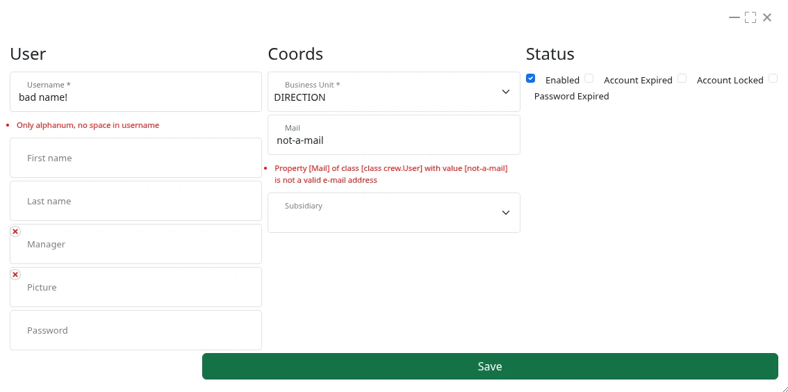

= Aperçu des étapes de développement
:taack-category: 1|doc/UserGuide
:toc:
:source-highlighter: rouge
:icons: font

== Activer le framework Taack

Afin de pouvoir afficher un objet dans un formulaire ou un tableau filtré, sa classe doit être annotée avec l'annotation `@TaackFieldEnum`.

Lorsque l'annotation `@TaackFieldEnum` est spécifiée sur une classe, des symboles supplémentaires sont générés par le framework. Ces symboles se terminent par un tiret bas (`_`) et sont utilisés avec les différents DSL.

=== Cas des classes standard

.Exemple de code pour activer une classe standard
[,groovy]
----
@GrailsCompileStatic                                    <1>
@TaackFieldEnum                                         <2>
final class QueryParameter implements Validateable {    <3>
    Currency currency = Currency.EUR
    Short monthStart = 1
    Short monthStop = 12
    Set<Subsidiary> subsidiaries
    String sellerNamePattern
    String productNameOrCodePattern
    String customerNameOrCodePattern
    Value itemValue
    ItemRange range
    Integer yearStart
    Integer yearStop = Calendar.instance.get(Calendar.YEAR)

    static constraints = {                              <4>
        itemValue nullable: true
        range nullable: true
        monthStart min: 1, max: 12
        monthStop min: 1, max: 12, validator: {         <5>
            queryParameter, monthStop ->
            if (monthStop < queryParameter.monthStart)
                return "monthStop.greater.or.equals.to.monthStart"
        }
    }
}

----

<1> Bonne pratique consistant à ajouter l'annotation `GrailsCompileStatic`
<2> L'annotation activant la transformation AST
<3> La classe doit implémenter `Validateable` pour prendre en charge les contraintes (non nécessaire pour les classes de domaine)
<4> Définition des contraintes
<5> La validation peut être une closure renvoyant une clé de traduction.

Cet exemple de code montre une classe standard (c'est-à-dire non définie dans le répertoire `domain`) activée pour être utilisée dans le framework Taack.
Elle ne peut pas être enregistrée, récupérée ou listée, car il ne s'agit pas d'une classe de domaine persistante.

Elle doit implémenter le trait Grails `Validateable`.

=== Cas des classes de domaine

.Exemple de code pour activer une classe de domaine
[,groovy]
----
@GrailsCompileStatic
@TaackFieldEnum
class CmsPage {                             <1>
    Subsidiary subsidiary
    Date dateCreated
    Date lastUpdated

    User userCreated
    User userUpdated

    Boolean published = false

    CmsPageLayout pageLayout = CmsPageLayout.NO_SIDE_COLUMN
    CmsPageType pageType

    String name

    Map<String, String> urlPart
    Map<String, String> title
    Map<String, String> hatContent
    Map<String, String> bodyContent

    CmsImage mainImage
    CmsVideoFile mainVideo

    Set<CmsImage> bodyImages

    static hasMany = [
            bodyImages: CmsImage
    ]

    static mappedBy = [bodyImages: "none"]

    static constraints = {
        name nullable: true
        urlPart nullable: true
        title nullable: true
        hatContent nullable: true
        bodyContent nullable: true, widget: 'textarea'
        mainImage nullable: true
        mainVideo nullable: true
        bodyImages nullable: true
    }

    static mapping = {
        autoTimestamp true
    }
}
----

<1> Pas besoin d'implémenter `Validateable` dans le cas d'une classe de domaine

Les classes de domaine sont traitées comme des citoyens de première classe au sein du framework Taack. Elles peuvent tirer parti des fonctionnalités avancées fournies par le `TaackSaveService`.

== Manipulation d'objets pour les classes de domaine

=== Lister des objets dans des tableaux

Le Table DSL ajoute le symbole `iterate` qui permet d'afficher une liste d'objets :

[, groovy]
----
TaackFilter tf = taackFilterService.getBuilder(User)        <1>
        .setSortOrder(TaackFilter.Order.DESC, u.dateCreated_)
        .setMaxNumberOfLine(20).addFilter(f).build()

iterate(tf) { User ru ->                                    <2>
    row {                                                   <3>
    }
}
----

<1> Spécifie les filtres, sécurise les listes d'objets et définit certaines contraintes d'affichage
<2> Itère sur ce `TaackFilter` avec une closure `row`
<3> Dessine la ligne...

=== Enregistrer des objets via le Form DSL et afficher les erreurs

Afin d'enregistrer un nouvel objet ou un objet modifié (nous verrons les considérations de sécurité plus loin), appelez simplement la méthode suivante dans l'action cible du formulaire :

[, groovy]
----
taackSaveService.saveThenRedirectOrRenderErrors(User, this.&index)
----

Il existe 3 scénarios possibles :

 * Si l'objet est valide et que l'utilisateur possède les droits requis pour le manipuler, le navigateur sera redirigé vers l'action spécifiée dans le deuxième paramètre.
 * Si l'objet contient des champs invalides, le formulaire sera mis à jour pour mettre en évidence les champs problématiques (voir l'image ci-dessous).
 * Si l'utilisateur n'a pas les droits pour traiter l'objet, une erreur est affichée.

Ici, `index` est l'action vers laquelle rediriger en cas de succès, et `User` est la classe de l'objet.

[[form-html-errors-output]]
.Cas où le formulaire n'est pas valide : retour à l'utilisateur. Notez que les erreurs signalées sont localisées.

