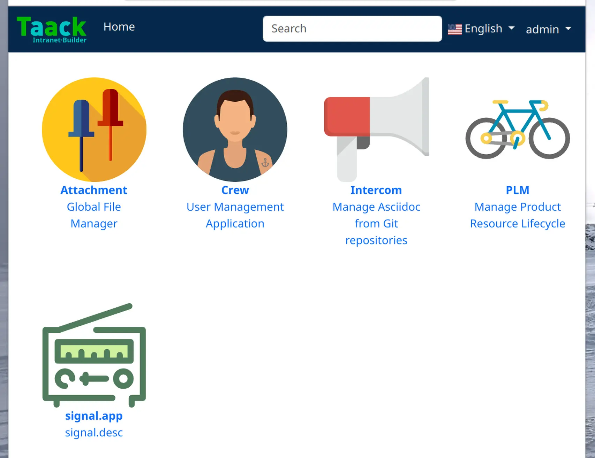

[[_about_plugins]]
= Acerca de los plugins
:doctype: book
:toc:
:source-highlighter: rouge
:taack-category: 1|doc/plugin
:icons: font

== Registrar una aplicación

Una aplicación registra únicamente sus *puntos de entrada* (es decir, las #acciones# que se ejecutan al acceder a la aplicación) y los *iconos SVG* correspondientes. Los nombres de los puntos de entrada del controlador se utilizan para las etiquetas y descripciones localizadas en los archivos de propiedades `i18n`.

.Registro de la aplicación Crew
[source,groovy]
----
@PostConstruct
void init() {
TaackAppRegisterService.register TaackApp(          <1>
        CrewController.&index as MC,                <2>
        new String(
            this.class
            .getResourceAsStream("/crew/crew.svg")  <3>
            .readAllBytes())
    )
}

----

<1> Llamada al método estático `TaackAppRegisterService.register`
<2> Definir el punto de entrada
<3> Icono SVG

== I18n

En las propiedades `i18n`, añada:

[source,properties]
----
crew.app=Crew
crew.desc=User Management Application
attachment.app=Attachment
attachment.desc=Global File Manager
----

== Mosaico de aplicaciones predeterminado

De forma predeterminada, el https://github.com/Taack/intranet/blob/main/server/grails-app/controllers/taack/website/RootController.groovy[`RootController`] en el servidor contiene el punto de entrada. Se puede cambiar fácilmente.

.Mosaico de aplicaciones predeterminado

