= Erste Anwendung

== Wie funktioniert die Anwendung mit dem Taack Framework?

Ihr Intranet-Projekt besteht aus zwei Teilen:

* Die Anwendungs-Plugins im Ordner `app` sind Mikroprojekte mit jeweils eigenen Abhängigkeiten, eigenem Build usw. (z. B. Crew).
Eine ausführlichere Erklärung zur Deklaration von Plugins finden Sie unter link:doc/plugin/taack-plugin.adoc#_about_plugins[Über Plugins].
* Der Hauptserver verwendet alle Anwendungs-Plugins, die in seiner Datei `build.gradle` eingebunden sind, und zeigt sie auf der Hauptseite des Intranets an.

== Ein neues Anwendungs-Plugin erstellen


Stellen Sie vor dem Erstellen eines neuen Anwendungs-Plugins (eines Gradle-Moduls) sicher, dass Sie die neueste Version Ihres Intranets aus unserem GitHub-Repository abgerufen haben (siehe link:install.adoc[Installation]).

.Führen Sie den folgenden Befehl im Stammverzeichnis Ihres Intranets aus:

// setting system properties with the -D flag
// setting project properties with the -P flag

[,bash]
----
$ ./gradlew -DmodName=myBooks server:generateTaackAppTask
----

Dadurch wird ein neuer Ordner `app/myBooks` erstellt.

[NOTE]
====
Ersetzen Sie unter `intranet/app/myBooks/grails-app/domain` das Verzeichnis `myBooks` durch `my.books`. Dadurch wird sichergestellt, dass aus `controllers` und `services` auf die in `domain` erstellten Klassen zugegriffen werden kann, da sie Teil desselben Pakets sind.
====


.Inhalt von myBooks
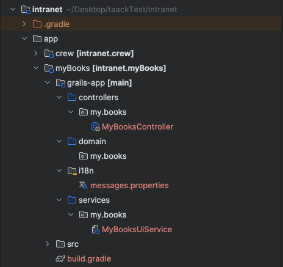

Damit Ihre IDE das neu erstellte Modul erkennt, laden Sie Gradle neu, indem Sie auf das unten gezeigte Symbol klicken:

.Gradle neu laden
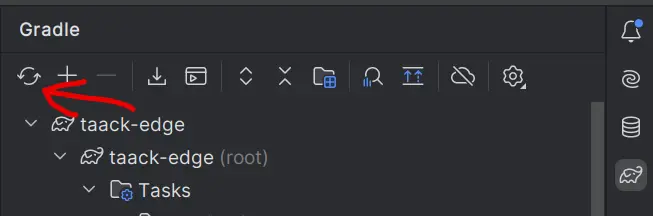

== Zukünftige Updates verwalten

Meistens umfasst die Aktualisierung Ihres Intranets das Aktualisieren des Ordners `buildSrc`, der Datei `gradle.properties` und seltener der `build.gradle`-Dateien der Anwendungen.

[NOTE]
====
Tatsächlich ist dieser Vorgang in der langfristigen Softwareentwicklung üblich und sollte Einsteiger nicht abschrecken.
====

== Ein anwendungsweites Menü erstellen

[sidebar]
====
**TODO:**
Wir werden zwei Menüs erstellen: eines für Bücher und eines für Autoren. In jedem Menü können Sie neue Einträge hinzufügen, sie filtern und alle Einträge in einer Tabelle anzeigen.
====

Konzentrieren wir uns auf die Navigation für Ihre neue Anwendung `myBooks`.
Der erste Schritt besteht darin, festzulegen, wie das Menü aufgebaut wird. Öffnen Sie `grails-app/services/my/books/MyBooksUiService`.

.Sie sollten den folgenden Code sehen (der je nach Version leicht abweichen kann):
[,groovy]
----
static UiMenuSpecifier buildMenu(String q = null) { // <1>
    new UiMenuSpecifier().ui {
        menu MyBooksController.&index as MC
    }
}
----
<1> Fügen Sie `static` hinzu, falls es noch nicht vorhanden ist.

Wir erstellen ein link:doc/DSLs/menu-dsl.adoc[UiMenuSpecifier]-Objekt, um die Menüstruktur zu definieren, und geben dann den anzuzeigenden Inhalt an.

[,groovy]
----
menu MyBooksController.&index as MC
----

In diesem Fall erstellt `menu` einen einfachen Link in der Navigationsleiste. `index` ist der angezeigte Name für den Link, und `MyBooksController.&index` (unter Verwendung von MethodClosure) definiert die Aktion, zu der der Link weiterleitet.


== Klassen erstellen
Erstellen Sie eine Groovy-Klasse namens `Author` in `grails-app/domain/my/books`.


.Eine Klasse erstellen
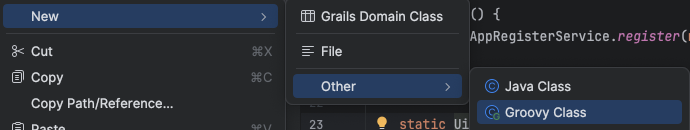


.Fügen Sie den folgenden Code hinzu:
[,groovy]
----
import grails.compiler.GrailsCompileStatic
import taack.ast.annotation.TaackFieldEnum

@GrailsCompileStatic
@TaackFieldEnum
class Author {
    String firstName
    String lastName
    Date dateOfBirth
}
----

Erstellen Sie eine weitere Groovy-Klasse namens `Book` in `grails-app/domain/my/books`.

.Fügen Sie den folgenden Code hinzu:
[,groovy]
----
import grails.compiler.GrailsCompileStatic
import taack.ast.annotation.TaackFieldEnum

@GrailsCompileStatic
@TaackFieldEnum
class Book {
    String title
    String authorName
    int numberOfPages
}
----

[NOTE]
====
Verwenden Sie für Leistung und Typsicherheit immer `@GrailsCompileStatic`. Verwenden Sie `@TaackFieldEnum`, weitere Informationen finden Sie link:doc/UserGuide/DevelopingStepsOverview[hier].
====


== Eine Tabelle erstellen

Zeigen wir nun eine Tabelle auf unserer Seite `listBook` an. Öffnen Sie `grails-app/services/my/books/MyBooksUiService`.

.Erstellen Sie einen neuen Tabellen-Specifier namens `buildBookTable`:
[,groovy]
----

UiTableSpecifier buildBookTable() {
    Book book = new Book()
    UiTableSpecifier bookTableSpecifier = new UiTableSpecifier()
    bookTableSpecifier.ui {
    //Add table content inside the closure here
    }
}

----
Hier definieren wir eine neue Tabelle, die `Book`-Instanzen auflistet. Verwenden Sie `import taack.ui.dsl.UiTableSpecifier`.


.Um die Tabellenüberschriften zu definieren, fügen Sie den folgenden Code in die Closure ein (importieren Sie die erforderlichen Klassen):
[,groovy]
----
bookTableSpecifier.ui {
    // -- Header --
    header {
        column {
            sortableFieldHeader book.title_ //<1>
        }
        column {
            label book.authorName_
        }
        column {
            label book.numberOfPages_
        }
        column {
            label "Delete book"
        }
    }
}
----
<1> Beachten Sie, dass wir hier `sortableFieldHeader` verwenden. Dadurch wird die Spalte sortierbar; Sie können die Bücher durch Klicken auf die Überschrift `book.title` in alphabetischer Reihenfolge sortieren.
Nun füllen wir unsere Tabelle, indem wir mit der Tabellen-DSL-Methode `iterate` über die `Book`-Instanzen in der Datenbank iterieren.

.Fügen Sie den folgenden Code hinzu (initialisieren und importieren Sie die erforderlichen Klassen):
[,groovy]
----
bookTableSpecifier.ui {
    //table headers...

    iterate(taackFilterService.getBuilder(Book) // <1>
        .setMaxNumberOfLine(8) // <2>
        .setSortOrder(TaackFilter.Order.DESC, book.title_) // <3>
        .build()) { Book bookIterator ->
    rowColumn {
        rowField bookIterator.title_ // <4>
    }
    rowColumn {
        rowField bookIterator.authorName_
    }
    rowColumn {
        rowField bookIterator.numberOfPages_
    }
    rowColumn {
        rowAction ActionIcon.DELETE * IconStyle.SCALE_DOWN, // <5>
            MyBooksController.&deleteBook as MethodClosure, bookIterator.id
        }
    }
}

----
<1> Verwenden Sie `import taack.domain.TaackFilterService`.
<2> Es werden nur die ersten acht Bücher angezeigt.
<3> Legt die Anzeigereihenfolge nach dem Titel der Bücher in absteigender Reihenfolge fest (verwenden Sie `import taack.domain.TaackFilter`).
<4> Der Unterstrich ist hier erforderlich.
<5> Verwenden Sie `import taack.ui.dsl.common.ActionIcon
import taack.ui.dsl.common.IconStyle`.

[NOTE]
====
Wir müssen die Aktion `deleteBook` erstellen. Vorerst lassen wir sie leer.
====

Öffnen Sie `grails-app/controllers/my/books/MyBooksController.groovy`.

.Fügen Sie die folgende Methode nach der Aktion `index` hinzu:
[,groovy]
----
def deleteBook () {}
----

Für jedes Buch in unserer Liste erstellen wir eine neue Zeile mit dem Titel des Buches in der ersten Spalte, gefolgt vom Autor, der Seitenzahl und einer Schaltfläche btn:[Delete] in der vierten Spalte.

Ihre Tabelle ist nun fertig; wir müssen sie nur noch auf der Seite rendern.
Um zuvor erstellte UiSpecifier zu rendern, müssen wir `taackUiService` verwenden, das bereits in dem durch den Befehl `create-taack-app` erstellten Controller importiert sein sollte.


Wir tun dies in einer Aktion namens `listBook`: Ersetzen Sie den Inhalt der Methode `index` durch eine Weiterleitung zur Aktion `listBook`.

.Weiterleitung zur Aktion `listBook`:
[,groovy]
----
def index() {
    redirect action: 'listBook'
}
----


.Erstellen Sie eine Aktion namens `listBook` und fügen Sie den folgenden Code hinzu:
[,groovy]
----
UiTableSpecifier tableBookSpecifier = myBooksUiService.buildBookTable() // <1>

        taackUiService.show(new UiBlockSpecifier().ui {
            table tableBookSpecifier
        }, MyBooksUiService.buildMenu())
----
<1> Ruft den von uns erstellten `tableSpecifier` aus `MyBooksUiService` ab.

Verwenden Sie `import taack.ui.dsl.UiTableSpecifier`.

`taackUiService.show(UiBlockSpecifier block, UiMenuSpecifier menu)` ist für das Rendern der übergebenen Spezifikation verantwortlich.
Wir verwenden die zuvor erstellte statische Methode `buildMenu()` aus `MyBooksUiService` als zweites Argument von `show()`, um das Menü zusammen mit der Seite zu rendern.


Sie können nun den Server starten und zu Ihrer neuen Anwendung (`myBooks.app`) navigieren.
Die Tabelle sollte funktionsfähig sein, aber derzeit sehen Sie nur die Tabellenüberschriften, da sich noch keine Bücher in Ihrer Datenbank befinden.
Fahren wir also damit fort, ein Formular zu erstellen und Objekte in der Datenbank zu speichern.


.Leere Büchertabelle
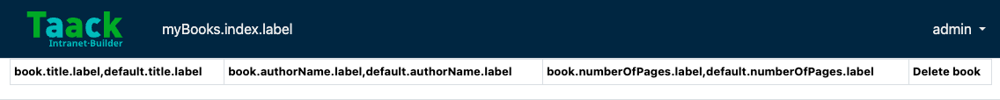


[[_adding_buttons_to_a_table_block]]
== Schaltflächen zu einem Tabellenblock hinzufügen

Fügen wir der Büchertabelle eine Schaltfläche hinzu, die über AJAX ein modales Fenster zum Erstellen eines neuen Buches öffnet.
Dazu müssen wir der Tabelle eine Closure hinzufügen.

.Fügen Sie den folgenden Code hinzu:
[,groovy]
----
taackUiService.show(new UiBlockSpecifier().ui {
    table tableBookSpecifier, {
        //Added Closure here
        menuIcon ActionIcon.CREATE, this.&bookForm as MethodClosure // <1>
    }
}, MyBooksUiService.buildMenu())

----
<1> Sie müssen die Aktion `bookForm` definieren, genau wie wir es bei `deleteBook` getan haben.

Vergessen Sie nicht, `import taack.ui.dsl.common.ActionIcon` zu verwenden.

Starten Sie nun den Server und navigieren Sie erneut zu Ihrer neuen Anwendung. Sie sehen oben rechts in der Tabelle eine Schaltfläche btn:[Create].

.Schaltfläche
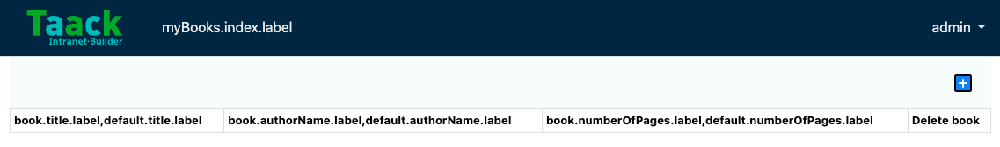

Die Methode `menuIcon` besteht aus den folgenden Parametern:

. Das von der Schaltfläche verwendete Symbol muss ein Enum-Wert von `ActionIcon` sein.
. Die Aktion, zu der die Schaltfläche weiterleitet.

== Ein Formular erstellen und Objekte speichern

Wir erstellen nun das Formular, mit dem Bücher angelegt und aktualisiert werden.
Um beide Fälle abzudecken, initialisieren wir in `MyBooksUiService` ein neues `Book` oder lesen es aus, falls eine Buch-ID in den Anfrageparametern übergeben wurde.

.Erstellen Sie einen neuen Form-Specifier namens `buildBookForm`:
[,groovy]
----
UiFormSpecifier buildBookForm(Book book) {
    book ?= new Book(params) // <1>
}
----
<1> Das bedeutet: Wenn `book` null ist, wird ihm mithilfe der Anfrageparameter eine neue Instanz zugewiesen.

Nun definieren wir das Formular und seinen Inhalt.

.Fügen Sie Folgendes in `buildBookForm` hinzu (importieren Sie die erforderlichen Klassen):
[,groovy]
----
UiFormSpecifier bookFormSpecifier = new UiFormSpecifier()
bookFormSpecifier.ui book, {
    //Section of fields
    section "Book details", {
        field book.title_
        field book.authorName_
        field book.numberOfPages_
    }
    //Save button
    formAction MyBooksController.&saveBook as MethodClosure // <1>
}
----
<1> Sie müssen die Aktion `saveBook` (genau wie `deleteBook`) in `MyBooksController` definieren.

Verwenden Sie `import taack.ui.dsl.UiFormSpecifier`.

Sobald Ihr Formular definiert ist, können Sie es mit der Methode `taackUiService.show()` anzeigen.

.Fügen Sie Folgendes in die Methode `bookForm` in `MyBooksController` ein:
[,groovy]
----
def bookForm(Book book) {
    UiFormSpecifier tableFormSpecifier = myBooksUiService.buildBookForm book

    taackUiService.show new UiBlockSpecifier().ui {
        modal {
            form tableFormSpecifier
        }
    }
}
----

Verwenden Sie `import taack.ui.dsl.UiFormSpecifier`.

Diesmal geben wir in `show` kein `buildMenu` an, da das Menü nicht innerhalb des modalen Fensters gerendert werden soll.

.Passen Sie die Aktion `saveBook` an (importieren und initialisieren Sie die erforderlichen Klassen):

[,groovy]
----
@Transactional
def saveBook() {
    taackSaveService.saveThenReloadOrRenderErrors(Book)
}
----
Verwenden Sie `import taack.render.TaackSaveService` und `import grails.gorm.transactions.Transactional`.

[NOTE]
====
Siehe link:doc/DSLs/block-dsl.adoc#_modal_stack_code_sample[Modales Fenster schließen und Seite neu laden], um zu erfahren, wie Sie die Verwendung von `redirectAction` beim Speichern vermeiden können...
====


Starten Sie den Server erneut. Sie sollten nun auf die Schaltfläche klicken und das Formular ausfüllen können.

.Formular
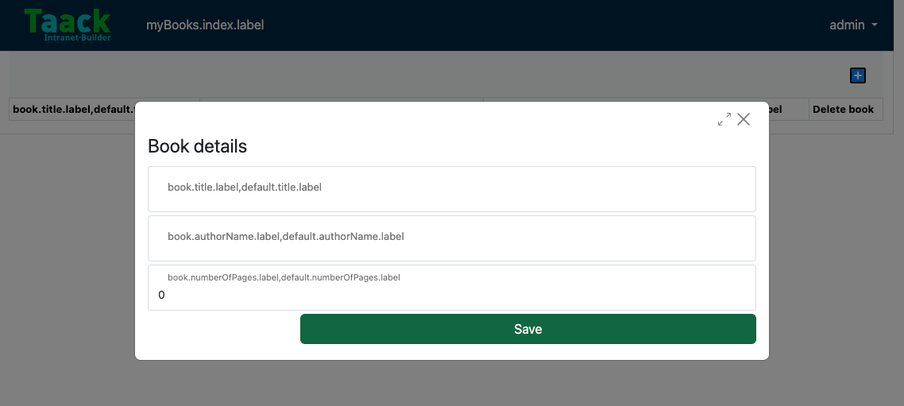

.Gespeicherte Bücher
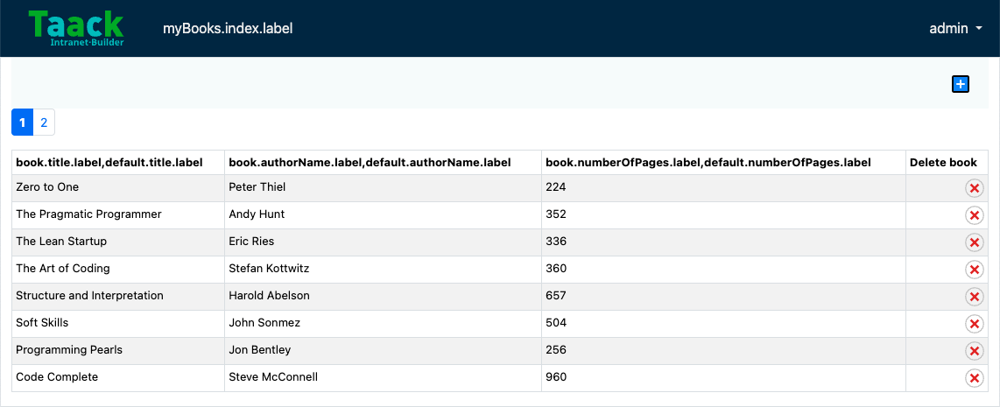

[NOTE]
====
In der oberen linken Ecke können Sie mithilfe der Seitenzahlen (1 oder 2) zwischen den Buchseiten wechseln. Diese Navigation wird angezeigt, weil die Liste auf 8 Bücher pro Seite begrenzt ist.
====

== Ein Objekt anzeigen

Nachdem wir nun Bücher erstellen und in einer Tabelle auflisten können, lassen Sie uns jedes Buch mithilfe eines modalen Fensters genauer anzeigen.
Auch hier definieren wir den Specifier und rendern ihn innerhalb eines Modal-Blocks mit `taackUiService.show()`.


.Erstellen Sie `showBook` (importieren Sie die erforderliche Klasse):
[,groovy]
----
def showBook(Book book) {
    // Define the show displayed fields
    UiShowSpecifier showSpec = new UiShowSpecifier().ui({
        fieldLabeled book.title_
        fieldLabeled book.authorName_
    })

    taackUiService.show(new UiBlockSpecifier().ui {
        modal {
            show showSpec
        }
    })
}
----
Verwenden Sie `import taack.ui.dsl.UiShowSpecifier`.

Außerdem müssen wir in der Tabelle einen Link zu diesem modalen Fenster anzeigen. Fügen Sie dazu in `MyBooksUiService` die folgende Zeile in derselben `rowColumn` (unterhalb des Buchtitelfelds) hinzu, in der die Schaltfläche erscheinen soll:

.Fügen Sie 2 Zeilen in `buildBookTable` hinzu:
[,groovy]
----

UiTableSpecifier buildBookTable() {
    //Section of code
    rowColumn {
        //Add these 2 lines
        rowAction ActionIcon.SHOW * IconStyle.SCALE_DOWN, // <1>
        MyBooksController.&showBook as MethodClosure, bookIterator.id
        rowField bookIterator.title_
    }
    //Section of code
}


----

<1> Hier verringern wir die Größe des Symbols mithilfe des Multiplikationsoperators.

Dadurch wird eine _kleine_ Symbolschaltfläche in der Tabellenzelle erstellt, die ein modales Fenster mit den entsprechenden Buchinformationen öffnet.

Beachten Sie, dass `ActionIcon` in diesem Fall mit einem `IconStyle` multipliziert wurde, um seine Größe zu ändern.

.Objekt anzeigen
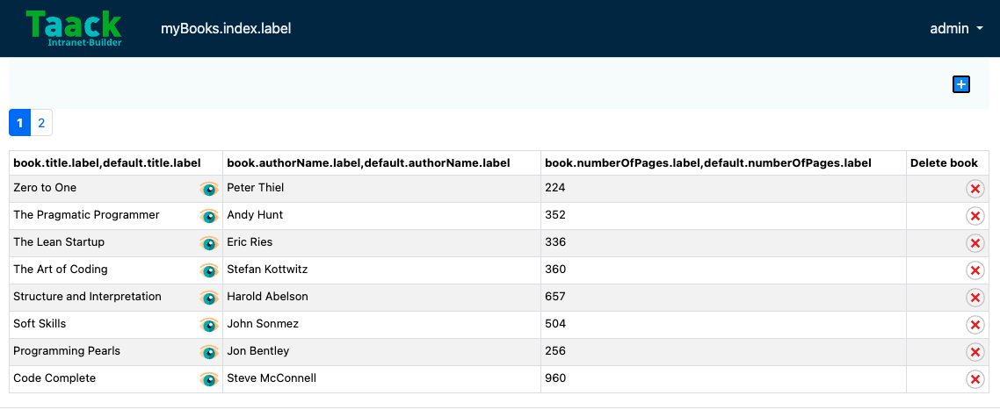
Klicken Sie auf das Augensymbol, um das Buch anzuzeigen.


== Ein Objekt löschen

Erinnern Sie sich an die Schaltfläche btn:[Delete], die wir unserer Tabelle hinzugefügt haben?
Machen wir die Schaltfläche btn:[Delete] nun funktionsfähig, indem wir die von ihr aufgerufene Aktion `deleteBook` definieren.


[,groovy]
----
@Transactional
def deleteBook(Book book) {
    book.delete()
    redirect action: 'index'
}
----

[NOTE]
====
In manchen Fällen ist es besser, ein Feld `enable` hinzuzufügen, um deaktivierte Objekte auszublenden, anstatt sie zu löschen.
====

Wir verwenden die Grails-Methode `delete`, um das Buch aus der Datenbank zu löschen, und leiten dann zur Aktion `index` weiter, in der sich die Büchertabelle befindet.

.Buch löschen
video::first-app-15-delete-book.mp4[Reload,width=800,align="left",options="autoplay,loop,muted"]


Beachten Sie, dass die Feldnamen keine direkten Beschriftungen sind, sondern i18n-Schlüssel wie `book.numberOfPages.label,default.numberOfPages.label` (die auf die i18n-Schlüssel in `messages.properties` verweisen). Ändern wir das!

== Überschriften benennen

Um die Namen der Überschriften festzulegen, öffnen Sie `app/myBooks/grails-app/i18n/messages.properties`.

.Setzen Sie `default.numberOfPages.label` und die anderen Beschriftungen auf Namen Ihrer Wahl:

[,properties]
----
default.authorName.label=Author Name
default.title.label=Title
default.numberOfPages.label=Number of Pages
myBooks.index.label=Books
myBooks.app=Book
myBooks.desc=Book storage
----

Starten Sie den Server, um die aktualisierten Beschriftungen anzuzeigen.

== Filtern
Wenn wir zu viele Bücher hinzufügen, verlieren wir möglicherweise Zeit bei der Suche nach einem bestimmten Buch. Das Filtern der Bücher macht die Buchsuche effizienter. Implementieren wir dies in `MyBooksUiService`.


.Erstellen Sie einen neuen Filter-Specifier namens `buildBookFilter`:
[,groovy]
----
UiFilterSpecifier buildBookFilter(Book book) {
    UiFilterSpecifier bookFilterSpecifier = new UiFilterSpecifier() // <1>

    bookFilterSpecifier.ui Book, { // <2>
        section "Book Filter", {  // <3>
            filterField book.title_ // <4>
        }
    }
}
----
<1> Erstellen Sie den Filter. Verwenden Sie `import taack.ui.dsl.UiFilterSpecifier`.
<2> Übergeben Sie die Objektklasse und die Closure mit den Spezifikationen des Filters über die Methode `ui`.
<3> Erstellen Sie einen Abschnitt mit der Bezeichnung "Book Filter".
<4> Fügen Sie dem Filter ein Feld hinzu; beachten Sie den *Unterstrich* am Ende des Feldnamens.

Der nächste Schritt besteht darin, diesen neu erstellten Filter anzuzeigen.

.Passen Sie `taackUiService.show` in `listBook` (in `MyBooksController`) an:
[,groovy]
----
def listBook() {
    Book book = new Book()
    UiTableSpecifier tableBookSpecifier = myBooksUiService.buildBookTable()
    UiFilterSpecifier filterBookSpecifier = myBooksUiService.buildBookFilter book

    taackUiService.show(new UiBlockSpecifier().ui {
        tableFilter filterBookSpecifier, tableBookSpecifier, {
            menuIcon ActionIcon.CREATE, this.&bookForm as MethodClosure
        }
    }, MyBooksUiService.buildMenu())
}
----
Verwenden Sie `import taack.ui.dsl.UiFilterSpecifier`.

.Filtern
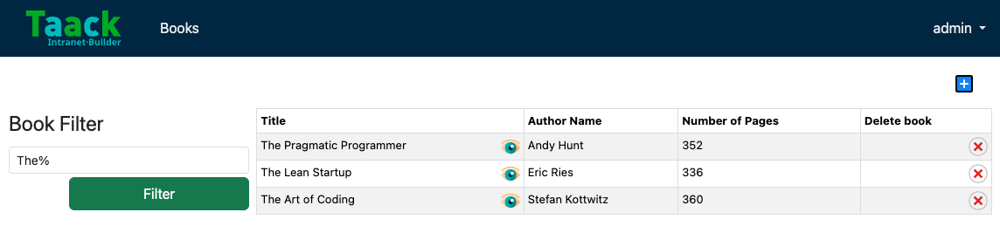


Ausführlichere Informationen zum Filtern finden Sie in der link:doc/DSLs/filter-table-dsl[Filter- und Tabellen-Dokumentation].

== Ein zweites Menü hinzufügen
Erinnern Sie sich an die Klasse `Author`, die wir zu Beginn erstellt haben? Es ist an der Zeit, sie zu verwenden! Wir erstellen ein zweites Menü, in dem wir Autoren hinzufügen und filtern können.

.Fügen Sie diese Codezeile in `buildMenu` in `MyBooksUiService` hinzu:
[,groovy]
----
menu MyBooksController.&listAuthor as MC
----
Dadurch wird in der oberen linken Ecke ein zweites Menü für den Zugriff auf die Autorenseite erstellt.

[NOTE]
====
Sie können auch verschachtelte Untermenüs innerhalb des Hauptmenüs erstellen.
[,groovy]
----
label("Menu", {
    subMenu(MyBooksController.&index as MC)
    subMenu(MyBooksController.&listAuthor as MC)
})
----
Dies erstellt ein Untermenü mit der Bezeichnung "Menu", das einen Link zur Aktion `index` (die der Aktion `listBook` entspricht) und zur Aktion `listAuthor` enthält. Dies ist nützlich, wenn Sie zusammengehörige Links unter einem einzigen Menüpunkt gruppieren möchten.
====
.Fügen Sie die folgenden Builder in `MyBooksUiService` hinzu:
[,groovy]
----
UiTableSpecifier buildAuthorTable(Boolean isSelect = false ) {
    Author author = new Author()
    UiTableSpecifier authorTableSpecifier = new UiTableSpecifier()
    authorTableSpecifier.ui {
        header {
            column {
                sortableFieldHeader author.firstName_
            }
            column {
                sortableFieldHeader author.lastName_
            }
            column {
                label author.dateOfBirth_
            }
            column {
                label "Delete Author"
            }
        }

        iterate(taackFilterService.getBuilder(Author)
                .setMaxNumberOfLine(8)
                .setSortOrder(TaackFilter.Order.DESC, author.lastName_)
                .build()) { Author authorIterator ->
            rowColumn {
                rowField authorIterator.firstName_
                rowAction ActionIcon.SHOW * IconStyle.SCALE_DOWN,
                        MyBooksController.&showAuthor as MethodClosure, authorIterator.id
            }
            rowColumn {
                rowField authorIterator.lastName_
            }
            rowColumn {
                rowField authorIterator.dateOfBirth_
            }
            rowColumn {
                rowAction ActionIcon.DELETE * IconStyle.SCALE_DOWN,
                        MyBooksController.&deleteAuthor as MC, authorIterator.id
            }
        }
    }
}

UiFormSpecifier buildAuthorForm(Author author) {
    author ?= new Author(params)
    UiFormSpecifier authorFormSpecifier = new UiFormSpecifier()
    authorFormSpecifier.ui author, {
        section "Author details", {
            field author.firstName_
            field author.lastName_
            field author.dateOfBirth_
        }
        formAction MyBooksController.&saveAuthor as MC
    }
}

UiFilterSpecifier buildAuthorFilter() {
    Author author = new Author()
    UiFilterSpecifier authorFilterSpecifier = new UiFilterSpecifier()

    authorFilterSpecifier.ui Author, {
        section "Author Filter", {
            filterField author.lastName_
        }
    }
}
----
Beachten Sie, dass `isSelect` in `buildAuthorTable` später verwendet wird.

.Erstellen Sie die Methode `listAuthor` in `MyBooksController`:
[,groovy]
----
def listAuthor() {
    UiTableSpecifier tableAuthorSpecifier = myBooksUiService.buildAuthorTable()
    UiFilterSpecifier filterAuthorSpecifier = myBooksUiService.buildAuthorFilter()

    taackUiService.show(new UiBlockSpecifier().ui {
        tableFilter filterAuthorSpecifier, tableAuthorSpecifier, {
            menuIcon ActionIcon.CREATE, this.&authorForm as MethodClosure
        }
    }, MyBooksUiService.buildMenu())
}
----

.Fügen Sie die erforderlichen Methoden `deleteAuthor`, `saveAuthor`, `authorForm` und `showAuthor` hinzu:
[,groovy]
----
def authorForm(Author author) {
    UiFormSpecifier tableFormSpecifier = myBooksUiService.buildAuthorForm author

    taackUiService.show new UiBlockSpecifier().ui {
        modal {
            form tableFormSpecifier
        }
    }
}

@Transactional
def deleteAuthor(Author author) {
    author.delete()
    redirect action: 'index'
}

@Transactional
def saveAuthor() {
    taackSaveService.saveThenReloadOrRenderErrors(Author)
}

def showAuthor(Author author) {
    UiShowSpecifier showSpec = new UiShowSpecifier().ui(author, {
        fieldLabeled author.firstName_
        fieldLabeled author.lastName_
    })

    taackUiService.show(new UiBlockSpecifier().ui {
        modal {
            show showSpec
        }
    })
}
----

.Setzen Sie die neuen Standardbeschriftungen auf Namen Ihrer Wahl:

[,properties]
----
default.firstName.label=First Name
default.lastName.label=Last Name
default.dateOfBirth.label=Date of Birth
myBooks.listAuthor.label= Authors

----

Sie haben nun getrennte Menüs für Bücher und Autoren, die jedoch derzeit unabhängig voneinander arbeiten. Was wäre, wenn Sie beim Erstellen eines Buches einen Autor direkt aus der Liste der registrierten Autoren auswählen könnten? Implementieren wir diese Funktion.

.Autorentabelle
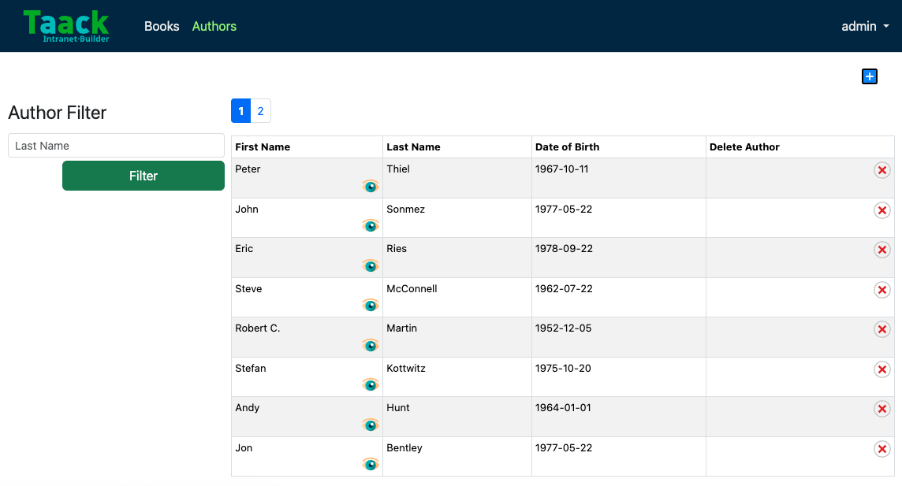


== Autoren mit Büchern verknüpfen

.Fügen Sie der Klasse `Author` die folgende Methode hinzu:
[,groovy]
----
String toString() {
    return firstName + ' ' + lastName
}
----

.Ändern Sie die Variable in der Klasse `Book`:
[,groovy]
----
Author author
----

[NOTE]
====
Ändern Sie in `MyBooksController` und `MyBooksUiService` alle Vorkommen von `book.authorName_` in `book.author_` und `bookIterator.authorName_` in `bookIterator.author_`.
====


[WARNING]
====
Vom Ändern des Namens oder Feldes einer Klasse wird dringend abgeraten, da hierfür die Dateien mit den zuvor hinzugefügten Daten gelöscht werden müssen.
Sie müssen `intranet/server/intranetDb.mv.db` und `intranet/server/intranetDb.trace.db` löschen, um Integritätsfehler zu vermeiden. Dadurch werden alle zuvor gespeicherten Daten gelöscht.
====

.Fügen Sie eine Zeile in `messages.properties` hinzu:
[,properties]
----
default.author.label=Author Name
----

.Passen Sie `buildAuthorTable` in `MyBooksUiService` an:
[,groovy]
----
rowColumn {
    rowField authorIterator.firstName_
    rowAction ActionIcon.SHOW * IconStyle.SCALE_DOWN,
            MyBooksController.&showAuthor as MethodClosure, authorIterator.id
    // Add the following if statement
    if (isSelect)
        rowAction tr('default.role.label'), ActionIcon.SELECT * IconStyle.SCALE_DOWN, authorIterator.id, authorIterator.toString()
}
----
Dadurch wird eine Auswahlschaltfläche hinzugefügt, um beim Ausfüllen von `bookForm` den Autor auszuwählen. Verwenden Sie `import static taack.render.TaackUiService.tr`.

.Passen Sie `buildBookForm` in `MyBooksUiService` an und ersetzen Sie `field book.author_`:
[,groovy]
----
ajaxField book.author_, MyBooksController.&selectAuthor as MC
----
Diese Zeile ruft `selectAuthor` auf, wenn in `bookForm` ein Autor ausgewählt wird.

Implementieren wir nun `selectAuthor`.

.Implementieren Sie `selectAuthor` in `MyBooksController`:
[,groovy]
----
def selectAuthor() {
    UiTableSpecifier t = myBooksUiService.buildAuthorTable true // <1>
    UiFilterSpecifier f = myBooksUiService.buildAuthorFilter()
    taackUiService.show new UiBlockSpecifier().ui {
        modal {
            tableFilter f, t
        }
    }
}
----
<1> Beachten Sie, dass `isSelect` den Wert `true` hat.
Dadurch wird bei der Auswahl eines Autors für das Buchformular eine kompakte Version der `Author`-Tabelle und ihres Filters gerendert.

.Ein Buch mit einem Autor aus der Autorentabelle hinzufügen
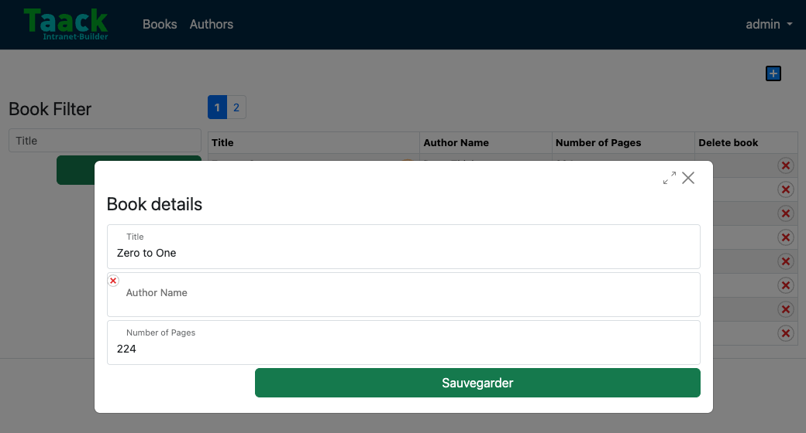

.Den Autor auswählen (klicken Sie auf die blaue Schaltfläche)
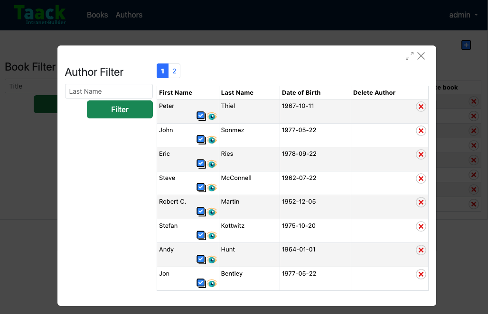


Sie verfügen nun über eine voll funktionsfähige CRUD-Oberfläche für Ihre Entitäten `Book` und `Author` unter Verwendung des Taack-DSL-Frameworks, ohne HTML- oder GSP-Views manuell schreiben zu müssen.


*Sie sind nun bereit, die erweiterten Funktionen des Taack UI Frameworks zu erkunden.*

*Willkommen!*


== Fehlerbehebung und häufige Fehler

.Fehlerausgabe:
[source,console]
----
ERROR: Cannot resolve symbol 'MyBooksUiService'
----
Sie haben vergessen, Gradle nach dem Erstellen des Plugins neu zu laden. Klicken Sie in Ihrer IDE auf die Schaltfläche zum Neuladen von Gradle.

.Fehlerausgabe:
[,console]
----
ERROR:  Field 'authorName_' not found
----
Sie haben das Feld `authorName` in `author` (eine Referenz auf `Author`) umbenannt. Stellen Sie sicher, dass Sie sowohl im Formular als auch in der Tabelle alle Vorkommen von `authorName_` in `author_` geändert haben.

.Fehlerausgabe:
[,console]
----
ERROR: No matching method for action...
----
Stellen Sie sicher, dass Sie die entsprechende Methode in `MyBooksController` deklariert und die `MethodClosure`-Syntax korrekt verwendet haben: `MyBooksController.&myMethod as MethodClosure`.


.Das Formular wird angezeigt, speichert aber nicht:
Möglicherweise fehlt die Annotation `@Transactional` in der Methode `saveBook` oder Sie haben vergessen, `taackSaveService` zu importieren.

.Datenbankfehler nach dem Umbenennen von Feldern:
Wenn Sie Felder in Domänenklassen geändert haben, müssen Sie die Datenbankdateien löschen:
`intranet/server/intranetDb.mv.db`
`intranet/server/intranetDb.trace.db`. Seien Sie vorsichtig, da hierdurch alle zuvor gespeicherten Daten gelöscht werden.

.Datenbank-Connector schreibt Transaktion nicht (kein Flush):

Möglicherweise verwenden Sie die falsche `@Transactional`-Annotation. Achten Sie darauf, diejenige aus dem GORM-Paket und nicht aus Javax zu verwenden.

.Zugriff auf die H2-Datenbankkonsole:

Vielleicht möchten Sie die Datenintegrität und die von der eingebetteten H2-Datenbank generierten DDLs überprüfen.

Dazu müssen Sie die Einstellungen von Spring Security anpassen.

Navigieren Sie zu
Root → /server → /grails-app → /conf

Dort finden Sie die Datei `application.groovy`.

Fügen Sie

```groovy
[pattern: '/h2-console/**',  access: ['permitAll']],
```
zu diesem Konfigurationsblock hinzu:
```groovy
grails.plugin.springsecurity.controllerAnnotations.staticRules = [
	[pattern: '/',               access: ['permitAll']],
	[pattern: '/error',          access: ['permitAll']],
	[pattern: '/index',          access: ['permitAll']],
	[pattern: '/index.gsp',      access: ['permitAll']],
	[pattern: '/shutdown',       access: ['permitAll']],
	[pattern: '/assets/**',      access: ['permitAll']],
	[pattern: '/**/js/**',       access: ['permitAll']],
	[pattern: '/**/css/**',      access: ['permitAll']],
	[pattern: '/**/images/**',   access: ['permitAll']],
	[pattern: '/**/favicon.ico', access: ['permitAll']]
]
```
