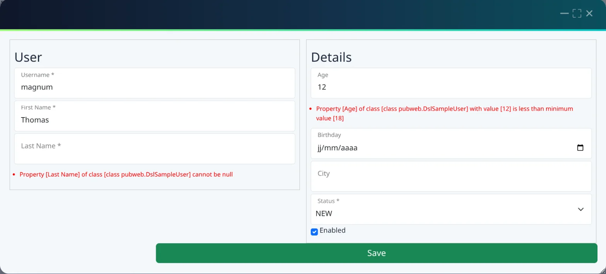
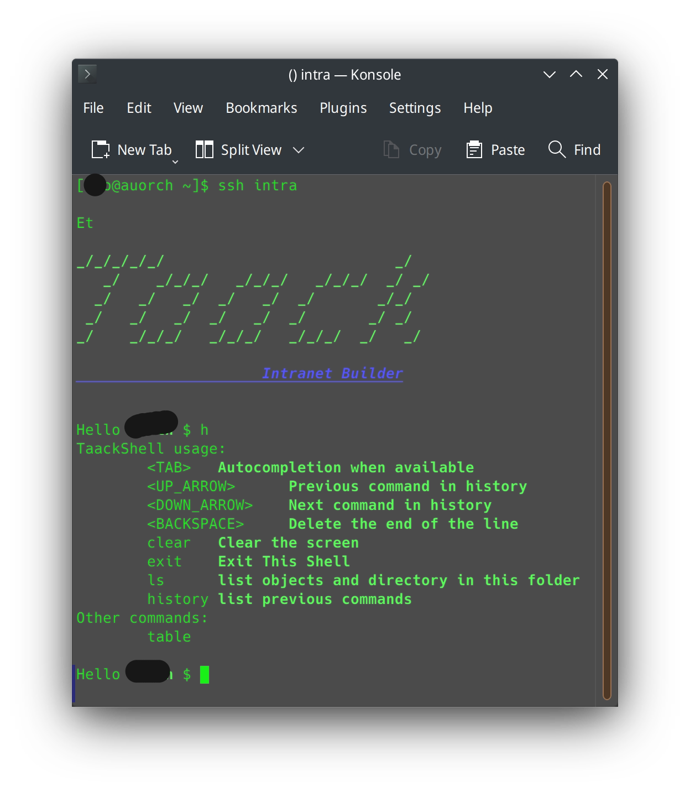
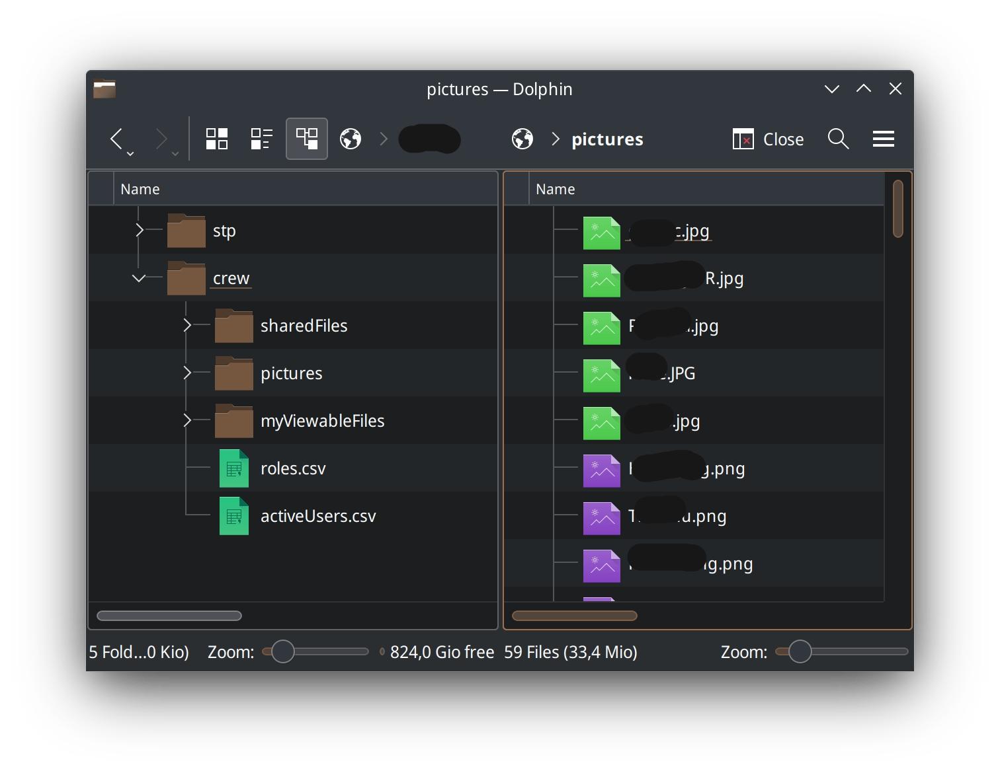

= DSL para Grails
:taack-category: 1
:source-highlighter: rouge
:icons: font

slide::[fn=slideshow-es]

[.home-intro]
== Cree su propia intranet usando un DSL (sin HTML ni JavaScript)

https://github.com/Taack/infra[Taack-UI] es un plugin de https://grails.org/[Grails] que amplía Grails describiendo interfaces de usuario mediante un http://docs.groovy-lang.org/docs/latest/html/documentation/core-domain-specific-languages.html[DSL de Groovy] (Domain Specific Language) con tipado estático.

[.home-grid.home-start]
--
[.home-card]
====
icon:rocket[]

*Instalar*

Configure Java, Grails y su primer servidor Taack.

link:usage-es.adoc#_installation_guide[Guía de instalación →]
====

[.home-card]
====
icon:graduation-cap[]

*Primera aplicación*

Paso a paso: una tabla, un formulario, un filtro, un menú.

link:usage-es.adoc#_first_app[Cree su primera aplicación →]
====

[.home-card]
====
icon:play-circle[]

*Probar los DSL*

Cada página de DSL abre sus ejemplos en vivo, en una ventana modal.

link:doc/DSLs/form-dsl-es.adoc[Explorar los DSL →]
====
--

[.home-news]
****
*Última versión: 0.7.11* (con 0.7.10): nuevos temas seleccionables desde el menú de configuración y un guardado rediseñado que evita el binding.
link:news-es.adoc[Todas las noticias →]
****

== Del código a la pantalla

Un formulario ocupa unas pocas líneas de Groovy. Los campos son símbolos generados a partir de su clase (`username_`), por lo que el compilador los verifica; las restricciones se convierten en mensajes de error localizados.

[.home-split]
--
[source,groovy]
----
def form() {
    DslSampleUser u = new DslSampleUser()
    taackUiService.show(new UiBlockSpecifier().ui {
        modal {
            form createForm(u, {
                row {
                    col {
                        section 'User', {
                            field u.username_
                            field u.firstName_
                            field u.lastName_
                        }
                    }
                    col {
                        section 'Details', {
                            field u.age_
                            field u.birthday_
                            field u.city_
                            field u.status_
                            field u.enabled_
                        }
                    }
                }
                formAction this.&saveForm as MC
            })
        }
    })
}
----

--

pass:[<a class="taackMenu" ajaxAction="/dslSample/form" href="/dslSample/form">&#9654; Try it live</a>]

== Características

[.home-grid]
--
[.home-card]
====
icon:shield[]

*Seguridad por campo*

Los objetos se muestran y editan según los permisos del usuario en *cada campo*. Los enlaces y acciones de formulario que el usuario no puede ejecutar se ocultan automáticamente.

link:doc/UserGuide/Security-es.adoc[Seguridad →]
====

[.home-card]
====
icon:file-pdf-o[]

*Un DSL, todas las salidas*

La misma descripción se renderiza en *HTML*, *PDF*, *correos electrónicos* y *CSV*.

link:doc/DSLs/block-printable-dsl-es.adoc[DSL imprimible →]
====

[.home-card]
====
icon:language[]

*Localizado y validado*

Las etiquetas provienen de archivos i18n y los errores de validación se localizan sin código adicional.

link:doc/DSLs/form-dsl-es.adoc#_form_validation[Validación de formularios →]
====

[.home-card]
====
icon:table[]

*Filtrar, ordenar, paginar*

Tablas y filtros sin escribir consultas ni mantener datos de sesión.

link:doc/DSLs/filter-table-dsl-es.adoc[DSL de filtros y tablas →]
====

[.home-card]
====
icon:search[]

*Búsqueda de texto completo*

Indexación con Solr de objetos de dominio con tipado estático, con facetas y clasificación. Las vistas previas de archivos se pueden ampliar.

link:more/Search/Search-es.adoc[Búsqueda →]
====

[.home-card]
====
icon:database[]

*JDBC sobre su modelo*

Consulte objetos de dominio con TQL (Taack Query Language) desde IntelliJ, DBeaver o LibreOffice Base.

link:more/JDBC/taack-jdbc-driver-es.adoc[Controlador JDBC de Taack →]
====

[.home-card]
====
icon:terminal[]

*SSH y SFTP*

Una interfaz de consola ejecutándose dentro del proceso del servidor y un sistema de archivos virtual por usuario, con verificación de credenciales (módulo `taack-ui-ssh`).

<<ssh_sftp,Capturas de pantalla ↓>>
====

[.home-card]
====
icon:code-fork[]

*Servidor Git*

La aplicación Intercom sirve Git sobre SSH: la documentación escrita en AsciiDoc se envía mediante push y luego se renderiza.

link:app/Intercom-es.adoc[Intercom →]
====
--

== ¿Por qué Taack?

[.home-compare,cols="2,3,3,3",options="header"]
|===
|
|Taack
|Grails con GSP
|Front-end en JavaScript

|UI escrita en
|DSL de Groovy, con tipado estático
|Plantillas GSP, HTML, CSS
|JavaScript o TypeScript, más una API REST

|Nombres de campos verificados
|En tiempo de compilación
|En tiempo de ejecución
|Depende del contrato de la API

|Permisos por campo y acción
|Integrados, enlaces ocultados automáticamente
|Escritos a mano
|Escritos a mano, en ambos lados

|PDF, CSV, Correos
|El mismo DSL que en pantalla
|Código separado
|Código separado

|Lenguajes necesarios
|Groovy
|Groovy, HTML, CSS, JavaScript
|Groovy o Java, JavaScript, HTML, CSS
|===

== Creado con Taack

[.home-grid.home-apps]
--
[.home-card]
====
image::screenshot-dsl-table.webp[Crew]

*Crew*: usuarios, roles y jerarquía.

link:app/Crew-es.adoc[Crew →]
====

[.home-card]
====
image::plm12-screenshot.webp[FreeCAD PLM]

*FreeCAD PLM*: uso compartido de modelos FreeCAD y control de versiones lineal.

link:app/Plm-es.adoc[FreeCAD PLM →]
====

[.home-card]
====
image::news-table2.webp[Intercom]

*Intercom*: servidor SSH y Git, documentación en AsciiDoc publicada mediante Git.

link:app/Intercom-es.adoc[Intercom →]
====

[.home-card]
====
image::step-preview1.webp[Viewers]

*Viewers*: conversión y vista previa de archivos, como modelos STEP.

link:app/Viewers-es.adoc[Viewers →]
====

[.home-card]
====
image::collabora-editor.webp[Collabora Editor]

*Collabora Editor*: edición en línea de archivos adjuntos de oficina con Collabora.

link:app/Collabora-Editor-es.adoc[Collabora Editor →]
====
--

[[ssh_sftp]]
== SSH y SFTP

[.home-split]
--
[[ssh_screenshot]]
.Sesión de servidor SSH

[[sftp_screenshot]]
.Explorador de archivos SFTP

--
