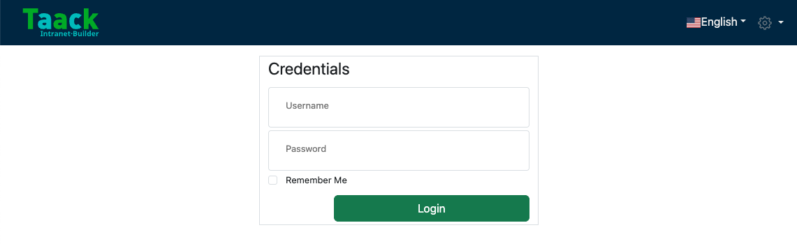
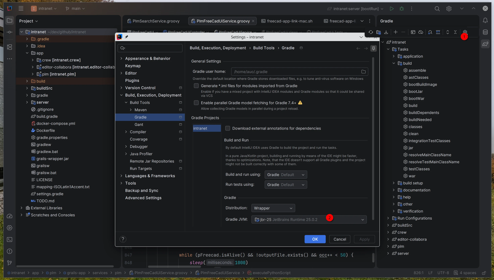

= 安装指南

== 环境要求

在开始之前，请确保您的计算机上已安装以下工具：

* *Java* (JDK 25 ...)
* *Git*
* https://github.com/unoconv/unoserver[unoserver]

=== 安装前置依赖

==== macOS (Homebrew)

.使用 Homebrew 安装 JDK 24 和 Git
[source,bash]
----
$ brew install openjdk@25
$ brew install git
----

==== Windows (Winget)

.使用 Winget 安装 JDK 25 和 Git
[source,bash]
----
winget install --id Microsoft.OpenJDK.25
winget install --id Git.Git
----

== 克隆开箱即用的内网项目

.克隆初始仓库：

[source,bash]
----
$ git clone https://github.com/Taack/intranet.git
----

该仓库包含一个最小化的内网骨架（Crew 用户管理 + *Spring Security 插件*），可直接用于开发。

== 启动您的内网

.进入刚刚克隆的 intranet 目录并启动服务器：

[source,bash]
----
$ cd intranet
$ ./gradlew server:bootRun
----

[NOTE]
====
`./gradlew` 命令使用 Gradle Wrapper，因此您无需手动安装 Gradle。
====

.构建完成后，您将看到：
[source,bash]
----
Grails application running at http://localhost:9442
----

[sidebar]
====
**TODO：**
在浏览器中访问该地址以进入内网。
请使用默认登录凭据：

* **用户名**：`admin`
* **密码**：`ChangeIt`
====

.登录凭据

若要修改默认的管理员密码，请编辑以下文件：

* `server/grails-app/conf/application.yml`
* `server/grails-app/conf/application-MACOSX.yml`

找到以下行：
[source,yaml]
taack.admin.password: ChangeIt

完成修改后，删除 `intranetDb.mv.db` 文件以使新密码生效。

[NOTE]
====
`application-MACOSX.yml` 仅在应用检测到 macOS 环境时使用。如果您使用的是 Linux 或 Windows，该文件将被忽略。
====

[WARNING]
====
删除 `intranetDb.mv.db` 文件将永久清除之前存储的所有数据。
====

=== 配置持久化数据库

如果您希望持久化保存数据，请修改 `server/grails-app/conf/application.yml` 和
`server/grails-app/conf/application-MACOSX.yml` 文件以使用持久化数据库。

.这里我们让 H2 在开发模式下将数据持久化到文件中：

[source,yaml]
----
environments:
    development:
        dataSource:
            dbCreate: update        <1>
            url: jdbc:h2:./intranetDb;LOCK_TIMEOUT=10000;DB_CLOSE_ON_EXIT=FALSE <2>
----

<1> 创建模式（请参阅 Grails GORM 文档）
<2> `intranetDb`：数据文件名的根名称

=== 生成用于 Tomcat 的 Jar 文件

.使用 assemble 任务代替 bootRun：

[source,bash]
----
$ ./gradlew server:assemble
----
打包好的 JAR 文件（例如 `server-0.6.jar`）将位于 `server/build/libs` 目录下。

.您可以将其部署到生产服务器或在本地进行测试

[source,bash]
----
cd server/build/libs
java -jar server-[version].jar   <1>
----
<1> 版本号位于 `build.gradle` 中，默认值为 0.6

[TIP]
====
启动新实例时，请确保该应用程序尚未在运行。
====

== 配置您的 IDE

我们强烈建议使用最新版本的 *IntelliJ Ultimate Edition*，以获得对 *Groovy* 和 *Grails* 的全面支持。

=== IntelliJ Ultimate Edition

我们建议安装 *IntelliJ Taack 插件*，您可以从 IntelliJ 插件市场 https://plugins.jetbrains.com/plugin/20792-taackuiastautocomplete[TaackUiASTAutocomplete] 安装，或直接从 https://github.com/Taack/infra/releases/tag/v0.1[源代码仓库]安装。

打开项目：依次点击 File > Open... 并选择 `intranet/settings.gradle`。

确保 Gradle 使用的是 JDK 25：

.打开 Gradle 设置并检查 Gradle JDK 版本

<1> 打开 Gradle 设置
<2> 确认 Gradle JVM 版本为 25（发行版提供商不限）

=== Visual Studio Code

如果您更倾向于使用 Visual Studio Code，我们建议安装以下扩展来配合本框架使用：

* https://marketplace.visualstudio.com/items?itemName=vscjava.vscode-java-pack[Extension Pack for Java]
* https://marketplace.visualstudio.com/items?itemName=marlon407.code-groovy[code-groovy]
* https://marketplace.visualstudio.com/items?itemName=vscjava.vscode-gradle[Gradle for Java]
* https://marketplace.visualstudio.com/items?itemName=MellowMarshmallow.groovy[Groovy]

[NOTE]
====
VS Code 无法识别 Grails 和 Taack 框架的大部分特性，包导入、代码导航和代码提示功能可能会受到限制。为了获得完整支持，IntelliJ 仍然是首选 IDE。
====
