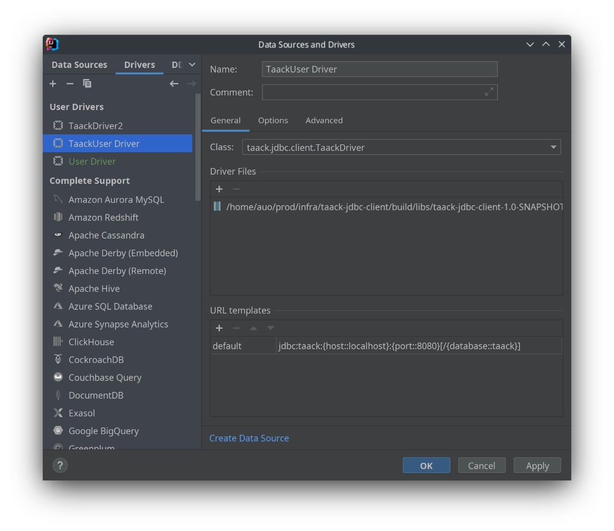
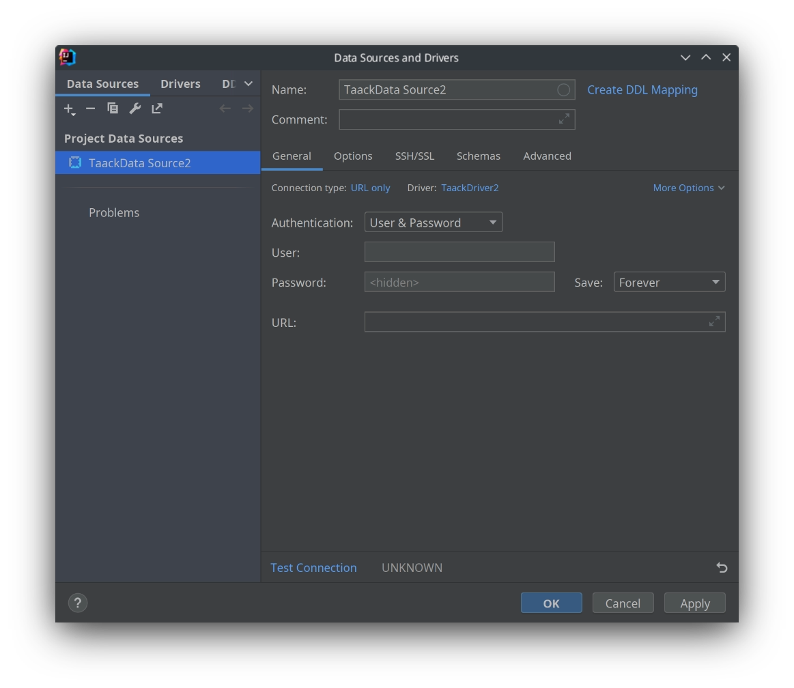

= Intellij JDBC 连接
:doctype: book
:taack-category: 1|more/JDBC
:source-highlighter: rouge
:toc:
:icons: font

== 添加驱动程序

在数据库面板中点击 `+` 号，然后点击 `Driver`



添加驱动类后应会自动设置 `Class` 字段

== 为此驱动程序添加数据源

在数据库面板中点击 `+` 号，然后点击 `Data Source`，接着选择您在上一步中设置好名称的驱动程序。



使用您的 Intranet 用户名和密码。

URL 应该如下所示：

```
jdbc:taack:localhost:8080/taack
```

对于非本地主机，我们强制使用 https 连接。

== 查询

您应该能够浏览领域类、导出 CSV 数据或执行 TQL 查询。
