= Libreoffice Base
:doctype: book
:taack-category: 1|more/JDBC
:source-highlighter: rouge
:toc:
:icons: font

== Configurer LibreOffice pour utiliser le JDK 17

Cliquez sur l'outil `Tools` > `Options`, puis dans la boîte de dialogue *Options - LibreOffice - User Data*, cliquez sur `LibreOffice` > `Advanced` dans l'arborescence.

La case `Use a Java runtime environment` doit être cochée, et vérifiez qu'un JRE version 17 est détecté.

Si ce n'est pas le cas, installez Java 17 et répétez le processus. Vous pouvez cliquer sur le bouton `Add` et suivre la procédure s'il n'est pas détecté mais que vous savez qu'il est installé.

.Java 17 est détecté et sélectionné
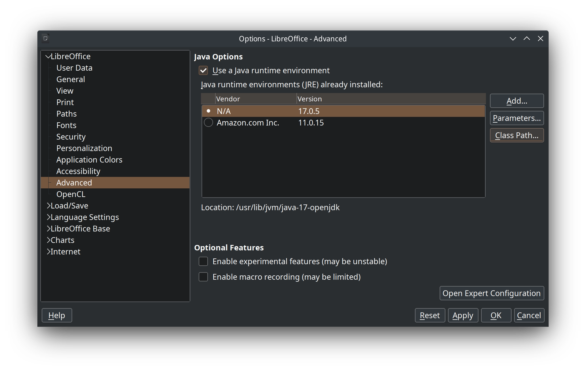

Cliquez sur le bouton `Apply` ou `Ok`.

== Ajouter le pilote Jar

Téléchargez https://github.com/Taack/infra/releases/tag/v0.1[taack-jdbc-client-0.2-SNAPSHOT-all.jar]

Revenez à la boîte de dialogue avancée.

Cliquez sur `Class Path...`, dans la boîte de dialogue, cliquez sur `Add Archive...`, puis sélectionnez le fichier que vous avez téléchargé.

.Pilote ajouté à l'environnement d'exécution
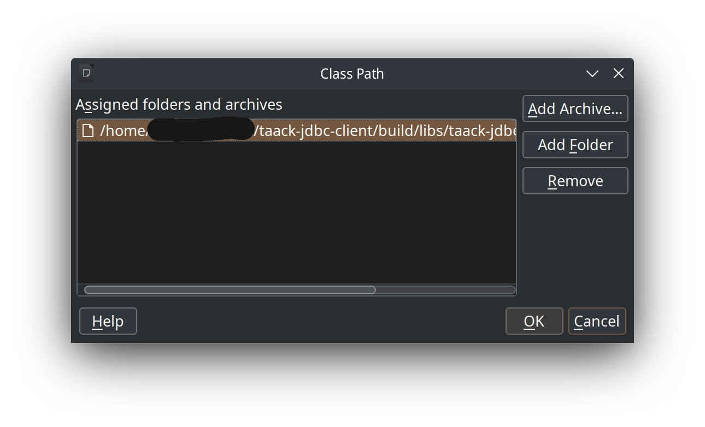

Cliquez sur le bouton `Ok`.

== Créer un fichier LibreOffice Base

Ouvrez #LibreOffice#, cliquez sur `Base Database`

=== Sélectionner JDBC

.Étape 1 : Sélectionner JDBC
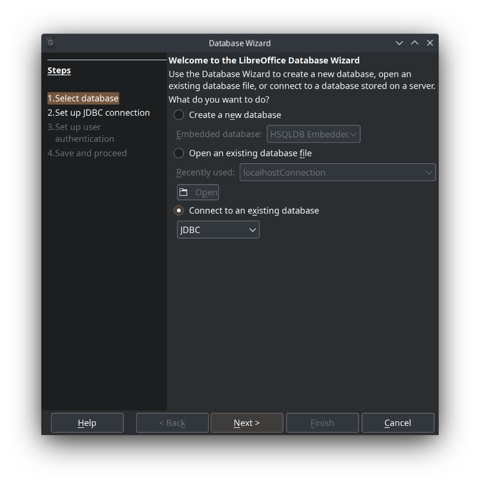

Cliquez sur le bouton `Next`.

=== Entrer l'emplacement du pilote dans le Jar

jdbc : `taack:localhost:8080/taack`

Remplacez localhost et le port par l'URL et le port de votre instance.

Classe du pilote JDBC : `taack.jdbc.client.TaackDriver`

.Étape 2 : Chaîne de connexion du pilote
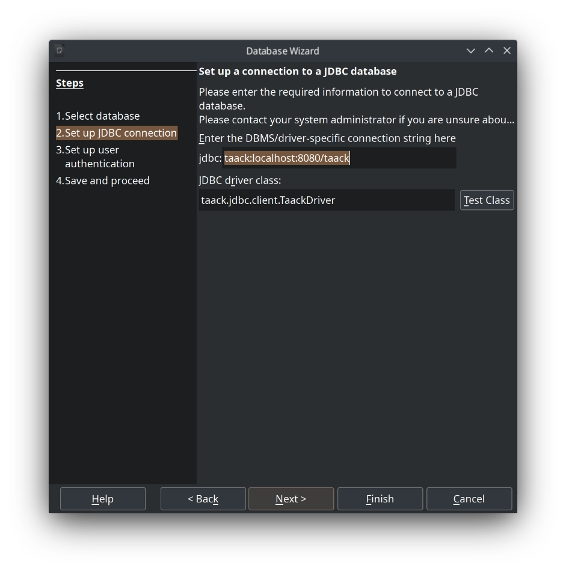

=== Définir le nom d'utilisateur

Le `User name` doit être un utilisateur actif de votre application Intranet (avec `ROLE_ADMIN` ou `ROLE_JDBC_ADMIN`).

Voir https://github.com/Taack/infra/blob/main/taack-ui/grails-app/controllers/taack/support/TaackJdbcController.groovy[la classe TaackJdbcController].

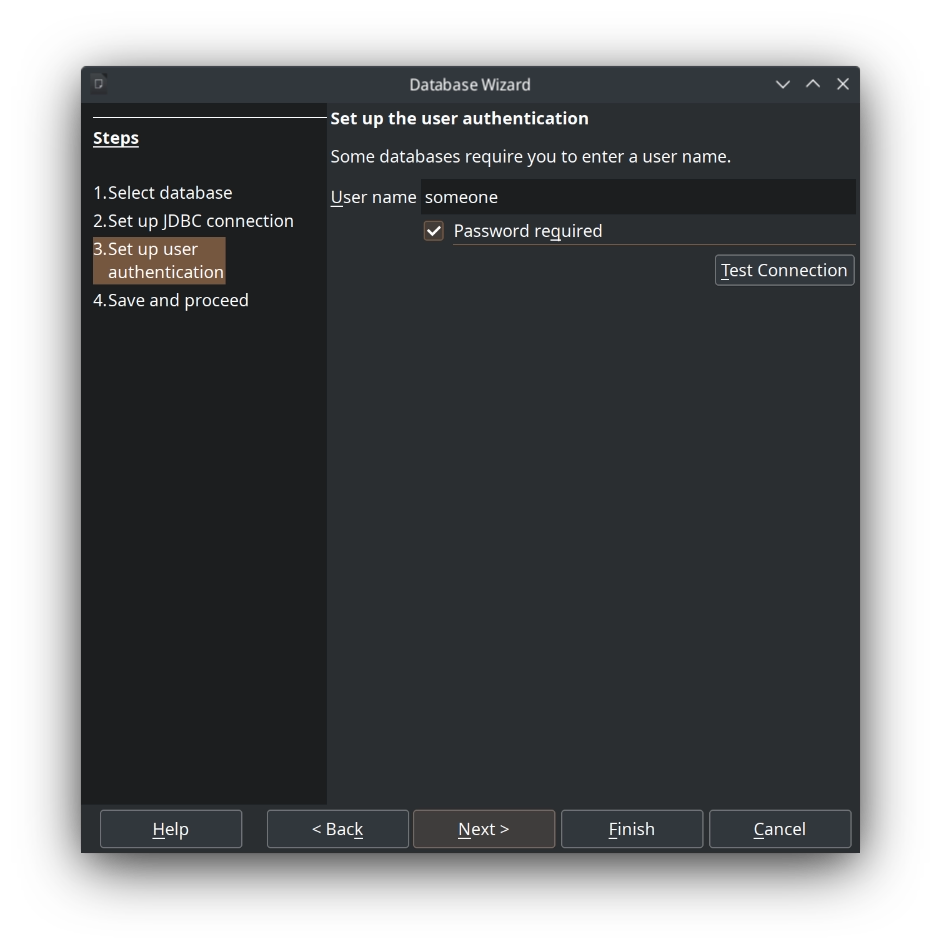

Cliquez sur le bouton `Finish`, puis définissez un nom de fichier.

== Utilisation dans Base

Ouvrez le fichier enregistré à l'étape précédente et saisissez votre mot de passe lorsque vous y êtes invité.

.Tables lues par le pilote
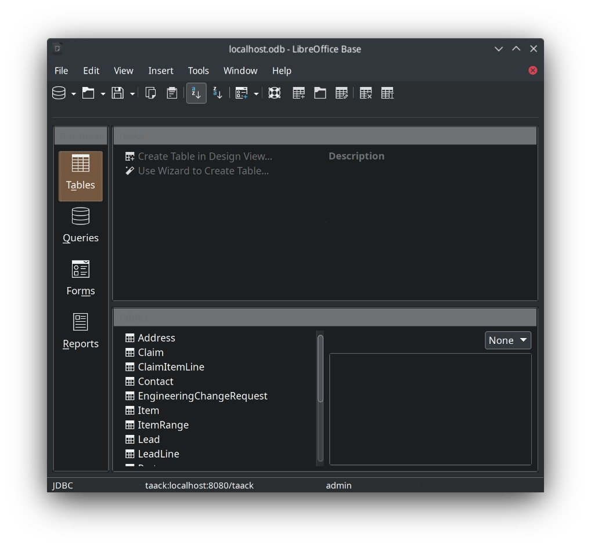

Cliquez sur le bouton Queries, puis sur `Create Query in SQL View`

WARNING: N'utilisez pas l'assistant (wizard). L'Intranet utilise le langage TQL pour interroger les données, LibreOffice ne connaît pas ce langage.

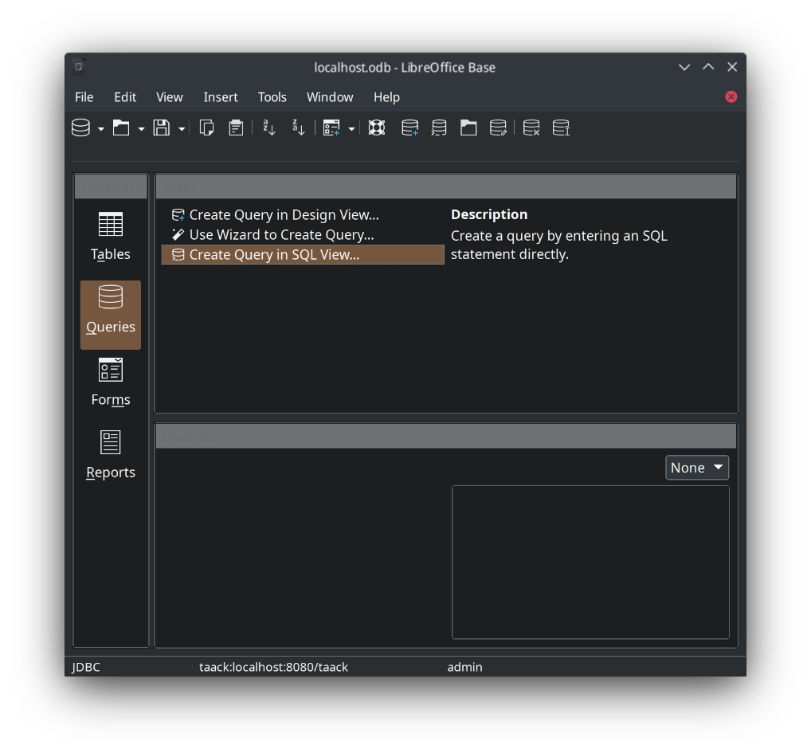

Avant de pouvoir saisir des requêtes, cliquez sur `Run SQL Command directly`

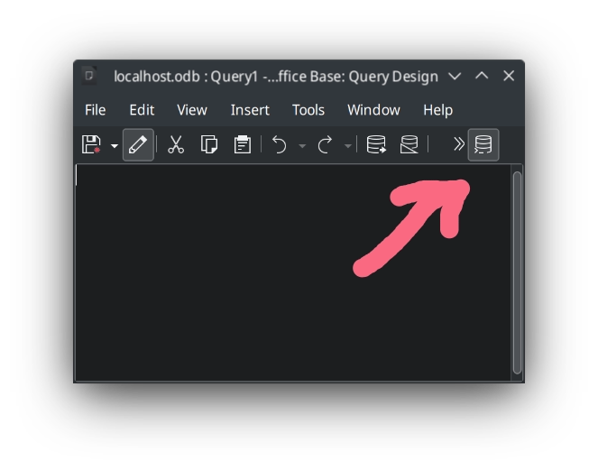

Maintenant, vous pouvez saisir vos requêtes TQL...

Voir link:taack-jdbc-driver-fr.adoc#_tql_queries[Requêtes TQL].

== Utilisation dans Calc

Une fois que vous avez créé quelques requêtes et que vous les avez enregistrées, vous pouvez accéder aux données directement depuis Calc.

[[_open_query_as_a_pivot_table]]
=== Ouvrir une requête sous forme de tableau croisé dynamique

`Data` > `Pivot Table` puis `Data source in registered Calc`

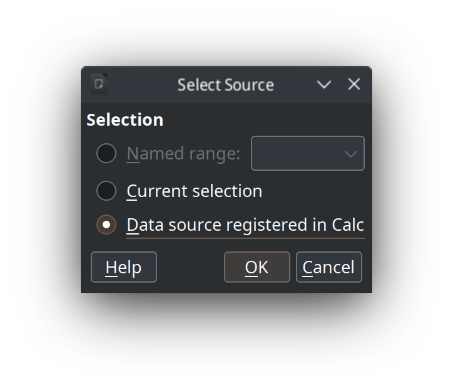

Sélectionnez le fichier dans lequel vous avez enregistré vos requêtes, saisissez votre mot de passe Intranet, puis sélectionnez la source de données.

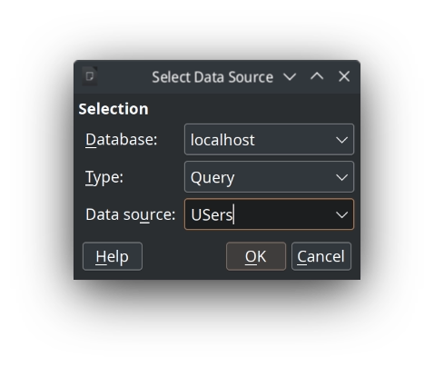

Ici, je choisis Query et je sélectionne la requête Users.

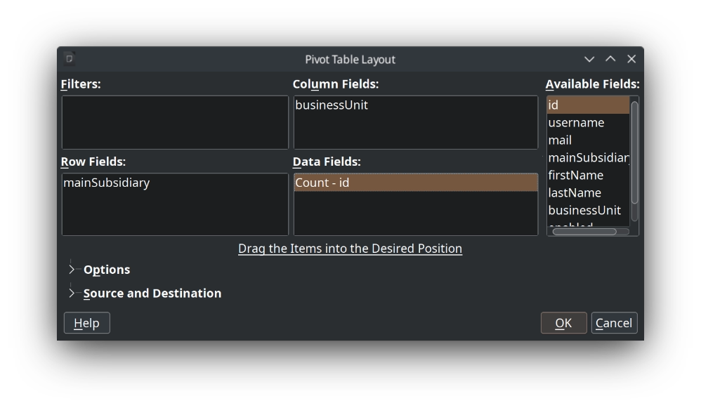

C'est tout. Vous pouvez modifier votre tableau croisé dynamique selon vos besoins.

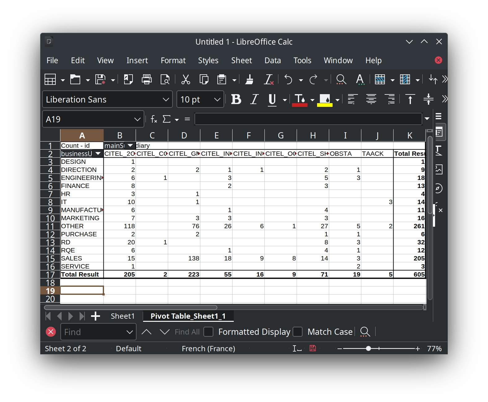

=== En tant que source de données

TODO
