= Neuigkeiten
:doctype: book
:taack-category: 3
:toc:
:source-highlighter: rouge
:icons: font

== Version 0.7.10 und 0.7.11

* Neue Themes (auf image:https://taack.org/assets/taack/icons/actions/config.svg[] klicken und Theme auswählen)
* Überarbeitung des Speicherns zur Vermeidung von `bind`

== Version 0.7.9

* Erlaubt `IN` oder `NOT IN` über eine innere HQL-Abfrage, siehe <<filterFieldExpressionReverse>>
* Grails 7.2.4
* Verbesserung der Diagramme

[[filterFieldExpressionReverse]]
.Neuer Filter filterFieldExpressionReverse
====
.Filter filterFieldExpressionReverse
[source,groovy]
----
def parentParts() {
    UiFilterSpecifier f = new UiFilterSpecifier().sec PlmFreeCadPart, {         <1>
        PlmFreeCadLink link = new PlmFreeCadLink()
        filterFieldExpressionReverse(link.part_,                                <2>
                true,                                                           <3>
                new FilterExpression(null as Object, Operator.NE, link.part_))  <4>
    }
    taackUiService.show(new UiBlockSpecifier().ui {
        tableFilter(plmFreeCadUiService.buildPartFilter(), plmFreeCadUiService.buildPartTable(null, f), {
            menuIcon ActionIcon.GRAPH, this.&model as MC
        })
    }, buildMenu())
}
----
<1> Wir erstellen einen Filter für `PlmFreeCadPart`
<2> Wir möchten übergeordnete Baugruppen auflisten, also diejenigen, bei denen das Feld `PlmFreeCadLink part` nicht auf das aufgelistete `PlmFreeCadPart` verweist
<3> `true` steht für `notIn`
<4> Wörtlich: Wir wollen alle *PlmFreeCadPart*, die keine untergeordneten Elemente sind

.Generiertes HQL
[source,hql]
----
select
    distinct sc  ,sc.dateCreated
from PlmFreeCadPart sc
where
    sc.id NOT IN (select auo.part.id from PlmFreeCadLink auo where auo.part IS NOT NULL)    <1>
    and sc.nextVersion IS NULL
order by sc.dateCreated DESC
----

<1> Durch den Ausdruck `filterFieldExpressionReverse` hinzugefügte `where`-Klausel

====

== Version 0.7.8

* Wartungsrelease

== Version 0.7.7

* Grails 7.2.3
* Neues Maven-Artefakt `taack-ui-ext` zum Hinzufügen grafischer Komponenten
* <<calendar-component>>

[[calendar-component]]
.Neue Kalenderkomponente
====

.Tabellenansicht
[source,groovy]
----
def calendarTable(TaackCalendarParams calendarParams) {
    UiTableSpecifier t = taackCalendarUiService.calendarUiTable(calendarEvents.collect {    <1>
        new TaackCalendarEventAdapter(it.key, it.value)
    }.iterator() as Iterator<TaackCalendarEvent>, calendarParams)
    taackUiService.show new UiBlockSpecifier().ui {
        table t
    }, RootController.buildMenu()
}
----
<1> Tabelle aus einem `TaackCalendarEvent`-Iterator erstellen. Verwendung des Adapter-Musters, um beliebige Objekte in `TaackCalendarEvent` umzuwandeln.

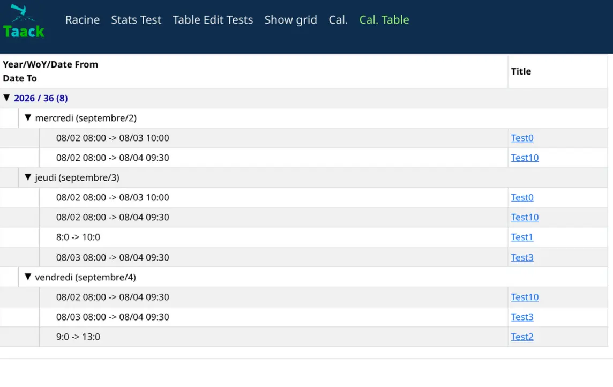

.Standardansicht
[source,groovy]
----
def calendarEntries(TaackCalendarParams calendarParams) {
    taackUiService.show taackCalendarUiService.calendarBlock(CalendarController.&fromCustom as MC, calendarEvents.collect {
        new TaackCalendarEventAdapter(it.key, it.value)
    }.iterator() as Iterator<TaackCalendarEvent>, calendarParams), RootController.buildMenu()}
----
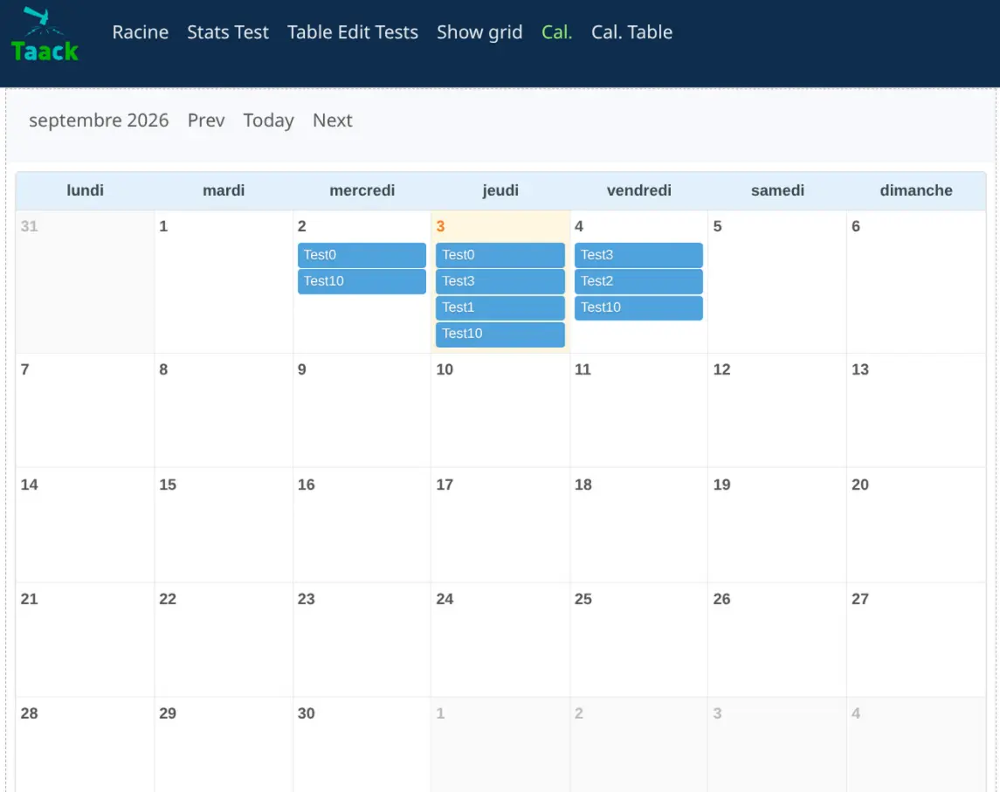

====

== Version 0.7.6

* Verbesserung des benutzerdefinierten Editors
* Grails 7.2.0

== Version 0.7.5

* <<show-grid-layout>>
* <<replace-modal>>
* <<save-or-close-and-refresh>>

image:show-grid-layout.webp[]

[[show-grid-layout]]
.Show-Grid-Layout
====

.Anordnung eines Show-Blocks auf einem responsiven Raster über `ShowLayout.GRID`
[source,groovy]
----
new UiShowSpecifier().ui ShowLayout.GRID, {                      <1>
    fieldLabeled item.ref_
    fieldLabeled item.name_
    fieldLabeled item.itemStatus_
    fieldLabeled item.gtin_
    fieldLabeled Style.SPAN_TWO, item.labeling_                  <2>
    fieldLabeled Style.BOLD + Style.SPAN_FULL, item.description_ <3>
}
----

<1> Übergeben Sie `ShowLayout.GRID`, um die Felder auf einem sich automatisch anpassenden Raster anstatt vertikal in einer Spalte anzuordnen. Der Standardwert ist `ShowLayout.LIST`.
<2> Jedes Feld belegt standardmäßig eine Rasterzelle. `Style.SPAN_TWO` / `Style.SPAN_THREE` können verwendet werden, damit Rasterzellen mehrere Spalten überspannen.
<3> `Style.SPAN_FULL` lässt ein Feld die gesamte Zeile überspannen. Spans lassen sich über `+` mit jedem anderen Stil kombinieren (hier mit `Style.BOLD`).

Beachten Sie, dass das Raster automatisch so viele Spalten einpasst, wie es die Containerbreite zulässt, wobei jede mindestens `220px` breit ist (`grid-template-columns: repeat(auto-fit, minmax(220px, 1fr))` auf der Klasse `taackShowGrid`; das Minimum kann in Ihrem CSS überschrieben werden).

====

[[replace-modal]]
.Neues Ersetzen von Modal-Inhalten
====
.Ersetzen des gesamten Inhalts eines übergeordneten Modals
[source,groovy]
----
@Transactional
def doComplexStuff() {
    boolean isDone = false

    // doComplexStuff

    taackUiService.show(new UiBlockSpecifier().ui {
        replaceModal {
            custom("<h1> ${isDone ? 'Done.' : 'Not Done.'} </h1>")
        }
    })
}
----
====

[[save-or-close-and-refresh]]
.Neues Speichern oder Schließen eines Modals und Aktualisieren
====
.Code
[source,groovy]
----
@Transactional
@Secured(['ROLE_ADMIN', 'ROLE_CONSOLATOR_ADMIN'])
def saveLlmRag() {
    taackSaveService.saveOrCloseModalAndRefresh(LlmRag)     <1>
}
----

<1> Wenn mehrere Modals übereinander gestapelt sind, ist es nun möglich, das Modal unter dem obersten zu aktualisieren, während das oberste geschlossen wird.

====

== Version 0.7.4

* Verwendung von Flying Saucer zur PDF-Erzeugung, um Lizenzprobleme mit iText AGPL zu vermeiden
* Verbesserung der Benutzerinteraktion bei Diagrammen
* xref:doc/DSLs/diagram-dsl.adoc[Diagramm-DSL] :
** Neuer Diagrammtyp `timeline` hinzugefügt
** Bereitstellung von `DiagramOption` zur Anpassung von Diagrammen
* <<table-sticky-columns>>

[[table-sticky-columns]]
.Fixierte Tabellenspalten (Sticky Columns)
====

.Einfrieren der linken Spalten über `TableOption`
[source,groovy]
----
TableOption tableOption = new TableOption.TableOptionBuilder()
        .stickyColumns(2).build() <1>

new UiTableSpecifier().ui tableOption, {
    header {
        sortableFieldHeader p.ref_
        sortableFieldHeader p.name_
        // ... any number of columns ...
    }
}
----

<1> Anzahl der am linken Rand einzufrierenden Spalten. Sie bleiben sichtbar, während die Tabelle horizontal gescrollt wird.

Beachten Sie, dass Tabellen mit fixierten Spalten nicht in der Breite beschränkt sind und stattdessen die CSS-Klasse `taack-sticky-table` verwenden, die die maximale Breite jeder Spalte auf 12rem begrenzt.

====

== Version 0.7.2

* Grails 7.0.7, Java 25 für Laufzeit und Build
* <<kan-ban>>
* <<table-inline-edit>>
* Unterstützung einer Klasse in `section` für die Beschriftung (siehe <2> in <<section-labelling>>)
* <<fileter72>>
* <<rowCol>>
* <<poke>>
* <<accordion>>
* <<scrollPanel>>

[[kan-ban]]
.Kanban mit Drag & Drop
====

.Kanban-Spezifikation ohne Filter
[source,groovy]
----
new UiKanbanSpecifier().ui {
    ReminderStatus.values().each { ReminderStatus status ->             <1>
        column(this.&changeStatus as MC, [newStatus: status.name()]) {  <2>
            header status.name()                                        <3>
            reminders.grep { Reminder t -> t.status == status }
                     .sort { -it.lastUpdated.getTime() }
                     .each { Reminder rIt ->
                card(rIt.selfObject_) {                                 <4>
                    cardField rIt.title_, null, Style.BOLD + Style.BLUE
                    cardFieldRaw this.getReminderDoersHtml(rIt),
                        new Style('', 'position: absolute; right: 3px; top: 12px;')
                    cardAction ActionIcon.SHOW * IconStyle.SCALE_DOWN,
                        ReminderController.&showReminder as MethodClosure, rIt.id
                    cardField rIt.priority_
                }
            }
        }
    }
}
----

<1> Über Spalten iterieren
<2> Eine Spalte definieren
<3> Kopfzeilenname dieser Spalte
<4> Karte mit `cardField`, `cardFieldRaw` und `cardAction` erstellen

.Kanban
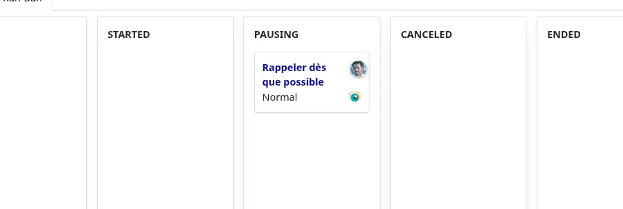

====

[[table-inline-edit]]
.Objekte in Tabellen bearbeiten
====
.`rowQuickEdit`-Block deklarieren
[source,groovy]
----
rowQuickEdit(CrmController.&applyLeadLine as MC, ll.id) {           <1>
    rowColumn {
        rowFieldEdit ll.salePrice_                                  <2>
        rowFieldEdit ll.qty_                                        <2>
        rowField nf.format(tot), style                              <3>
    }
}
----

<1> `rowQuickEdit` deklariert, welche Aktion bei der Inline-Bearbeitung aufgerufen werden soll
<2> `rowFieldEdit` bearbeitet den Wert in einem Eingabefeld ODER zeigt den Inhalt an, falls nicht erlaubt
<3> Andere Felder werden während der Bearbeitung neu berechnet

.Definition von `applyLeadLine`
[source,groovy]
----
@Transactional
def applyLeadLine() {
    LeadLine ll = new LeadLine()
    taackSaveService.saveThenReloadOrRenderErrors
                    LeadLine, ll.qty_, ll.salePrice_            <1>
}
----

<1> Beim Speichern werden die Felder aufgelistet, die ausschließlich im `rowQuickEdit`-Block aktualisiert werden dürfen

.Inline-Bearbeitung mit lokalisierter Fehlerrückmeldung
image::screenshot-inline-edit.webp[]

====

[[fileter72]]
.Neue Filter-Serialisierung
====
.Filter deklarieren
[source,groovy]
----
UiFilterSpecifier createReminderFilter(FieldInfo... leftField) {
    Reminder r = new Reminder()
    User u = new User()
    new UiFilterSpecifier(leftField).ui Reminder, {                 <1>
        section Reminder, {                                         <2>
            filterField r.assignee_, u.username_
            filterField r.status_
            filterField r.priority_
            filterField r.title_
        }
    }
}
----

[[section-labelling]]
<1> `leftField` listet Felder auf, die im einbettenden Objekt auf einen `Reminder` verweisen
<2> Neue `section` mit Klassenargument zur automatischen Berechnung von i18n

.Filter verbinden (Join)
[source,groovy]
----
UiFilterSpecifier createReminderLinkFilter(FieldInfo... leftField) {
    ReminderLink rl = new ReminderLink()
    new UiFilterSpecifier(leftField).ui(ReminderLink, {
        section tr('reminderLink.label'), {
            filterField rl.kind_
        }
    }).join(createReminderFilter(rl.reminder_))                     <1>
}
----

<1> Das Feld `reminder` ist ein `Reminder`; wir verwenden den Filter für die Klasse `Reminder` wieder.

.Verbundene Filter
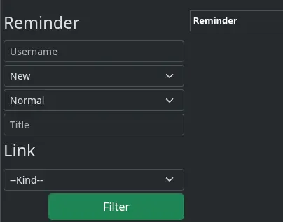

====

[[rowCol]]
.Neue Layout-Option `rowCol`
====
[source,groovy]
----
        taackUiService.show createModalForm(reminder, {
            section {
                field reminder.title_
                rowCols 3, {                                        <1>
                        field reminder.dueDate_
                        field reminder.status_
                        field reminder.priority_
                }
                ajaxField reminder.assignee_, CrewController.&selectUserM2O as MC
                field reminder.body_
            }
----

<1> Vermeidet `row`, gefolgt von `col`, `col`, `col` ...

.`rowCol` im Formular
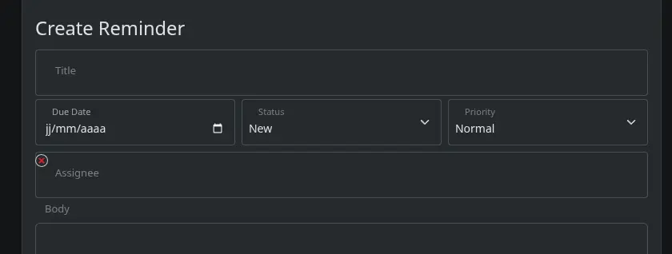
====

[[poke]]
.Neue Layout-Anweisung `poke` zur Blockaktualisierung
====
[source,groovy]
----
taackUiService.show(new UiBlockSpecifier().ui {
    table statsService.buildTable()                                 <1>

    row {
        poke p1, {                                                  <2>
            col BlockSpec.Width.HALF, {
                diagram(statsService.&buildChart1 as MethodClosure)
            }
        }
        poke p2, {                                                  <2>
            col BlockSpec.Width.HALF, {
                diagram(statsService::buildChart2 as MethodClosure)
            }
        }
    }
}
----

<1> Beim Klicken auf eine Tabelle können andere Blöcke aktualisiert werden
<2> `poke` p1 und p2 sind boolesche Werte. Wenn `true`, werden Blöcke innerhalb des `poke`-Blocks aktualisiert

====

[[accordion]]
.Akkordeon (Accordion)
====
[source,groovy]
----
accordion {
    accordionItem('Filter') {
        form CrmDashboardUiService.filterForm(filter)
    }
}
----

====

[[scrollPanel]]
.scrollPanel
====
[source,groovy]
----
scrollPanel('512px') {
    UiTableSpecifier t
    boolean seeSalesmen = params.boolean('seeSalesmen')
    boolean seeTop = params.boolean('seeTop')
    if (seeTop) {
        t = crmDashboardUiService.topSalesmen(leads)
    } else if (seeSalesmen) {
        t = this.crmDashboardUiService.topCountries(leads)
    } else {
        t = crmDashboardUiService.topCustomer(leads)
    }
    table(t) {
        menu 'Salesmen', this.&group as MC, [seeTop: true, seeSalesmen: false]
        menu 'Customers', this.&group as MC, [seeTop: false, seeSalesmen: false]
        menu 'Countries', this.&group as MC, [seeTop: false, seeSalesmen: true]
    }
}
----

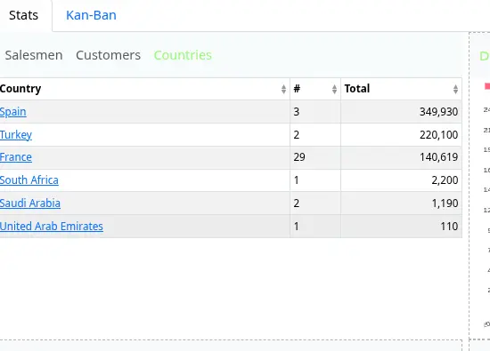

====

== Version 0.7.1

* Fehlerbehebung bei i18n mit der `bootRun`-Aufgabe bei aktiviertem Hot-Reload

.Was ist neu in 0.7.1
video::ZLj-YqnxMew[youtube, 480]

== Version 0.7.0

* Grails 7, Gradle 8.4, Java 24, Groovy 4.0.28 ...
* Verbesserung der Leistung: Seitenübertragung beginnt früher und benötigt weniger Speicher pro Seite
* Aufteilung von `taack-ui` in `taack-ui`, `taack-ui-jdbc`, `taack-ui-pdf`, `taack-ui-ssh`, `taack-ui-search`, `taack-ui-asciidoc`. Ein minimaler Server, der nur `taack-ui` verwendet, sollte als JAR etwa 70 MB groß sein
* Kontextmenüs für Felder und Klassen (siehe <<contextual-menu-code-sample>>)
* Benachrichtigungshelfer: ermöglicht das Markieren ungelesener Zeilen in einer Tabelle über den Filter-Setter `setLastReadingDate` (siehe <<notification-setLastReadingDate-sample>>)
* #Änderungen bei SolrSearch#: Objektkontexte müssen generisch registriert werden (siehe <<TaackGormClassRegisterService>>)
* Neue Diagrammanpassung über Builder, was die Integration von Diagrammen in E-Mails und PDFs erleichtert (siehe <<diagram-builders>>)
* Asciidoc-Editor mit Copy/Paste-Konvertierungsfunktionen (siehe <<asciidoc-editor>>)
* Verbesserung der Diagrammausgabe in E-Mails und PDFs
* `TaackUiConfiguration` wird nicht über `application.yml` initialisiert; die Felder sind statisch und können in `server/grails-app/init/.../Application.groovy` geändert werden (siehe <<taack-ui-configuration>>)
* Es ist nun möglich, bei einem Drop-Ereignis auf einer Tabelle oder einer Tabellenzelle über einen Callback benachrichtigt zu werden (siehe <<drop-on-table>>, <<drop-on-cell>>)

[[contextual-menu-code-sample]]
.Codebeispiel für Kontextmenüs
[source,groovy]
----
TaackUiService.registerContextualMenuClosure(                           <1>
    new Lead().leadStatus_,
    new UiMenuSpecifier().ui { Long id ->                               <2>
        label 'Change Status'
        Lead.read(id)?.leadStatus?.transitionsTo()?.each {
            menu it.toString(),                                         <3>
                CrmController.&changeLeadStatus as MC,
                [id: id, leadStatus: it.toString()]
    }
})
----

<1> Ein Kontextmenü für ein Feld registrieren
<2> Reguläre `MenuSpecifier`-Closure verwenden (wie bei allen anderen Menüs)

.Ergebnis eines Rechtsklicks auf den Lead-Status
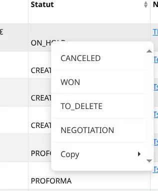

[[notification-setLastReadingDate-sample]]
.Filter erstellen, der ungelesene Einträge markiert
[source,groovy]
----
TaackFilter.FilterBuilder tf = taackFilterService.getBuilder(Item)
        .setMaxNumberOfLine(10)
        .setSortOrder(TaackFilter.Order.DESC, i.dateCreated_)

tf.setLastReadingDate(lastAccessDateFromUser)   <1>
----

<1> Neueste Objekte werden fett dargestellt, siehe <<unread-notif>>

[[unread-notif]]
.Ungelesene Zeilen, bei denen `lastUpdated` des Objekts > `lastAccessDateFromUser` ist
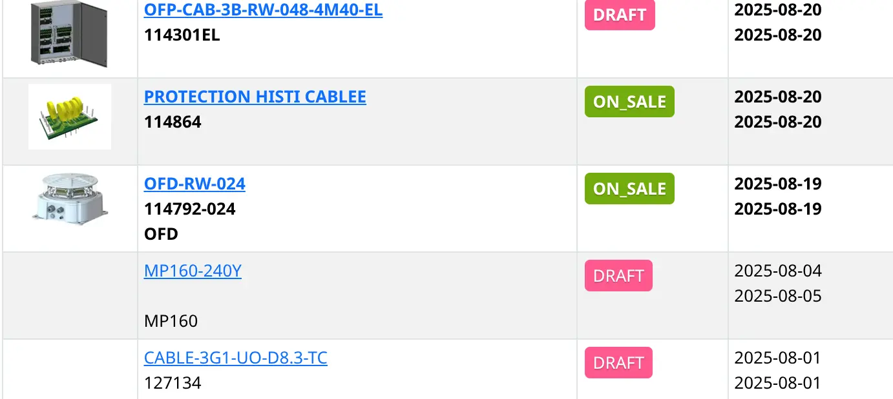

[[TaackGormClassRegisterService]]
.Registrieren, wie ein Objekt angezeigt wird
[source,groovy]
----
TaackGormClassRegisterService.register(
        new TaackGormClass(ItemRange.class).builder
                .setShowMethod(Bp2Controller.&showRange as MethodClosure)   <1>
                .build(),
        new TaackGormClass(Item.class).builder
                .setShowMethod(Bp2Controller.&showItem as MethodClosure)    <1>
                .setShowLabel({ Long id ->                                  <2>
                    def i = Item.read(id)
                    return "${i.name} ${i.ref ?: ''} ($id)"
                })
                .setTypeLabel({ Long id ->                                  <3>
                    return TaackUiService.tr('default.item.label')
                }).build()
)
----

<1> Wie das Objekt angezeigt wird
<2> Benutzerdefinierte Beschriftung
<3> Typ für die Facettierung

[[diagram-builders]]
.Diagramm-Builder
[source,groovy]
----
new UiDiagramSpecifier().ui {
    bar {
        labels 'xLabel1', 'xLabel2', 'xLabel3', 'xLabel4'
        dataset 'dataset1', 1.0, 2.0, 3.0, 4.0
        dataset 'dataset2', 6.0, 1.0, 2.0, 4.0

        option DiagramOption.builder
            .setClickAction(Rma2Controller.&editClaim as MethodClosure)
            // "diagramAction" was moved to here
            .showDataCount()
            // The numbers are hidden by default. Use this option if need to show
            .hideLegend()
            // The legends are shown by default. Use this option if need to hide
            .setResolution(DiagramOption.DiagramResolution.DEFAULT_4K)
            // Default resolution is [SVG: 960x480, PNG: 2160x1080].
            // Allow to set to 540p, 720p, 1080p, 2K, 1440p, 4K
            .setKeyColors(Color.RED, Color.BLUE)
            // Allow to self-define the colors for each dataset
            // (If not set, there are by default 7 colors)
            .setTitle("Test Chart") // Diagram title
            .build()
    }
}
----

[[asciidoc-editor]]
.Asciidoc-Editor
[source,groovy]
----
//...
EditorOption.EditorOptionBuilder editor = EditorOption.getBuilder()
editor.addSpanRegexes(TaackBaseAsciidocSpans.spans)                 <1>
editor.addSpanRegexes(TaackAsciidocTable.spans)                     <1>
editor.addSpanRegexes(TaackAsciidocPlantUML.spans)                  <1>
editor.onDrop(this.&dropEditor as MC, cmsPage.id)                   <2>
fieldEditor cmsPage.bodyContent_, editor.build()                    <3>
innerFormAction this.&previewBody as MC                             <4>
//...

@Transactional
def dropEditor() {                                                  <2>
    CmsPage page = CmsPage.get(params.long('cmsPage'))
    params.remove('cmsPage')
    String past = params.get('onpaste')
    if (past) {                                                     <5>
        render taackAsciidocService.convertFromHtml(past)
    } else {                                                        <6>
        final List<MultipartFile> mfl = (request as MultipartHttpServletRequest).getFiles('filePath')
        final mf = mfl.first()

        if ([AttachmentContentType.SHEET_ODS.mimeType,
             AttachmentContentType.LO_TEXT.mimeType
            ].contains(mf.contentType)) {                           <7>
            render taackAsciidocService.convert(page, mf.inputStream)
        } else {                                                    <8>
            CmsImage cmsImage = taackSaveService.save(CmsImage)
            if (cmsImage && page) {
                cmsImage.cmsPage = page
            }
            render "image::${cmsImage.originalName}[]"
        }
    }
}
----

<1> Syntax-Span-Erweiterungen hinzufügen (im Grunde ein regulärer Ausdruck und eine Klasse zum Einfärben des Codes)
<2> Callback, wenn eine Datei abgelegt oder Inhalte aus einer anderen Seite bzw. Anwendung eingefügt werden
<3> Das Feld im Formular
<4> Optionale Vorschau-Aktion
<5> Einfügen von HTML-Inhalten. Der Inhalt wird in Asciidoc konvertiert
<6> Abschnitt zum Ablegen von Dateien
<7> Die Datei ist eine ODS- oder Writer-Datei; sie wird in Asciidoc konvertiert und Bilder werden importiert
<8> Die Datei ist ein Bild; sie wird im CMS gespeichert.

WARNING: `taackAsciidocService` verwendet den Dienst `TaackEditorService` aus `taack-ui-asciidoc`, siehe link:doc/DSLs/form-dsl-de.adoc#_asciidoc[Formular-DSL]

[[taack-ui-configuration]]
.TaackUiConfiguration
[source,groovy]
----
@CompileStatic
class TaackUiConfiguration {
    static String defaultTitle = 'Taack'
    static String logoFileName = 'logo-taack-web.svg'
    static int logoWidth = 70
    static int logoHeight = 60

    static boolean fixedTop = false
    static boolean hasMenuLogin = true
    static boolean outlineContainer = false
    static String bgColor = '#05294c'
    static String fgColor = '#eeeeee'
    static String bodyBgColor = '#fff'

    static String home = System.getProperty('user.home')
    static String root = home + '/intranetFiles'
    static String taack = home + '/taack'
    static String resources = taack + '/resources'
    static String javaPath = '/usr/bin/java'
    static String plantUmlPath = home + '/plantuml-1.2022.7.jar'
    static String solrUrl = 'http://localhost:8983/solr/taack'
    static Boolean disableSecurity = false
}
----

.`Application.groovy`
[source,groovy]
----
@CompileStatic
class Application extends GrailsAutoConfiguration {
    static void main(String[] args) {
        TaackUiConfiguration.disableSecurity = true
        TaackUiConfiguration.hasMenuLogin = false
        GrailsApp.run(Application, args)
    }
}
----

[[drop-on-table]]
.Ablegen auf einer Tabelle (Drop on Table)
[source,groovy]
----
        TableOption tableOption = new TableOption.TableOptionBuilder()
                .onDropAction(this.&testDrop as MC).build()             <1>

        new UiTableSpecifier().ui tableOption, {
            header {
                sortableFieldHeader cb.position_
                sortableFieldHeader cb.subsidiary_
                label 'Page OR Menu Entry'
            }
----

<1> Aktion, die beim Ablegen irgendwo auf der Tabelle aufgerufen wird.

[[drop-on-cell]]
.Ablegen auf Zellen (Drop on Cells), die Zeilenspalte ist ein Ablagebereich
[source,groovy]
----
cellDropAction(CmsController.&testCellDrop as MC)                       <1>
rowColumn {
    rowField cp.title_
    rowField 'test drop'
}
----

<1> Aktion, die beim Ablegen irgendwo auf der Zelle aufgerufen wird.

== Version 0.6.1

* Diagramm-Aktion (siehe <<_diagram_action>>)
* Vollbild-Modal
* Statische Hilfsmethoden (siehe <<_static_helper>>)

[[_diagram_action]]
.Verwendung von Diagramm-Aktionen
[source,groovy]
----
new UiDiagramSpecifier().ui {
    bar {
        labels 'date1', 'date2', 'date3'
        dataset 'Stuff1', 3.0, 4.0, 5.0

        diagramAction this.&clickDiagram as MC, id, <1>
        [optionalParam: 'value']                    <2>
    }
}

def clickDiagram() {
    println(params)
    // [id: 123456, dataset: "Stuff1",
    // optionalParam: "value"                       <3>
    // x: "date1", y: "3.0"]
}

----

<1> Diagramm-Aktion
<2> Kann eine Map übergeben
<3> Aktionsparameter enthalten *label*, *value*, *dataset name* und *map*

[[_static_helper]]
.Verwendung statischer Hilfsmethoden
[source,groovy]
----
import org.codehaus.groovy.runtime.MethodClosure as MC

import static taack.ui.TaackUi.createMenu           <1>

@Override
UiMenuSpecifier editorCreate() {
    createMenu {                                    <2>
        menu this.&createFromTemplate as MC
        menuIcon
            CollaboraIcons.WRITER,
            this.&createFromTemplate as MC,
            [collaboraApp: CollaboraApp.WRITER]
    }
}
----

<1> Statischer Import
<2> Statischer Aufruf `createMenu`, Kurzform für `new UiMenuSpecifier().ui`; weitere Kurzformen umfassen `createModal`, das `UiBlockSpecifier` zurückgibt

video::wF323zHFa94[youtube, 480]

== Version 0.6

* Ladeanimation
* Diagramm-Zoom / -Scrollen
* Diagramm-Tooltips
* Tabellen-Mehrfachauswahl (siehe <<doc/DSLs/filter-table-dsl.adoc#table-sample1>>)
* Verzögertes Laden von Tabs (Lazy Loading)
* Verbesserung der Paginierung
* Optimierung des Zeichnens, Vermeidung unnötiger Zeichenvorgänge
* Vermeidung von Fällen, in denen Blöcke doppelt gezeichnet wurden
* Verbesserung des Suchlayouts
* Unterstützung für `BigDecimal` in Tabellen, Anzeige gemäß dem Gebietsschema des Benutzers
* WiP: Einfacher Asciidoc-WYSIWYG-Editor

== Version 0.5.7

* Bereinigung des `show`-DSL-Codes, Übergabe eines Objektparameters an `UiShowSpecifier().ui` als veraltet markiert
* Erster Asciidoctor-WYSIWYG-Editor
** Unterstützung für Drag & Drop von Bildern und Dateien
* Weitere Diagramm-DSLs
** timeSeries
** areaChart
** bubbleChart
* Sicherheit
** Standardmäßige Bereinigung (Sanitizing) angezeigter Informationen (`fieldRaw` verwenden, um die Bereinigung zu umgehen)
** Zugriffsprüfung an allen Einstiegspunkten
* Fehlerbehebungen und Aktualisierung von Abhängigkeiten

WARNING: Ersetzen Sie `field <html code>` durch `fieldRaw <html code>`

== Version 0.5.6 (behebt Fehler aus 0.5.5)

* Reduzierung des Abhängigkeitsbereichs für Solr und Tika
* Anzeige sortierbarer Tabellenspalten und der Sortierrichtung (siehe <<sorting-screenshot>>)
* Blockmenüs werden nun wie Blöcke aktualisiert
* Für komplexe Layouts kann Code einfach wiederverwendet werden. Variablen zur Kontextualisierung des Layouts lassen sich nun einfach beibehalten (siehe <<context-keeper>>)

[[sorting-screenshot]]
.Spaltenüberschriften zeigen die Sortierrichtung an
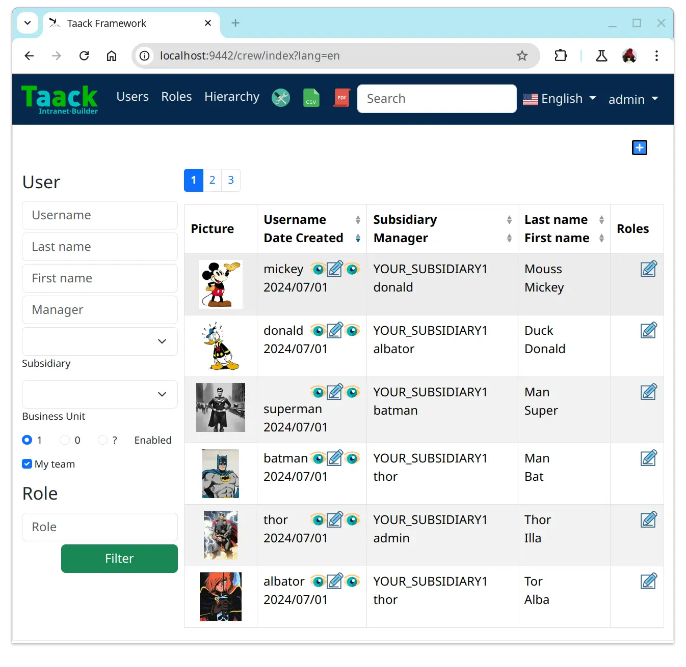

[[context-keeper]]
.Wie der Kontext beim Klicken auf eine Tabelle beibehalten wird
[source,groovy]
----
def showPart(PlmFreeCadPart part, Long partVersion, Boolean isHistory) {<1>
    taackUiService.show(
            plmFreeCadUiService.buildFreeCadPartBlockShow(
                    part, partVersion, false, isHistory),               <2>
            buildMenu(),
            "isHistory")                                                <3>
}
----

<1> `isHistory` ist ein Aktionsparameter
<2> `isHistory` wird beim Zeichnen des Blocks verwendet; wir müssen ihn erneut übertragen, um durch Beibehaltung des Kontexts exakt dasselbe Blocklayout zu zeichnen
<3> Der Schlüssel `isHistory` wird als letztes Argument von `taackUiService.show` übergeben. Sie können mehrere beizubehaltende Schlüssel angeben.

== Version 0.5.4

* Überarbeitung der Diagramm-DSL (siehe link:doc/DSLs/diagram-dsl-de.adoc[])

== Version 0.5.3

* Fehlerbehebung bei Formular-Kontrollkästchen (Checkboxes)
* Erlaubt Aliase in *TQL* für Formelspalten
* Codebereinigung und Aktualisierung von Abhängigkeitsversionen

== Version 0.5.2

* Der JDBC-Client ist nun auch eine AsciidoctorJ-Erweiterung
* Hinzufügen von Gettern zu über JDBC zugänglichen Domänenfeldern
* Hinzufügen der DSL <<tql_tdl>> zur Beschreibung, wie abgefragte Daten angezeigt werden sollen (entweder als Tabelle oder als Balkendiagramm)
* Wiederherstellung der manuellen Beschriftung bei Menüs
* Weiteres zur Diagramm-DSL (Danke an Chong und ZhenQing)
* Bessere Anpassungsmöglichkeiten

[[tql_tdl]]
.TQL und TDL (Taack Display Language)
[source,sql]
----
select
    u.rawImg,
    u.username,
    u.manager.username
from User u
where u.dateCreated > '2024-01-01' and u.manager.username = 'admin';
--
table rawImg as "Pic", username as "Name", manager as "Manager"

----

.Ergebnisse
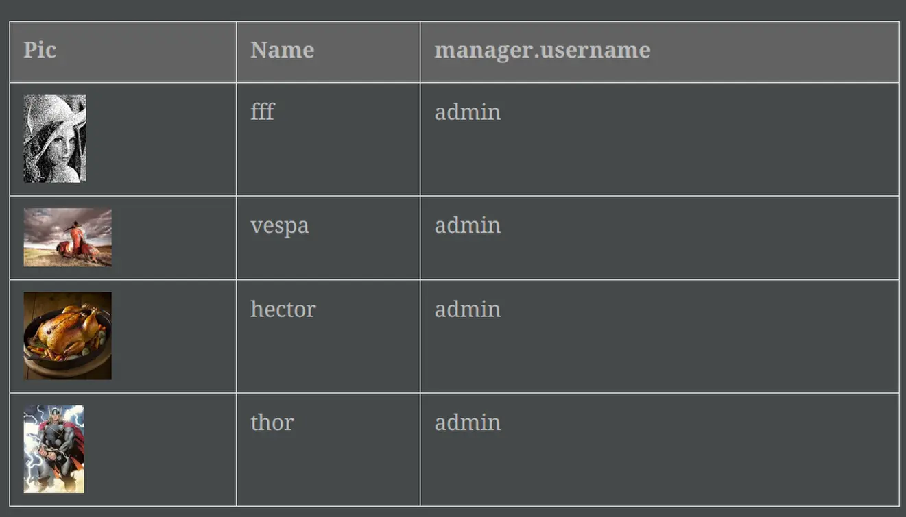

== Version 0.5.1

* <<_replacement_tp>>, Anwendungsmodul registriert sich unabhängig
* Entfernung der Charts-DSL
* Fehlerbehebung bei der Diagramm-DSL, <<_replacement_chart>>
* Erlaubt Diagramme in PDFs (siehe <<_diagrams_into_pdf>> und <<_diagrams_output>>)

[[_replacement_tp]]
.Ersatz von TaackPlugin
[source,groovy]
----
@PostConstruct
void init() {
    TaackUiEnablerService.securityClosure(
        this.&securityClosure,
        CrewController.&editUser as MC,
        CrewController.&saveUser as MC)
    TaackAppRegisterService.register(
        new TaackApp(
            CrewController.&index as MC,                    <1>
            new String(
                this.class
                    .getResourceAsStream("/crew/crew.svg")  <2>
                    .readAllBytes()
            )
        )
    )
}
----

<1> Einstiegspunkt
<2> Icon

[[_replacement_chart]]
.Ersatz von Charts: Diagramme
[source,groovy]
----
private static UiDiagramSpecifier d1() {
    new UiDiagramSpecifier().ui {
        bar(["T1", "T2", "T3", "T4"] as List<String>, false, {
            dataset 'Truc1', [1.0, 2.0, 1.0, 4.0]
            dataset 'Truc2', [2.0, 0.1, 1.0, 0.0]
            dataset 'Truc3', [2.0, 0.1, 1.0, 1.0]
        }, DiagramTypeSpec.HeightWidthRadio.ONE)
    }
}
----

[[_diagrams_into_pdf]]
.PDF mit Diagrammen
[source,groovy]
----
printableBody {
    diagram(d1(), BlockSpec.Width.HALF)
    diagram(d2(), BlockSpec.Width.HALF)
}
----

[[_diagrams_output]]
.Gestapeltes Balkendiagramm
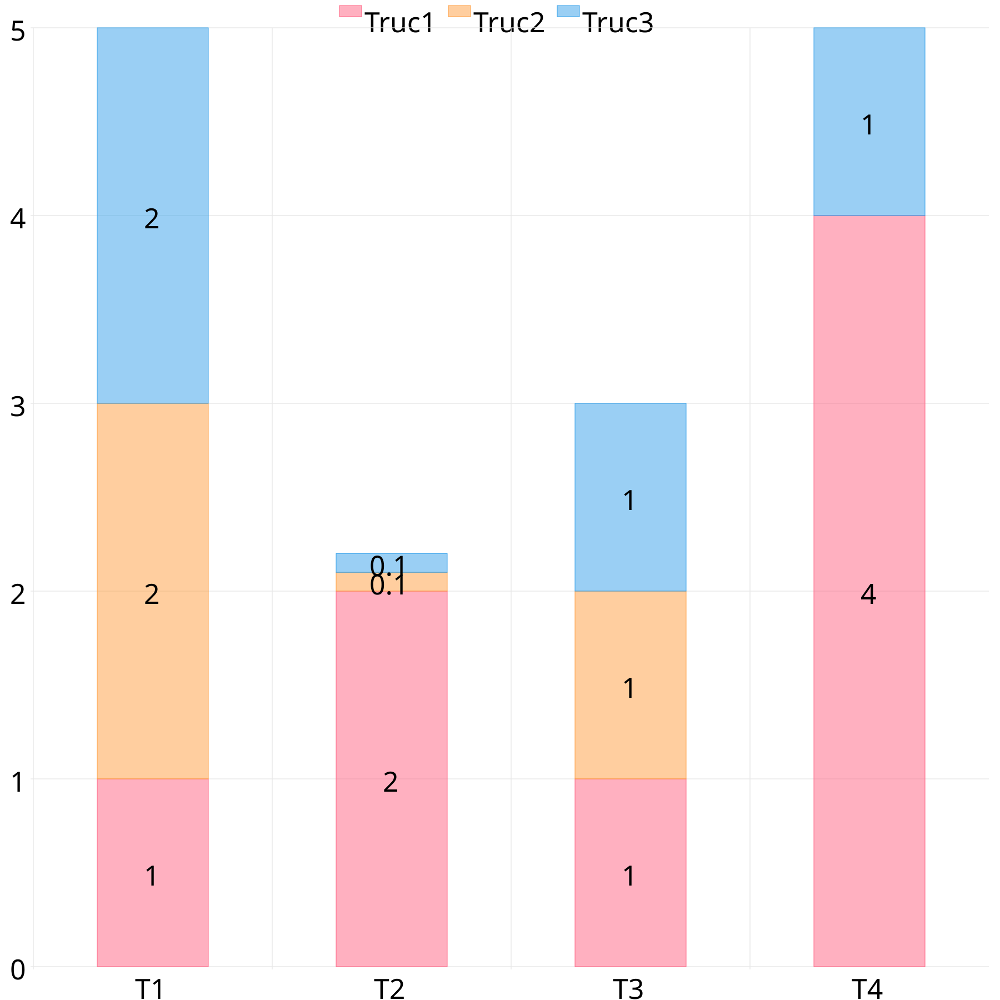

== Version 0.5.0

slide::[fn=slideshow-whatsnew050-de]

== Version 0.4.2

Demnächst verfügbar... diese Version sollte einige schöne Änderungen mitbringen (wobei manchmal alter Code inkompatibel wird)

- Verbesserung der DSL-Hierarchie
* versteckte Felder nur oben zur besseren Lesbarkeit
* keine redundante Parameterübergabe im Formular
* keine redundante Parameterübergabe im Filter
* `filterField` ausschließlich unter `section`
* Felder der obersten Ebene im Formular nur im Header
- Hook für Formularfelder zur sauberen Anzeige von M2M
- Hook zur Registrierung typischer Objektfilter
- Verbesserung der Zustandswiederherstellung
- Fehlerbehebung bei Tabellengruppierung / Bäumen mit Paginierung
- TBD

== Version 0.4.1

- Zusammenführung von Suchmenü, Icon-Menü und Sprachmenü, siehe <<new_menu_layout>>
- Beibehaltung bestimmter Parameter ... (Sprache, Niederlassung, Bestand, andere ...) über die Menü-DSL
** Verschiebung der unterstützten Sprachen in die Menüs (aus der Plugin-Deklaration), siehe <<new_menu_layout_code>>
- Ermöglicht das Debuggen von Kotlin-JS-Code, siehe <<new_allow_kotlinjs_debug>>
- Korrektur des Dateipfads beim Aktualisieren. Auf dieselbe Weise wie bei O2M, mit Vorschau
- Verbesserung der Zustandswiederherstellung
- Test der Mac-Laufzeitumgebung und des kalten automatischen Neustarts in der Entwicklung
- Automatische Beschriftung für Solr `indexField`, siehe <<new_solr_code>>

[[new_menu_layout]]
.Aktualisiertes Menülayout
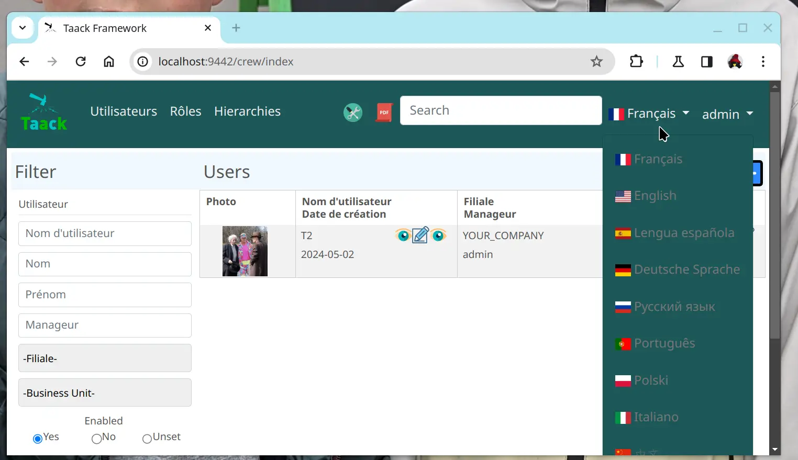

[[new_menu_layout_code]]
.Code für das Menülayout
[source,groovy]
----
private UiMenuSpecifier buildMenu(String q = null) {
    new UiMenuSpecifier().ui {
        menu CrewController.&index as MC
        menu CrewController.&listRoles as MC
        menu CrewController.&hierarchy as MC
        menuIcon ActionIcon.CONFIG_USER, this.&editUser as MC
        menuIcon ActionIcon.EXPORT_PDF, this.&downloadBinPdf as MC
        menuSearch this.&search as MethodClosure, q
        menuOptions(SupportedLanguage.fromContext())            <1>
    }
}
----

<1> Die Sprachauswahl befindet sich rechts neben der Suchleiste, und weitere Enums können hinzugefügt werden

[[new_allow_kotlinjs_debug]]
.Anleitung zum Debuggen von Kotlin JS
[source,bash]
----
$ cd infra/browser/client                             <1>
$ ./gradlew browserDevelopmentRun                     <2>
$ vi intranet/server/grails-app/conf/application.yml  <3>
# Uncomment line bellow
# client.js.path: 'http://localhost:8080/client.js'

# Then your browser should show Kotlin code !
----

<1> Wechseln Sie in den Client-Ordner, in dem der JS-Code generiert wird
<2> Starten Sie einen Server, der `client.js` und `client.js.map` bereitstellt ...
<3> Bearbeiten Sie Ihre Intranet-Datei `application.yml`

[[new_solr_code]]
.Neue Vereinfachung der Solr-DSL (keine Beschriftung mehr erforderlich)
[source,groovy]
----
@PostConstruct
private void init() {
    taackSearchService.registerSolrSpecifier(this,
            new SolrSpecifier(User,
                CrewController.&showUserFromSearch as MethodClosure,
                this.&labeling as MethodClosure, { User u ->
        u ?= new User()
        indexField SolrFieldType.TXT_NO_ACCENT, u.username_
        indexField SolrFieldType.TXT_GENERAL, u.username_
        indexField SolrFieldType.TXT_NO_ACCENT, u.firstName_
        indexField SolrFieldType.TXT_NO_ACCENT, u.lastName_
        indexField SolrFieldType.POINT_STRING, "mainSubsidiary", true, u.subsidiary?.toString()
        indexField SolrFieldType.POINT_STRING, "businessUnit", true, u.businessUnit?.toString()
        indexField SolrFieldType.DATE, 0.5f, true, u.dateCreated_
        indexField SolrFieldType.POINT_STRING, "userCreated", 0.5f, true, u.userCreated?.username
    }))
}
----

== Version 0.4.0

* Kein `paginate` mehr in Tabellen. Siehe <<new_iterate_code>>
* Kein `list`, sondern ein `iterate`, das eine Closure als Parameter entgegennimmt, mit einem Builder-Pattern-Ansatz zur Übergabe von Argumenten
* Menüs werden nun automatisch beschriftet (verwenden Sie `lang=test` in der URL, um Menüs zu übersetzen). Siehe <<new_menu_code>>
* Kein #isAjax#-Parameter mehr in Tabellen ... Siehe <<new_rowAction_code>>
* Änderung von `rowLink` in `rowAction` <<i18n_isAjax>>
* Keine Beschriftung bei #rowAction# in Tabellen erforderlich. Siehe <<new_rowAction_code>>
* Kein `ajaxBlock` mehr erforderlich für Tabellen, Formulare und `tableFilters`
* `formAction` hat keinen #isAjax#-Parameter mehr
* `formAction` hat keinen obligatorischen i18n-Parameter mehr
* `form` hat keinen obligatorischen i18n-Parameter mehr, i18n basiert auf dem aktuellen Aktionsnamen
* Block-Aktion hat keinen obligatorischen i18n-Parameter mehr, i18n basiert auf der Zielaktion
* Block-Aktion hat keinen obligatorischen `isAjax`-Parameter mehr

[[new_iterate_code]]
.Neue Verwendung von `iterate`
[source,groovy]
----
iterate(taackFilterService.getBuilder(Role)                     <1>
        .setMaxNumberOfLine(20)                                 <2>
        .setSortOrder(TaackFilter.Order.DESC, u.authority_)     <3>
        .build()) { Role r, Long counter ->
            row {
                rowColumn {
                    rowField r.authority
                    if (hasSelect)
                        rowAction
                            ActionIcon.SELECT * IconStyle.SCALE_DOWN,
                            CrewController.&selectRole as MC
                            r.id                                <4>
                }
            }
        }

----

<1> iterieren
<2> Die Angabe von `max` reicht aus, um die Paginierung bei weiteren Zeilen auszulösen
<3> Ersetzt das alte ineffiziente Muster zur Beschreibung der anfänglichen Sortierung und Reihenfolge
[[i18n_isAjax]]
<4> Kein i18n- und `isAjax`-Parameter mehr

[[new_menu_code]]
.Neuer `menu`-Code
[source,groovy]
----
private UiMenuSpecifier buildMenu(String q = null) {
    UiMenuSpecifier m = new UiMenuSpecifier()
    m.ui {
        menu CrewController.&index as MC        <1>
        menu CrewController.&listRoles as MC
        menu CrewController.&hierarchy as MC
        menuSearch this.&search as MethodClosure, q
    }
    m
}
----

<1> Kein i18n-Parameter

[[new_rowAction_code]]
.Neuer `rowAction`-Code
[source,groovy]
----
if (hasActions) {
    rowColumn {
        rowAction ActionIcon.EDIT * IconStyle.SCALE_DOWN, this.&roleForm as MC, r.id <1>
    }
}
----

<1> Kein i18n-Parameter, kein letzter `isAjax`-Parameter

== Version 0.3.9

Seit langem keine Updates mehr, der Winterschlaf geht zu Ende. Diese Version bietet:

- Grails 6.2.0
- Groovy 3.0.21
- Aktualisierung verschiedener Abhängigkeiten ... (siehe https://github.com/Taack/infra/compare/v0.3.8...v0.3.9[Changelog])
