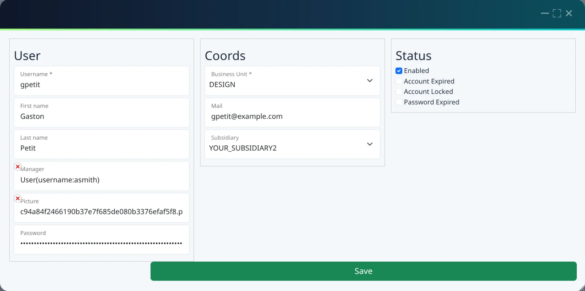
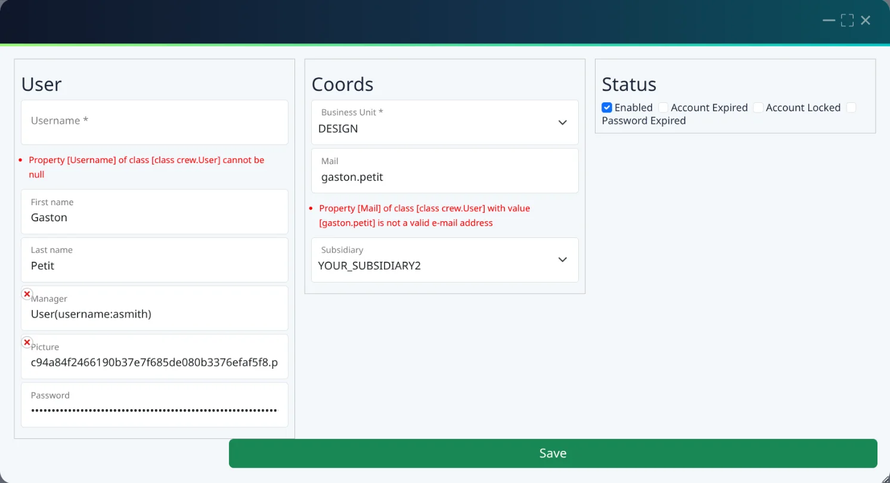
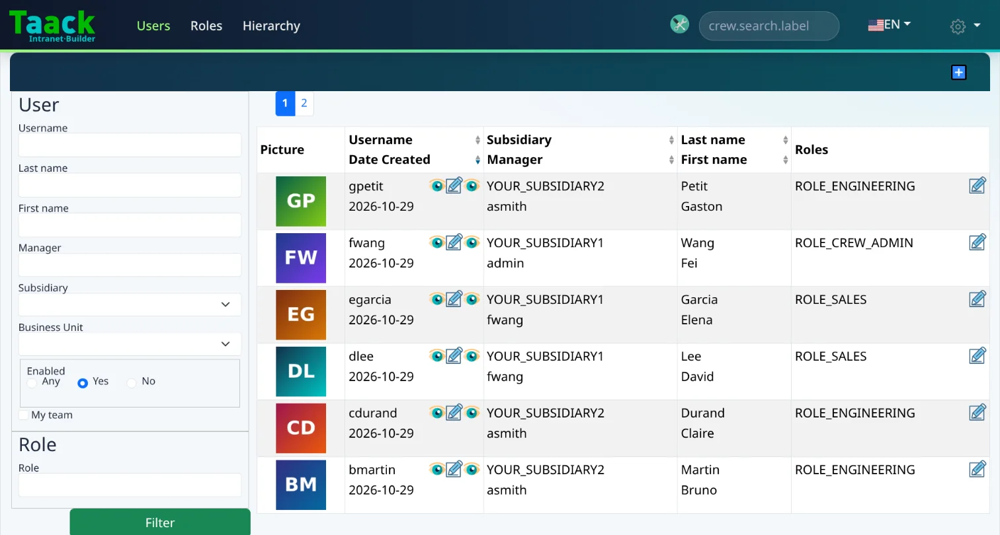
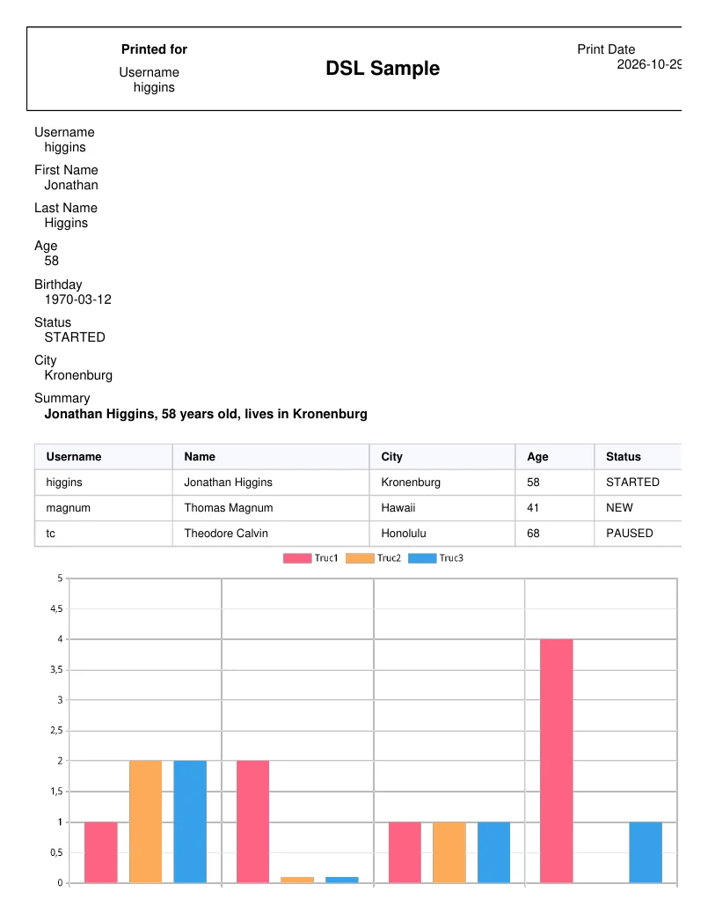

include::_settings_reveal.adoc[]
:source-highlighter: highlightjs
:highlightjs-languages: groovy, gnuplot
:title-slide-transition: zoom
:title-slide-transition-speed: fast
:icons: font
:docinfo: shared
:customcss: custom.css
:taack-height: 512

= Taack UI

[.hero,transition=zoom]
== Créez votre intranet en [.accent]#Groovy#

[.lead]
DSL typés pour Grails : sans HTML, sans JavaScript

[.chips]
[.chip]#HTML# [.chip]#PDF# [.chip]#CSV# [.chip]#Mail#

[.columns.split,transition=slide]
== Décrivez, sans templates

[.column]
--
[source,groovy]
----
new UiFormSpecifier().ui user, {
    section "User", {
        field user.username_
        field user.firstName_
        field user.lastName_
        ajaxField user.manager_,
            this.&selectUser
    }
    formAction this.&saveUser
}
----
--

[.column]
--

--

[.columns.split,transition=slide]
== Vérifié à la compilation

[.column.points]
--
* Symboles [.accent]#field_# générés à partir de vos classes
* Renommez un champ, le compilateur trouve chaque écran
* Erreurs de validation traduites automatiquement
--

[.column]
--

--

[.shot,transition=slide]
== Tableaux, filtres, pagination

[.charts,transition=slide]
== Des graphiques en quelques lignes

image:diag-dsl-bar.webp[] image:diag-dsl-line.webp[] image:diag-dsl-pie.webp[] image:diag-dsl-whiskers.webp[]

[.columns.split,transition=slide]
== Le même DSL, imprimé en PDF

[.column]
--
[source,groovy]
----
new UiPrintableSpecifier().ui {
    printableHeader '2.5cm', {
        show userHeader, Width.THIRD
    }
    printableBody {
        show userShow, Width.MAX
        table userTable, Width.MAX
        diagram barChart, Width.MAX
    }
}
----
--

[.column]
--

--

[.cards,transition=slide]
== Tout compris

[.card]
--
icon:search[] +
Recherche plein texte
--

[.card]
--
icon:eye[] +
Aperçus de fichiers
--

[.card]
--
icon:database[] +
JDBC sur votre modèle
--

[.card]
--
icon:terminal[] +
SSH & SFTP
--

[.hero,transition=zoom]
== Essayez en direct

[.lead]
Chaque page DSL de la documentation ouvre ses exemples dans une fenêtre modale

[.chips]
[.chip]#Docs › DSLs# [.chip]#▶ Essayer en direct#
